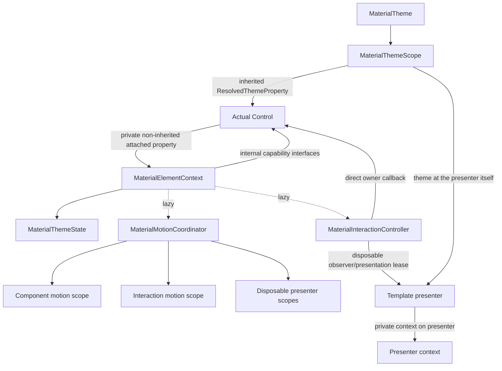

# Material Runtime Context Refactor Plan

Status: Implemented; final validation complete except environment-blocked visual parity

Scope: Intentional breaking refactor; source and binary compatibility are not required

Last verified against the repository: 2026-08-07

This document is the source of truth for the breaking refactor. The working tree may contain a
partial implementation while the phases are being executed; a phase is not complete until its
focused tests, source gates, and owner-level invariants pass.

## 1. Decision summary

Replace the current mixed `MaterialControl` / `MaterialThemeWatcher` / independently-owned
`MotionGroup` / `MaterialInteractionHost` architecture with one private runtime context per actual
`Control`.

The final architecture has these properties:

- Every Material component inherits the most appropriate Avalonia base class.
- A private, non-inherited attached property stores one `MaterialElementContext` on each owner.
- `MaterialThemeScope.ResolvedThemeProperty` remains the sole Material theme transport.
- `MaterialElementContext` owns the owner's resolved theme state and lifecycle orchestration.
- One lazy motion coordinator supplies one frame clock and multiple disposable scopes per owner.
- One lazy interaction controller translates physical input into Material interaction state.
- Components continue to own token resolution, component state, layout, and rendering policy.
- Template presenters resolve their own theme and borrow only their templated owner's interaction.
- The old runtime types and all compatibility shims are deleted at the end.

This is not a public XAML behavior and does not introduce a new public service locator. The attached
property is only an owner-local storage mechanism for internal runtime state.

## 2. Goals and non-goals

### Goals

- Delete `MaterialControl` without losing theme, motion, or interaction behavior.
- Eliminate duplicate theme subscriptions and duplicate frame schedulers on the same owner.
- Make ownership and lifetime explicit for controls, helpers, and template presenters.
- Preserve all component-local token invalidation paths such as Variant, Size, IsError, checked
  state, and effective-enabled changes.
- Replace private-field reflection in tests with intentional internal test seams.
- Make detach, reattach, template replacement, and stale animation-frame behavior deterministic.
- Leave no obsolete aliases, forwarding base classes, dual runtime paths, or legacy test bridges in
  the final tree.

### Non-goals

- Preserving source or binary compatibility for the deleted public runtime types.
- Exposing `MaterialElementContext` to application code.
- Applying Material runtime behavior globally to every Avalonia `Control` through a class handler.
- Moving component runtime policy into `Foundation`.
- Turning component properties or token selection into a generic behavior DSL.

### Review findings locked into this plan

The following points are implementation requirements, not optional cleanup. They address the
review of the proposed context/coordinator design:

1. **Theme deduplication is not a token invalidation mechanism.** The context deduplicates only
   `(ResolvedTheme reference, IsDark)`. `Variant`, `Size`, `IsError`, checked/selected state, and
   effective-enabled changes must still enter the component's own `OnPropertyChanged` path and
   call `ApplyTokens` using the already committed context snapshot. `MaterialLoadingIndicator`
   is the mandatory regression case because it previously called `OnThemeChanged` directly for
   `Variant`.
2. **The first publication needs a separate sentinel.** `ResolvedTheme.Default` is a valid result,
   so a `MaterialThemeState.Default` value alone cannot mean “not resolved yet”. Keep an explicit
   `hasPublished` bit (equivalent to the old nullable watcher state) and test the no-theme case.
3. **Detach semantics must be explicit.** The target contract keeps the current effective-value
   behavior: inherited fallback, including `ResolvedTheme.Default`, is published while leaving a
   scope. We do not retain the last attached theme. If a future product decision changes that
   policy, it must add a `_detaching` state set by `DetachedFromLogicalTree` and suppress fallback
   notifications by that state—not by `IsAttachedToLogicalTree` or `Parent`, whose values are
   already stale when Avalonia raises the notification.
4. **Input enablement is a dynamic channel.** `InteractionMode=None` and similar policies can
   change at runtime. Keep a dedicated `SetInputEnabled(bool)` operation that clears only
   physical Hovered/Focused/Pressed state when disabled; do not encode this as a static policy or
   as `SetExternalState`.
5. **Presentation geometry is a live lease.** Switch, Checkbox, RadioButton, Slider,
   RangeSlider, NavigationItem, and ripple presenters can move their interaction area every
   frame. A lease therefore has `UpdateGeometry(...)`; the controller stores the last geometry
   for subsequent pointer/ripple calculations and does not allocate a new lease per frame.
6. **Motion ordering includes post-callback re-checking.** A frame consumer may finish one
   animation and start/retarget another in the same `Ticked` callback (the Snackbar transition is
   the regression case). The coordinator must re-check running state after all callbacks and
   request another frame when necessary.
7. **Migration order is part of correctness.** The visual settler and manual clock must understand
   coordinators before the first production owner is migrated. Remove the obsolete ordering probes
   in the same early phase, rewrite the second-host ripple test for one-owner/one-controller,
   rename GroupCount assertions to coordinator/scope invariants, and move `ComposeOpacity` before
   deleting the old host. No source-search gate may be based on a comment substring.

## 3. Verified current baseline

Re-run these commands before implementation because the counts can drift:

```bash
rg -n --glob '*.cs' 'class\s+\w+\s*:\s*MaterialControl\b' src/Material3Expressive
rg -n --glob '*.cs' 'new\s+MaterialThemeWatcher\(' src/Material3Expressive
rg -n --glob '*.cs' 'new\s+MaterialInteractionHost\(' src/Material3Expressive
rg -n --glob '*.cs' 'MaterialInteraction\.GetOrCreate' src/Material3Expressive
rg -n --glob '*.cs' 'new\s+MotionGroup\(' src/Material3Expressive
```

At the verification date, production source contains:

- 17 controls inheriting `MaterialControl`.
- 33 `MaterialThemeWatcher` construction sites, including `MaterialControl` and
  `MaterialInteractionHost`.
- 14 `MaterialInteractionHost` construction sites: 13 direct component sites and one old attached
  cache factory.
- 4 presenter call sites using `MaterialInteraction.GetOrCreate`.
- 13 `MotionGroup` construction sites, including `MaterialControl` and
  `MaterialInteractionHost`.

No production factory, style, collection, or runtime type check depends on `MaterialControl` as a
type. Its production references are inheritance declarations and stale explanatory comments.

The 17 current subclasses to migrate to `TemplatedControl` are:

- `MaterialAppBar`
- `MaterialBadge`
- `MaterialCircularProgressIndicator`
- `MaterialDatePicker`
- `MaterialDivider`
- `MaterialFabMenu`
- `MaterialFloatingToolbar`
- `MaterialLinearProgressIndicator`
- `MaterialLoadingIndicator`
- `MaterialNavigationBar`
- `MaterialSearchBar`
- `MaterialShortNavigationBar`
- `MaterialSnackbar`
- `MaterialTabs`
- `MaterialTextField`
- `MaterialTimePicker`
- `MaterialWideNavigationRail`

### 3.1 Implementation snapshot (historical)

The following records the intermediate working-tree state used to sequence the migration. It is
retained for auditability; the final status and validation record below supersede its intermediate
“remaining work” wording:

- `Controls/Runtime` contains the context, coordinator/scope, interaction controller, geometry
  lease, and debug snapshot types.
- The five legacy runtime files have been removed from the working tree, and all 17 former
  `MaterialControl` subclasses have been changed to direct Avalonia bases.
- Core test/build work was exercised incrementally before the final solution, token, visual, and
  source-gate pass.
- The current slice has removed component `_theme.Changed` subscriptions, moved `ComposeOpacity`,
  completed policy/observer APIs, added live presentation geometry, and removed the `GroupCount`
  alias. The coordinator now uses one owner-frame transaction with post-consumer interaction
  observers, visual-detach epochs, and affected-scope lifecycle settling. The focused
  lifecycle/reentrancy/reparent coverage and final gate pass are now complete.

### 3.2 Implementation status for this working tree

Completed slices include the private context and theme sentinel/queue, direct owner capability
dispatch, the coordinator/test-clock/visual-settler migration, the interaction controller with
separate input/external/policy channels, live presentation leases, native-base and presenter
migration, all former `MaterialControl` subclasses, legacy runtime deletion, source-gate cleanup,
and the 0.2.0-alpha breaking note. The core build and 479 core tests pass. The only remaining
environment-qualified check is visual parity, whose external Compose/font prerequisites are absent.

This snapshot is descriptive only. The phase checkboxes and the definition of done below remain
the acceptance criteria.

## 4. Target architecture



### Ownership boundaries

| Owner | Responsibilities | Must not own |
|---|---|---|
| `MaterialThemeScope` | Publish and inherit immutable resolved theme snapshots | Component callbacks, motion, interaction |
| `MaterialElementContext` | Theme state, deduplication, lifecycle, controller construction, dispatch ordering | Token selection, input details, drawing |
| Concrete component | Token resolution, component state, layout, rendering, precise invalidation | Theme/tree subscriptions, independent frame scheduler |
| `MaterialMotionCoordinator` | One owner clock, animation advancement, scope management, lifecycle settle | Theme or component policy |
| `MaterialMotionScope` | Register and locally settle/remove one subsystem's animations | Independent time source |
| `MaterialInteractionController` | Physical input, interaction state, state layer, ripple, focus indication | Theme watcher, independent motion coordinator |
| Template presenter | Presentation geometry and drawing | Templated owner's theme state |
| `Foundation` | Pure tokens, state, animation, shape, and motion primitives | Control runtime lifecycle |

## 5. Locked design decisions

### 5.1 Private attached context

Use one private, non-inherited attached property:

```csharp
internal sealed class MaterialElementContext
{
    private static readonly AttachedProperty<MaterialElementContext?> ContextProperty =
        AvaloniaProperty.RegisterAttached<Control, MaterialElementContext?>(
            "__MaterialElementContext",
            typeof(MaterialElementContext),
            defaultValue: null,
            inherits: false);

    internal static MaterialElementContext GetOrCreate(Control owner);

    internal static bool TryGet(
        Control owner,
        [NotNullWhen(true)] out MaterialElementContext? context);
}
```

Rules:

- Do not expose the property or public get/set accessors.
- Do not clear it on logical or visual detach.
- Do not inherit it to children or template parts.
- Verify UI-thread access and do not add locking.
- `TryGet` must not create a context.
- Public Material controls acquire their context in their constructor.
- Trusted Material template presenters may acquire the templated owner's context during attach so
  stock Avalonia controls can use Material interaction behavior.
- A non-Control helper receives an existing context or scope; it must not create another runtime for
  the same owner.

Use an attached property rather than a `ConditionalWeakTable`: this is state belonging to a specific
Avalonia object, it remains discoverable for diagnostics/tests, and the owner-property-store-context
cycle remains collectible. Handle the attached property's one-time property notification through
two-phase publication.

### 5.2 Two-phase creation and reentrancy

The context state machine is:

```text
Missing
  -> Created       constructor completed; no subscriptions or callbacks
  -> Publishing    context stored in the private attached property
  -> Active        lifecycle subscriptions installed; initial theme may publish
```

Requirements:

- The context constructor is side-effect free.
- Store the context in the attached property before activation.
- A reentrant `GetOrCreate` during `SetValue` returns the same publishing instance.
- Publishing never calls component theme, motion, or interaction callbacks.
- Activation is idempotent and completes in `finally` after attached-property publication.
- If the owner is already logically attached at first creation, publish its current theme after
  publication completes.
- Normal control construction must not receive runtime callbacks.
- Fields must have valid Default-theme initialization before the first attach callback.

### 5.3 Theme state and first-publication sentinel

`MaterialElementContext` owns:

```csharp
internal readonly record struct MaterialThemeState(
    ResolvedTheme Theme,
    bool IsDark)
{
    internal static MaterialThemeState Default => new(ResolvedTheme.Default, false);
}
```

It must separately track whether it has ever published:

```csharp
private MaterialThemeState _theme = MaterialThemeState.Default;
private bool _hasPublishedTheme;
```

Deduplicate only after the first publication:

```text
hasPublishedTheme
AND ReferenceEquals(next.Theme, current.Theme)
AND next.IsDark == current.IsDark
    => suppress
```

This preserves the required first callback when no theme is declared and the effective snapshot is
already `ResolvedTheme.Default`.

Theme inputs are only:

- `MaterialThemeScope.ResolvedThemeProperty`
- `ThemeVariantScope.ActualThemeVariantProperty`

The context must commit the new state before invoking consumers. A relevant change raised during a
theme callback is queued and drained after the current dispatch instead of recursively dispatching.

### 5.4 Theme changes and component-local token invalidation are separate channels

Resolved component tokens depend on both context state and component-local properties:

```text
Resolved component tokens =
    Resolve(context theme, variant, size, error, enabled, checked, component state, ...)
```

Use an internal theme consumer only for context-originated changes:

```csharp
internal interface IMaterialThemeConsumer
{
    void OnMaterialThemeChanged(MaterialThemeState state);
}
```

Every component must retain its own `OnPropertyChanged` paths for local inputs. Both sources call the
same component-owned token application method:

```csharp
private void ApplyCurrentTokens() => ApplyTokens(_material.Theme);

void IMaterialThemeConsumer.OnMaterialThemeChanged(MaterialThemeState state) =>
    ApplyTokens(state);

protected override void OnPropertyChanged(AvaloniaPropertyChangedEventArgs change)
{
    base.OnPropertyChanged(change);

    if (change.Property == VariantProperty
        || change.Property == SizeProperty
        || change.Property == IsErrorProperty
        || change.Property == IsEffectivelyEnabledProperty)
    {
        ApplyCurrentTokens();
    }
}
```

Do not force a duplicate theme dispatch to represent a local component property change. The context
must not know which component properties affect tokens.

`ApplyTokens` remains responsible for the component's precise measure/arrange/render invalidation so
theme-originated and local-property-originated recomputation behave identically.

### 5.5 Detach and reparent theme semantics

The locked target behavior is to publish the current effective value, including the fallback
`ResolvedTheme.Default`, while leaving a scope. This matches the existing watcher contract and
keeps reparenting deterministic; the context instance and its subscriptions are retained.

Avalonia clears the inheritance parent before its logical-detach event. Inherited theme and variant
fallback notifications can therefore arrive while `Parent` and `IsAttachedToLogicalTree` still look
attached. A flag set in `DetachedFromLogicalTree` is too late to suppress those notifications when
the contract is to publish fallback, so the context must not use those properties as a dispatch
guard.

The context must follow the current effective Avalonia values:

- Publish the inherited fallback, including `ResolvedTheme.Default`, during detach.
- On reattach/reparent, resolve and publish the new scope.
- Retain the same context instance and subscriptions across both operations.

If a later version deliberately chooses “retain the last attached theme while detached”, that is a
different contract and must add an explicit `_detaching` marker set by the detach handler, plus a
guarded fallback notification. It must not be implemented by checking `IsAttachedToLogicalTree` or
`Parent`, whose values are already stale when Avalonia raises the notification.

### 5.6 Capability interfaces and dispatch

Use direct internal owner interfaces rather than per-control anonymous runtime subscriptions:

```csharp
internal interface IMaterialThemeConsumer
{
    void OnMaterialThemeChanged(MaterialThemeState state);
}

internal interface IMaterialMotionConsumer
{
    void OnMaterialMotionFrame();
}

internal interface IMaterialInteractionConsumer
{
    void OnMaterialInteractionChanged(InteractionState state);
}
```

Only implement the capabilities a component consumes. Theme-consuming components must implement
`IMaterialThemeConsumer`; they must not subscribe to `MaterialElementContext.Changed` and must not
reintroduce anonymous `_theme.Changed` handlers. The context dispatches the owner first, then its
context-owned interaction controller, then disposable secondary observer leases. Secondary
consumers whose lifetime is shorter than the owner use disposable observer leases instead of owner
interfaces.

### 5.7 One motion coordinator and multiple scopes per owner

Replace `MotionGroup` with internal types:

```csharp
internal sealed class MaterialMotionCoordinator
{
    internal MaterialMotionScope CreateScope(string diagnosticName);
    internal void StartIfNeeded();
    internal void SettleAllForLifecycle();
}

internal sealed class MaterialMotionScope : IDisposable
{
    internal T Add<T>(T animation) where T : IAnimation;
    internal SpringAnimation AddSpring(double value, SpringSpec spec);
    internal TweenAnimation AddTween(/* ... */);
    internal void Start();
    internal void Settle();
}
```

Rules:

- Exactly one coordinator may be constructed per context.
- The component, interaction controller, and short-lived presenters use separate scopes.
- All scopes share the same time axis; a scope must not expose `UseManualClock` or `AdvanceBy`.
- Scope `Settle`/`Dispose` affects only that scope.
- Only context lifecycle and test infrastructure may settle or advance the whole coordinator.
- `MotionTestClockScope` registers coordinators and drives every scope atomically.
- Public Foundation animation primitives may remain public; the control-bound scheduler is internal.

The production frame sequence is:

```text
advance animations in all scopes
  -> interaction removes completed transient animations
  -> owner IMaterialMotionConsumer synchronizes outputs
  -> secondary frame observers run
  -> invalidate owner visual
  -> re-check running state after every callback
  -> request another frame if required
```

Preserve the existing post-callback running-state check. A callback such as a snackbar transition
may retarget or start a new animation after the initial animation loop has completed.

The coordinator must use a generation/epoch for scheduled TopLevel callbacks:

- Increment/cancel the generation on visual detach and manual-clock takeover.
- Ignore callbacks captured under an older generation.
- On visual detach, cancel the generation and settle; do not suspend running animation across an
  unrendered gap.
- On visual attach, retry `StartIfNeeded` for work created before a TopLevel existed.
- Lifecycle settling is one coordinator transaction: settle all scopes, publish each affected
  scope's tick notification at most once, then run the owner synchronization/invalidation once.
  Do not call a scope-level settle callback and a coordinator-level callback for the same frame.

### 5.8 Interaction controller channels

Replace `MaterialInteractionHost` with one internal controller created only by the context:

```csharp
internal sealed class MaterialInteractionController
{
    internal InteractionState State { get; }
    internal double StateLayerOpacity { get; }

    internal void SetInputEnabled(bool enabled);
    internal void SetExternalState(InteractionState state, bool active);
    internal void UpdateIndicationPolicy(MaterialInteractionPolicy policy);

    internal IDisposable Subscribe(IMaterialInteractionObserver observer);
    internal MaterialInteractionPresentationLease AttachPresentation(Control presenter);
}
```

These are distinct channels:

- `SetInputEnabled` is a dynamic physical-input gate. Transitioning to false clears Hovered,
  Focused, Pressed, and press ripples.
- `SetExternalState` represents component-owned states such as Dragged and must not be conflated
  with the input gate.
- `UpdateIndicationPolicy` changes ripple/focus/hover/drag indication behavior without changing the
  underlying interaction state.
- Logical detach clears input-derived state and ripples, then settles lifecycle motion.
- Logical detach does not unconditionally clear externally-owned state.

The controller:

- Reads theme state from its context and receives explicit context theme notifications.
- Uses a dedicated scope from the owner's single motion coordinator.
- Installs owner input handlers exactly once on first creation.
- Uses named handlers rather than unremovable anonymous subscriptions where practical.
- Does not create a watcher, scheduler, or second attached cache.

`MaterialInteractionPolicy` is an immutable value containing the four indication switches (ripple,
focus, hover, and drag). It is not a substitute for `SetInputEnabled`: a policy update changes how
a state is drawn, while the input gate controls whether physical events are accepted.

### 5.9 Presentation leases are live, per-frame geometry providers

Presentation identity is stable for an attach lifetime, but its geometry is mutable:

```csharp
internal sealed class MaterialInteractionPresentationLease : IDisposable
{
    internal MaterialInteractionGeometry Geometry { get; }
    internal void UpdateGeometry(in MaterialInteractionGeometry geometry);
    internal void DrawLayers(DrawingContext context, IBrush? brush, CornerRadius cornerRadius);
}
```

Requirements:

- Controls such as Switch, Checkbox, Slider, RangeSlider, RadioButton, and NavigationItem may call
  `UpdateGeometry` from every Render.
- `MaterialRipplePresenter` may call it from every Render after `TranslatePoint`.
- Updating a struct value must not create a subscription or lease allocation per frame.
- The controller retains the last geometry for pointer and keyboard ripple origin calculations.
- Before the first update, the default interaction area is the owner bounds.
- Disposing a lease removes its geometry and observer relationship immediately.
- A controller has one primary physical presentation geometry at a time. Independent interaction
  targets require independent Control owners/contexts.
- Presenters that only react to state/motion use observer leases and do not compete for geometry.

The controller's natural internal surface remains available to production presenters and tests:
`Interaction`, `StateLayerOpacity`, `Set`, `DrawLayers`, and the interaction `Motion` scope are
behavioral capabilities, not compatibility shims. `_ripples` remains an implementation collection
because ripple lifetime needs it; tests must observe it through behavior or an intentional debug
snapshot rather than by depending on its private field name.

### 5.10 Theme scope is per actual element

- A presenter that consumes tokens acquires its own `MaterialElementContext` and reads its own
  inherited theme.
- It may borrow the templated owner's interaction controller through a disposable lease.
- Never replace the presenter's theme with the templated owner's theme merely because interaction
  is shared.
- A non-Control helper receives the relevant owner context explicitly.

### 5.11 Old virtual ordering is intentionally retired

The old guarantee that `MaterialControl.OnThemeChanged` runs before a derived
`OnAttachedToLogicalTree` or `OnPropertyChanged` is not retained.

The replacement contract is behavioral:

- Theme application completes synchronously by the end of the effective property notification.
- Theme application completes by the end of logical attachment.
- The resolved theme is applied before the first meaningful measure/render.
- Theme-dependent logic belongs in `IMaterialThemeConsumer`, not in an override watching
  `ResolvedThemeProperty`.
- Component-local property overrides may read the already committed context theme and reapply
  tokens as described in section 5.4.

Do not add a global `AddClassHandler<Control>` to simulate the old ordering. Avalonia class handlers
still run after the virtual property callback, and global dispatch would involve unrelated controls.

## 6. Proposed source layout

```text
src/Material3Expressive/Controls/Runtime/
  MaterialElementContext.cs
  MaterialElementContracts.cs
  MaterialThemeState.cs
  Motion/
    MaterialMotionCoordinator.cs
    MaterialMotionScope.cs
  Interaction/
    MaterialInteractionController.cs
    MaterialInteractionPolicy.cs
    MaterialInteractionGeometry.cs
    MaterialInteractionPresentationLease.cs
    MaterialInteractionObserverLease.cs
    MaterialInteractionDebugSnapshot.cs
```

Keep pure types where they currently belong:

- Theme transport and immutable resolved theme types remain under `Foundation/Theming`.
- Animation, spring, easing, and shape primitives remain under `Foundation`.
- `InteractionState` and pure state-layer token calculations remain under `Foundation/State`.
- Move `MaterialInteractionHost.ComposeOpacity` to a focused pure rendering utility rather than
  retaining a static dependency on the deleted host.
- Move animated-shape creation/registration to a motion scope or focused motion helper.

## 7. Context lifecycle matrix

| Trigger | Context action | Required guarantee |
|---|---|---|
| First `GetOrCreate`, owner detached | Publish AP, activate subscriptions, no component callback | Constructor-safe defaults |
| First `GetOrCreate`, owner already attached | Publish AP, activate, publish current theme once | No missed template-created owner context |
| Resolved theme or actual variant changes | Commit, deduplicate, dispatch owner then interaction | Callback reads new state |
| Component Variant/Size/Error/Enabled changes | Component calls `ApplyTokens(context.Theme)` | No fake theme event |
| Logical attach | Resolve current effective theme | Theme ready before layout/render |
| Inheritance parent removal | Publish effective fallback including Default | No unreliable attach-state heuristic |
| Logical detach | Clear input-derived interaction, settle coordinator | No stale press/hover/focus |
| Visual attach | Retry coordinator start | Pre-TopLevel work starts |
| Visual detach | Cancel epoch, settle coordinator | No animation persists across visual gap |
| Reparent/reattach | Reuse context and resolve new scope | No duplicate subscriptions |
| Template presenter detach | Dispose observer, presentation, and presenter motion leases | No old template retention |

## 8. Tests and intentional test seams

### 8.1 Context tests

- One context per owner under repeated and reentrant `GetOrCreate`.
- Context property is private, non-inherited, and never copied to a child.
- No theme/motion/interaction callback during ordinary control construction.
- First attach publishes exactly once even when the result is `ResolvedTheme.Default`, false.
- Context created on an already attached owner publishes immediately after AP publication.
- Theme reference plus dark-state deduplication.
- Theme changes raised during a theme callback are queued rather than recursively dispatched.
- Detach publishes the effective Default fallback.
- Reparent resolves the new scope while retaining the same context instance.
- Detach/reattach does not add duplicate subscriptions.
- Motion and interaction remain unallocated until requested.
- UI-thread access is enforced.

### 8.2 Component token-input tests

Retain or add representative tests proving that token recomputation happens for:

- Variant changes, including `MaterialLoadingIndicator`.
- Size and Label changes, including FAB-like controls.
- IsError and effective-enabled changes, including text/dropdown inputs.
- Checked/selected changes where token colors or shapes depend on state.
- Theme changes after one of the local properties has already changed.

The migration audit must inspect every existing `ApplyTokens()` call and every direct invocation of
`OnThemeChanged(...)`; do not infer coverage from watcher removal alone.

### 8.3 Motion tests

- One coordinator per owner.
- Component, interaction, and presenter scopes share one clock.
- Scope-local settle/dispose does not affect sibling scopes.
- `MotionTestClockScope` advances coordinators, not individual scopes.
- Exact manual-clock delta and negative-time rejection.
- Animation created or retargeted in a frame consumer schedules the next frame.
- Mutation during tick is safe.
- Visual detach settles and invalidates the old callback generation.
- A stale callback cannot advance a reattached owner.
- Lifecycle settle produces the expected final synchronization callback.

Rename test terminology from GroupCount to CoordinatorCount. If scope cardinality is relevant, expose
an internal diagnostic count separately; do not give scopes independent clocks.

### 8.4 Interaction tests

- One controller per owner, including stock Avalonia controls created through a template presenter.
- `SetInputEnabled(false)` clears only input-derived state and ripples.
- Disabling input after `Pressed` has ended still clears the released ripple fade and invalidates the
  owner, so no transient frame survives a mode switch or detach.
- External Dragged state is not accidentally treated as physical input state.
- Logical detach clears stale Pressed/Hovered/Focused state.
- Theme changes recalculate focus/state-layer presentation without a second watcher.
- Owner consumer dispatch precedes secondary observers.
- Presentation geometry can change every frame and is used for the next press.
- Disposed presentation/observer leases receive no further callbacks.
- Template replacement does not retain old geometry, observers, or motion tracks.
- Keyboard activation uses the one context-owned controller; tests must not construct a second host.

### 8.5 Replace reflection with deliberate internal diagnostics

Final tests must not depend on private runtime field names such as `_interaction`, `_motion`, or
`_ripples`. The controller may keep those members when they are required by its behavior; what is
removed is test coupling to their names.

Use friend-assembly access to:

- `MaterialElementContext.TryGet`
- `MotionCoordinatorIfCreated`
- `InteractionIfCreated`
- an immutable `MaterialInteractionDebugSnapshot` when a ripple count/center cannot be asserted
  cleanly through output behavior

Keep the controller's natural internal `Motion`, `Interaction`, `StateLayerOpacity`, `Set`, and
`DrawLayers` capabilities. Do not add aliases or fields solely to preserve an old reflection test.

### 8.6 Visual test infrastructure migration (completed)

`VisualMotionSettler` now discovers only `MaterialElementContext` instances and their created
coordinators; `MotionTestClockScope` likewise controls coordinators and never reaches private
runtime fields. The temporary mixed-runtime bridge was removed with the last legacy owner.

This bridge migration was an explicit hard gate inside Phase 2. The obsolete virtual-ordering tests
were deleted, the second-host ripple test now retrieves the context-owned controller, and motion
tests use one coordinator plus explicit scopes. Manual-clock tests hold a coordinator (or a scope's
coordinator), never a private group handle.

Update reflection-based unit tests in the same commit as their owning component. Replace the old
theme-ordering probes only when `MaterialControl` stops providing that contract.

## 9. Migration rules

The migration unit is an actual owner, not a subsystem or source file.

For each owner, one change must replace all of its old runtime ownership:

```text
MaterialThemeWatcher
+ direct MotionGroup
+ MaterialInteractionHost / MaterialInteraction cache
    -> one cached MaterialElementContext
```

Rules:

- Never leave one owner with both a legacy host/group and a new context controller/coordinator.
- Temporary coexistence is allowed only across different owners during implementation.
- Do not create a compatibility wrapper in which the new runtime delegates to the old runtime or
  vice versa.
- Update deterministic and visual tests for the owner in the same slice.
- Re-run the source inventory after every cohort.
- Keep unrelated user/worktree changes untouched.

## 10. Phased implementation plan

### Phase 0 — Freeze baseline and inventory

- [x] Re-run the five inventory searches in section 3 and save the owner list in the implementation
      notes/commit description.
- [x] Confirm all `MaterialControl` references are inheritance, tests, or documentation.
- [x] Run the current solution build and core tests.
- [x] Run the current non-parity visual tests.
- [x] Record visual-parity environment prerequisites separately from visual mismatch results.
- [x] Record the current public API types to be deleted.

Exit condition: the starting behavior and complete migration surface are known.

### Phase 1 — Add context and theme runtime contracts

- [x] Add `Controls/Runtime` and the internal capability interfaces.
- [x] Add the private non-inherited context attached property.
- [x] Implement two-phase publication and idempotent activation.
- [x] Implement theme resolution, first-publication sentinel, deduplication, and queued reentrancy.
- [x] Preserve effective Default fallback during detach.
- [x] Add context-only probe controls and all section 8.1 tests.
- [x] Add representative dual-input token tests proving theme and local properties call the same
      component resolver.

Do not migrate a production owner yet, and do not modify `MaterialControl` to wrap the context.

Exit condition: the new theme runtime is independently correct while legacy production behavior is
unchanged.

### Phase 2 — Add motion coordinator and migrate the test clock/settler first

- [x] Implement one coordinator with disposable scopes.
- [x] Implement post-consumer running-state recheck.
- [x] Implement epoch cancellation, visual-detach settle, and visual-attach retry.
- [x] Register coordinators with `MotionTestClockScope`.
- [x] Update `VisualMotionSettler` to discover both context coordinators and legacy groups during the
      migration window **before migrating any production motion owner**.
- [x] Delete the two old virtual-ordering tests as soon as the new dispatch path is enabled.
- [x] Rewrite MotionGroup-centric unit tests around coordinator and scope invariants; rename
      `GroupCount` to `CoordinatorCount` and provide scope-level handles where required.
- [x] Rewrite the deliberate second-host ripple test to assert one controller per owner.
- [x] Add the snackbar-style callback-starts-new-animation regression test.

Exit condition: the first production coordinator can be introduced without a silent visual-test
clock gap, stale ordering probes, or tests that accidentally create two runtimes for one owner.

### Phase 3 — Add interaction controller and live presentation leases

- [x] Implement context-only controller creation.
- [x] Implement `SetInputEnabled`, `SetExternalState`, and indication policy updates.
- [x] Implement input-derived detach cleanup.
- [x] Implement owner direct dispatch and disposable secondary observers.
- [x] Implement presentation leases with per-frame `UpdateGeometry`.
- [x] Implement default owner-bounds geometry and last-geometry retention.
- [x] Implement the interaction motion scope on the owner's coordinator.
- [x] Move `ComposeOpacity` to a focused rendering utility before removing the old host reference.
- [x] Add intentional internal debug snapshots for tests that require ripple internals.

Exit condition: the new controller is behavior-complete without using the old host, watcher, or
group.

### Phase 4 — Migrate native-base theme-only owners

For each owner that inherits a stock Avalonia base and has no motion/interaction ownership:

- [x] Replace the watcher field with one cached context.
- [x] Implement `IMaterialThemeConsumer` explicitly.
- [x] Preserve every local-property `ApplyTokens` trigger.
- [x] Keep presenter theme resolution on the presenter itself.
- [x] Update its tests in the same change.
- [x] Verify no legacy runtime remains on that owner.

Exit condition: the selected owners have exactly one context and no watcher.

### Phase 5 — Migrate native-base motion and interaction owners atomically

For every stock-base owner with any combination of watcher, group, and host:

- [x] Replace all of those fields in one owner-level change.
- [x] Register component animations in the component scope.
- [x] Route interaction animations through the controller's sibling scope.
- [x] Convert frame handlers to `IMaterialMotionConsumer` where owner-lifetime dispatch is needed.
- [x] Convert short-lived observers to disposable leases.
- [x] Replace private-field reflection tests at the same time.
- [x] Preserve all local Variant/Size/Error/Enabled/Checked token paths.

Special audits in this phase:

- [x] `MaterialListItem`: dynamic input gate and externally-owned Dragged state.
- [x] `MaterialSwitch`: per-frame moving interaction area and stale Pressed cleanup.
- [x] Checkbox/RadioButton/Slider/RangeSlider/NavigationItem: render-time geometry updates.
- [x] Snackbar transitions: animation started from a frame consumer.
- [x] Composite/scaffold controls: helpers receive the owner's context/scope rather than creating
      their own runtime for the same owner.

Exit condition: migrated native-base owners have one context, one coordinator at most, and one
controller at most.

### Phase 6 — Migrate stock-control template presenters

- [x] Migrate `MaterialRipplePresenter`.
- [x] Migrate Button, ToggleButton, and IconButton container presenters.
- [x] Give every theme-consuming presenter its own context.
- [x] Borrow only the templated owner's interaction through observer/presentation leases.
- [x] Update geometry on Render/bounds changes and dispose leases on detach/template replacement.
- [x] Prove a stock Button and all of its Material presenters resolve one owner controller.
- [x] Rewrite the test that currently constructs a second host on an already templated Button so it
      retrieves that one context-owned controller; do not merely rename the old host field.
- [x] Update visual cases that settle motion through presenter-owned or owner-owned animations.

Exit condition: no presenter calls `MaterialInteraction.GetOrCreate` and template replacement leaves
no old observer or geometry.

### Phase 7 — Migrate all 17 `MaterialControl` subclasses

For each listed control in section 3:

- [x] Change the base class to `TemplatedControl`.
- [x] Acquire one context.
- [x] Replace `OnThemeChanged` with explicit `IMaterialThemeConsumer` implementation.
- [x] Replace protected `ResolvedTheme`, `IsDarkVariant`, and `Spring` reads with context state.
- [x] Replace protected `Motion` and `OnMotionTick` with the component scope and
      `IMaterialMotionConsumer` as appropriate.
- [x] Preserve local token triggers, especially `MaterialLoadingIndicator.Variant`.
- [x] Remove lifecycle overrides whose only purpose was old base behavior.
- [x] Fully migrate any interaction owned by the same control in the same change.
- [x] Update focused tests and visual cases.

In the same phase:

- [x] Replace `ThemeProbe` with a `TemplatedControl + IMaterialThemeConsumer` probe.
- [x] Delete the two old virtual-ordering assertions.
- [x] Add/retain tests for theme-before-first-measure/render, live changes, and reparenting.

Exit condition: no production class inherits `MaterialControl`.

### Phase 8 — Close inventory and delete the legacy runtime

- [x] Re-run all construction/inheritance searches.
- [x] Migrate any nested or late-created helper missed by the owner cohorts.
- [x] Move `ComposeOpacity` and other pure helpers out of `MaterialInteractionHost`.
- [x] Move animated-shape registration to the motion scope/helper.
- [x] Delete `MaterialControl.cs`.
- [x] Delete `MaterialThemeWatcher.cs`.
- [x] Delete `MaterialInteractionHost.cs`.
- [x] Delete `MaterialInteraction.cs`.
- [x] Delete `MotionGroup.cs` after all production/test consumers use the coordinator.
- [x] Remove the transitional legacy branch from `VisualMotionSettler` and
      `MotionTestClockScope`.
- [x] Remove stale usings, XML docs, comments, and active architecture documentation.
- [x] Confirm no obsolete alias or forwarding type remains.

Exit condition: only the new runtime architecture exists.

### Phase 9 — Public API, versioning, documentation, and full validation

- [x] Document deletion of the four public types: `MaterialControl`, `MaterialThemeWatcher`,
      `MaterialInteractionHost`, and `MotionGroup`.
- [x] Document the new direct Avalonia base type for every affected public control.
- [x] Add a breaking-change/migration note; do not offer a compatibility shim.
- [x] Prefer version `0.2.0-alpha` for the incompatible runtime line.
- [x] Account for the CI rule requiring root-owned packages to share one base version, or explicitly
      revise that versioning policy before changing only the main package version.
- [x] Update active motion and visual-parity documentation from MotionGroup terminology to
      coordinator/scope terminology.
- [x] Run all validation in section 12 (visual parity remains infrastructure-blocked; see note below).

Exit condition: implementation, public API, package version, tests, and documentation all describe
the same final architecture.

## 11. Final source and architecture gates

Production gates:

```bash
rg -n 'class\s+\w+\s*:\s*MaterialControl\b' src/Material3Expressive
rg -n 'new\s+MaterialThemeWatcher\(' src/Material3Expressive
rg -n 'new\s+MaterialInteractionHost\(' src/Material3Expressive
rg -n 'MaterialInteraction\.GetOrCreate' src/Material3Expressive
rg -n 'new\s+MotionGroup\(' src/Material3Expressive
```

All must return zero.

Constructor ownership gates:

```bash
rg -n 'new\s+MaterialMotionCoordinator\(' src/Material3Expressive
rg -n 'new\s+MaterialInteractionController\(' src/Material3Expressive
```

Each constructor must appear only in `MaterialElementContext`.

Stale-name cleanup:

```bash
rg -n '\bMaterialControl\b|\bMaterialThemeWatcher\b|\bMaterialInteractionHost\b|\bMotionGroup\b' \
  src/Material3Expressive tests/Material3Expressive.Tests tests/Material3Expressive.VisualTesting
```

Any remaining match must be removed or be an explicitly retained historical archive reference
outside active source/tests.

Reflection-debt gate:

```bash
rg -n 'GetField\("_(interaction|motion|ripples)"|PrivateField\([^,]+,\s*"_(interaction|motion|ripples)"' tests
```

This must return zero.

Additional active-reference gates:

```bash
rg -n --glob '*.cs' 'MaterialInteractionController\.ComposeOpacity|MaterialInteractionHost\.ComposeOpacity' \
  src/Material3Expressive
rg -n --glob '*.cs' 'GroupCount|new\s+MaterialInteractionHost\(' \
  tests/Material3Expressive.Tests tests/Material3Expressive.VisualTesting
rg -n --glob '*.cs' 'MaterialElementContext\.Changed|_theme\.Changed|_material\.Changed' \
  src/Material3Expressive
```

The first and third commands must return zero. The second may only match an explicitly documented
migration fixture while the mixed-runtime window is open; it must return zero at the final gate.
These gates use C# files and declarations rather than broad substrings in comments or prose.

## 12. Definition of done and validation

The refactor is complete only when all of the following hold:

- [x] Every production Material owner uses at most one context.
- [x] No owner uses both legacy and new runtime objects.
- [x] Theme transport still uses only inherited `ResolvedThemeProperty` plus actual theme variant.
- [x] First Default-theme resolution publishes exactly once.
- [x] Theme and every component-local token input produce correct current tokens.
- [x] Context is never inherited or recreated on ordinary detach/reattach.
- [x] One coordinator drives all motion scopes for an owner.
- [x] Frame consumers can start new animations without starving the next frame.
- [x] Visual detach cancels stale callbacks and settles motion.
- [x] One controller owns physical interaction for an owner.
- [x] Input disable/detach clears physical state without corrupting external state.
- [x] Presentation geometry follows animated controls frame by frame.
- [x] Template replacement leaves no stale observers, geometry, or motion tracks.
- [x] No final production or test code depends on private runtime field names.
- [x] All five legacy files/types are deleted with no shim.
- [x] Active documentation and package version describe the breaking architecture.

Run at minimum:

```bash
dotnet build Material3Expressive.slnx --no-restore -v:minimal
dotnet test tests/Material3Expressive.TokenGenerator.Tests/Material3Expressive.TokenGenerator.Tests.csproj --no-restore
dotnet test tests/Material3Expressive.Tests/Material3Expressive.Tests.csproj --no-restore
dotnet test tests/Material3Expressive.VisualTests/Material3Expressive.VisualTests.csproj --no-restore
```

Also run the repository's Compose-versus-Avalonia visual-parity workflow when its runner and pinned
font prerequisites are available. Infrastructure failure before a comparison report is not a visual
verdict.

Validation record for 2026-08-07:

- Solution build: passed with 0 errors; only the pre-existing `AVA3001` warning remains.
- TokenGenerator tests: 14/14 passed.
- Core tests: 479/479 passed.
- Visual-test assembly: 52 non-parity cases passed; 153 parity cases were blocked before
  comparison because the pinned Roboto font and Linux `cmd.exe`/Compose runner are unavailable.
- Final production source gates: zero matches for `MaterialControl` inheritance,
  `MaterialThemeWatcher` construction, `MaterialInteractionHost` construction,
  `MaterialInteraction.GetOrCreate`, and `MotionGroup` construction. The two new runtime
  constructors occur only in `MaterialElementContext`; stale-name, subscription, `GroupCount`, and
  private-field reflection gates are empty.
- `git diff --check`: passed.
- Package versions: the main package, MaterialSkiaShadow, and MaterialTypography.Roboto all declare
  `0.2.0-alpha`; all three package projects generated their nupkg/snupkg artifacts successfully.
  The main package was re-run outside the sandbox after the observed in-sandbox `dotnet` crash and
  completed successfully.

No phase is complete merely because it compiles. Its focused behavior tests, relevant visual cases,
inventory update, and owner-level no-dual-runtime check must pass before moving to the next cohort.
