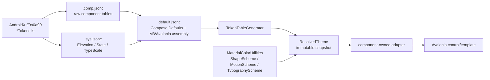

# Current theming architecture

The current implementation uses mutable authoring objects and immutable resolved snapshots.
`MaterialTheme` and its component override bags are authoring surfaces; a resolved snapshot is
published through inherited `MaterialThemeScope.ResolvedTheme` and consumed by controls and
markup extensions.

## Resolution order

For a control and token, resolution proceeds from strongest to weakest:

1. control-local override;
2. nearest subtree theme;
3. application or `TopLevel` theme;
4. built-in resolved defaults.

Consumers resolve against the control that receives the value. Markup extensions use rooted
`.Self()` bindings so a `ControlTheme` does not accidentally capture the application or one
unrelated control during XAML parsing.

## Token pipeline

Token source files are split by ownership under `src/Material3Expressive/Tokens/`: reference tables
use `.ref.jsonc`, shared system tables use `.sys.jsonc`, raw component transcriptions use
`.comp.jsonc`, and component assembly/override tables use `.default.jsonc` under `Tokens/Defaults/`.
The token generator emits token sets, component variants, internal resolved accessors, and sparse
public override bags. New domains should keep upstream values in a raw component table and put
runtime assembly or Avalonia corrections in its matching defaults table; do not duplicate
constructor defaults, resolver arms, and markup fallbacks by hand.

The current frozen-baseline coverage is 103 raw component tables, 3 system tables, and 35 defaults
tables. `MaterialColorUtilities` remains the owner of palette and system-colour resolution;
`ShapeScheme`, `MotionScheme`, and `TypographyScheme` remain the owners of their runtime contracts.
Those owners are intentionally not mirrored as JSON reference tables. The explicit exceptions and
the 27 raw-only future component sources are recorded in the
[token coverage inventory](../reference/token-coverage.md).

System typography is owned by `TypographyScheme.TypeScaleOverrides`; component defaults stay in
`MaterialTheme.Components`. The old `TypeScaleOverrides` item in `Components` remains only as an
obsolete compatibility path during the alpha migration.

Button is the first component boundary being tightened. Its raw `Tokens/Component/Button/` files
remain AndroidX-shaped, while `Controls/Button/` owns the `ToggleButtonDefaults` adapter and its
state-aware markup resolver. The adapter has separate checked, unchecked and disabled colour
contracts plus three shape states; the older `ButtonColorTokens` toggle fields remain only as a
compatibility surface while the public override API is migrated. Conditional interaction and
Avalonia property binding stay in C#, rather than becoming a JSON behaviour language.

The same boundary now exists for Switch and Slider. `Controls/Switch/` projects the generated
checked/unchecked/disabled colours into the visual state consumed by `MaterialSwitch`, while
`Controls/Slider/` shares disabled-colour projection between `MaterialSlider` and
`MaterialRangeSlider`. Their JSON tables remain static defaults; endpoint selection, pointer state,
motion and layout policy stay in the controls.

## Scope and history

This page is the current short contract. The detailed v3 investigation, including rejected
approaches and early phase labels, is preserved in
[the archived architecture record](../archive/theming-core-v3-architecture.md).
