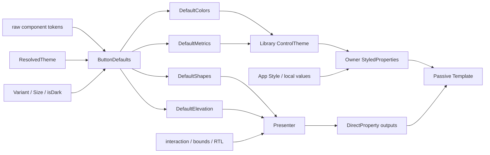

# 控件 Template 消费新 Theme/Token 架构（归档）

> **归档说明：** 本文记录上一轮 Component Defaults Projection 设计，不再代表目标架构。
> 当前目标设计与迁移入口见 [`docs/refactor/README.md`](../../refactor/README.md)。
这套新设计可以称为 Component Defaults Projection：

> Component Defaults 将 raw tokens 和 `ResolvedTheme` 解析成 semantic records；owner-local adapter 再通过 AvaloniaProperty 将这些 records 投影给 ControlTheme、template 和 presenter。

> **实现状态（2026-08）**：这一投影边界已推广到所有原有 component-default consumers。
> Button family、IconButton family 和自有控件都由各自的 Defaults owner 消费 raw tokens；
> 不存在 `.default.jsonc`、component snapshot 或 generated override bags。ToggleButton 仍保留
> 独立的 checked/unchecked 语义记录，而不是复用普通 Button 的颜色 aggregate。




## 1. Component Defaults 负责语义解析

`ButtonDefaults` 是无状态的 component policy owner：

```csharp
internal static class ButtonDefaults
{
    public static ButtonColors Colors(
        ResolvedTheme theme,
        ButtonVariant variant,
        bool isDark);

    public static ButtonMetrics Metrics(ButtonSize size);

    public static ButtonShapes Shapes(ButtonSize size);

    public static ButtonElevation Elevation(
        ButtonVariant variant);

    public static SpringSpec ShapeMotion(
        ResolvedTheme theme);

    public static Thickness OutlineThickness(
        ButtonVariant variant,
        ButtonSize size);
}
```

它负责：

- variant/size 到 raw token table 的映射；
- system color、shape、typography、motion 的解析；
- Compose corrections；
- Avalonia platform adaptations；
- 输出组件语义对象。

它不订阅 theme，不持有控件，也不写 AvaloniaProperty。

## 2. Defaults Adapter 负责生命周期

每个组件拥有一个 owner-local adapter，例如：

```text
ButtonDefaultsAdapter
ToggleButtonDefaultsAdapter
SwitchDefaultsAdapter
```

Adapter 监听与 defaults 有关的输入：

```text
ResolvedTheme
ActualThemeVariant
Variant
Size
```

依赖变化后调用 `ButtonDefaults`，并发布解析结果：

```csharp
private void Refresh()
{
    var theme = MaterialThemeScope.GetResolvedTheme(_owner);
    var isDark = IsDark(_owner.ActualThemeVariant);
    var variant = M3Button.GetVariant(_owner);
    var size = M3Button.GetSize(_owner);

    var colors = ButtonDefaults.Colors(theme, variant, isDark);
    var metrics = ButtonDefaults.Metrics(size);

    M3Button.SetDefaultColors(_owner, colors);
    M3Button.SetDefaultMetrics(_owner, metrics);
    M3Button.SetDefaultShapes(
        _owner,
        ButtonDefaults.Shapes(size));
    M3Button.SetDefaultElevation(
        _owner,
        ButtonDefaults.Elevation(variant));
    M3Button.SetDefaultShapeMotion(
        _owner,
        ButtonDefaults.ShapeMotion(theme));

    M3Button.SetDefaultOutlineThickness(
        _owner,
        ButtonDefaults.OutlineThickness(variant, size));
}
```

Adapter 只发布 default outputs，不直接修改 `Background`、`Padding` 等用户属性。

## 3. 通过 AvaloniaProperty 发布 semantic records

对于需要支持原生 Avalonia `Button` 的组件，使用 `M3Button` attached properties：

```csharp
public static readonly AttachedProperty<ButtonColors>
    DefaultColorsProperty;

public static readonly AttachedProperty<ButtonMetrics>
    DefaultMetricsProperty;

public static readonly AttachedProperty<ButtonShapes>
    DefaultShapesProperty;

public static readonly AttachedProperty<ButtonElevation>
    DefaultElevationProperty;

public static readonly AttachedProperty<SpringSpec>
    DefaultShapeMotionProperty;

public static readonly AttachedProperty<Thickness>
    DefaultOutlineThicknessProperty;
```

这些 properties：

- 是 library-owned default outputs，由 adapter 的 internal 写入路径维护；
- 不属于受支持的公共 override API；
- 不重复 Colors、Metrics 等字段；
- 可以被普通 Avalonia binding 观察。

编译后的 library AXAML 需要能访问 attached-property field，因此 field 本身必须是 `public`。
它们以 `EditorBrowsable(Never)` 隐藏，读写辅助方法保持 `internal`；这里的 `public` 是
AXAML metadata contract，不能被解读为通用 token override surface。

`M3Button` 也直接承载 Button family 的公开输入：`Variant`、`Size`、`IsSquare`、
`ContainerShapeOverride` 和 `StateLayerBrush`。没有额外的 `ButtonAxes` 或
`ButtonDefaultsProjection` 类型；前者是同文件中的顶层 enum，后者只是同一个 attached-property
owner 上标记为隐藏的 library contract。

对于 `MaterialFab` 等自有控件，也可以使用 DirectProperty 暴露同类输出，不一定需要 attached property。

## 4. 由 Material ControlTheme 激活 Adapter

原生 Button 只有在使用 Material ControlTheme 时才需要 defaults adapter。

核心主题设置内部 marker：

```xml
<Setter Property="m3:M3Button.UseMaterialDefaults"
        Value="True" />
```

marker 激活 `ButtonDefaultsAdapter`。

因此：

- Material Button 会消费 Material defaults；
- 普通非 Material Button 不承担额外计算；
- adapter 生命周期跟随 owner；
- 不需要全局 component registry。

## 5. ControlTheme 将 defaults 映射到公共属性

Library ControlTheme 使用普通 self-rooted binding：

```xml
<!-- 示意语法 -->
<Setter Property="Background"
        Value="{Binding Path=(m3:M3Button.DefaultColors).Container,
                        RelativeSource={RelativeSource Self}}" />

<Setter Property="Foreground"
        Value="{Binding Path=(m3:M3Button.DefaultColors).Content,
                        RelativeSource={RelativeSource Self}}" />

<Setter Property="BorderBrush"
        Value="{Binding Path=(m3:M3Button.DefaultColors).Outline,
                        RelativeSource={RelativeSource Self}}" />

<Setter Property="Padding"
        Value="{Binding Path=(m3:M3Button.DefaultMetrics).ContentPadding,
                        RelativeSource={RelativeSource Self}}" />

<Setter Property="MinHeight"
        Value="{Binding Path=(m3:M3Button.DefaultMetrics).ContainerHeight,
                        RelativeSource={RelativeSource Self}}" />

<Setter Property="BorderThickness"
        Value="{Binding Path=(m3:M3Button.DefaultOutlineThickness),
                        RelativeSource={RelativeSource Self}}" />
```

状态默认值由 pseudo-style 选择：

```xml
<Style Selector="^:disabled">
    <Setter Property="Background"
            Value="{Binding Path=(m3:M3Button.DefaultColors).DisabledContainer,
                            RelativeSource={RelativeSource Self}}" />

    <Setter Property="Foreground"
            Value="{Binding Path=(m3:M3Button.DefaultColors).DisabledContent,
                            RelativeSource={RelativeSource Self}}" />
</Style>
```

## 6. Template 只消费最终属性

Template 不知道 `ButtonDefaults`、`ResolvedTheme` 或 raw tokens：

```xml
<ContentPresenter
    Padding="{TemplateBinding Padding}"
    TextElement.Foreground="{TemplateBinding Foreground}" />
```

对于 state layer 等 component-specific 能力，增加可覆盖的 StyledProperty：

```xml
<Setter Property="m3:M3Button.StateLayerBrush"
        Value="{Binding Path=(m3:M3Button.DefaultColors).StateLayer,
                        RelativeSource={RelativeSource Self}}" />
```

template 再使用：

```xml
<MaterialRipplePresenter
    StateLayerBrush="{TemplateBinding m3:M3Button.StateLayerBrush}" />
```

## 7. Presenter 消费 profiles 和 runtime state

Presenter 直接读取默认 semantic properties：

```csharp
var shapes =
    M3Button.GetDefaultShapes(owner);

var elevation =
    M3Button.GetDefaultElevation(owner);
```

然后结合：

```text
enabled
pressed
hovered
IsSquare
ContainerShapeOverride
bounds
RTL
animation progress
```

计算当前展示结果。

需要 template 观察的运行时输出使用 DirectProperty，例如：

```text
CurrentCornerRadius
```

不创建统一的 `TemplateSettings` 对象。

## 8. Override 优先级

目标语义是：

```text
local value
    > app Style / ControlTheme
    > library Material ControlTheme bindings
    > DefaultColors / DefaultMetrics / ...
    > ButtonDefaults
    > raw tokens + ResolvedTheme
```

Default properties 和公共 override properties 是两套不同角色：

```text
DefaultColors       library-owned resolved fallback
Background          public effective property
ColorsOverride      optional public semantic override
```

Adapter 不能把 default 写成公共属性的 local value，否则会破坏 Avalonia 的样式优先级。

## 9. Button family 原型与全局结果

普通 Button 与 ToggleButton 已删除：

```text
MdButtonTokenExtension
ButtonToken enum
ButtonTokenResolver
MdToggleButtonTokenExtension
ToggleButtonToken enum
ToggleButtonTokenResolver
```

这两个控件不读取 `ResolvedTheme.Components` 或生成的 Button-family override bags。
ToggleButton 的颜色状态仍由自己的 `ToggleButtonDefaults` 解析；IconButton family 及其他控件
也已采用各自的 Defaults policy，而不是回到 JSON assembly 路径。

当前架构不需要：

```text
component-specific ThemeBinding/MultiBinding
TemplateSettings aggregate
generated component overrides
ResolvedTheme.Components
```

最终职责边界是：

```text
ButtonDefaults
    计算默认语义

ButtonDefaultsAdapter
    监听依赖并发布 default AvaloniaProperties

Library ControlTheme
    将 default properties 映射到标准/语义 StyledProperties

Template
    被动消费最终 properties

Presenter
    结合 interaction 和 geometry 计算运行时展示
```

Button 原型已验证两点：ControlTheme 内 attached semantic property 的 self binding 可以工作，
且 app `Style`/local value 会持续覆盖 library ControlTheme 的 defaults projection。当前环境
不能运行 visual-parity suite，因此这一原型没有视觉 parity 结论。
