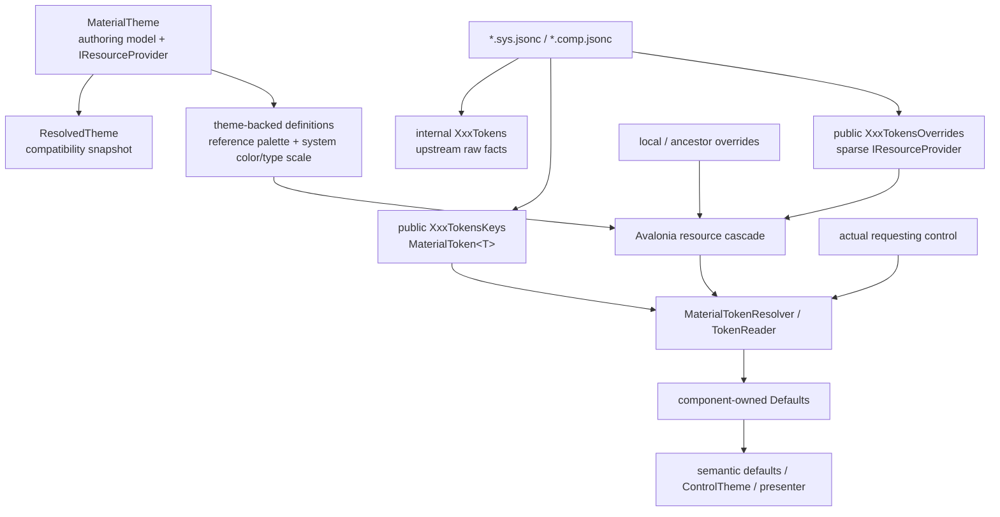

# 新 Theme/Token 架构（归档）

> **归档说明：** 本文记录上一轮未完成的 Theme/Token 过渡设计，不再代表目标架构。
> 当前目标设计与迁移入口见 [`docs/refactor/README.md`](../../refactor/README.md)。

> 本文描述当前已经落地的过渡架构，而不是最终迁移完成后的设想。
> 新 token runtime、generator surface、`MaterialTheme` resource provider 和 Button 纵向切片已经可用；
> 其他控件仍在逐步从 `ResolvedTheme + raw defaults` 迁移。

这次重构不再把主题视为沿树传播的一个不可拆分对象。每个 token 都是一个独立、强类型的
Avalonia resource key；Avalonia 资源系统负责作用域、覆盖和变化通知，Material token runtime
负责类型检查、alias/recipe 求值以及依赖图约束。



## 1. 核心原则

### 1.1 一个 token 就是一个强类型 resource key

`MaterialToken<T>` 同时携带：

- 稳定、可诊断的 `Path`；
- `Reference`、`System` 或 `Component` 层级；
- 最终值类型 `T`；
- 资源链中找不到定义时使用的强类型默认定义。

例如 generated component key 的形态是：

```csharp
MaterialToken<Color> FilledButtonTokensKeys.ContainerColor;
MaterialToken<double> FilledButtonTokensKeys.ContainerElevation;
MaterialToken<ShapeRole> ButtonSmallTokensKeys.ContainerShapeRound;
```

这些对象本身作为 Avalonia resource key，因此正常解析不依赖字符串匹配。`Path` 用于稳定标识和
错误信息，而不是热路径上的资源查找。

### 1.2 覆盖按 token 合成，不再是 nearest whole-theme wins

一个资源节点只需要提供它想修改的 token。未提供的 token 继续沿 Avalonia resource cascade
向祖先、Application 或 token 默认定义查找。

因此局部设置 `FilledButtonTokensOverrides.ContainerColor`：

- 不会替换整个 `MaterialTheme`；
- 不会屏蔽同一 Button token set 的其他值；
- 不会影响兄弟子树；
- 不会阻断从 Application theme 获取 system color/type scale。

准确的资源优先级由 Avalonia 的资源查找规则决定。架构只增加两个保证：稀疏 provider 对未定义
key 返回 miss；`MaterialTheme` 作为同一 scope 中的广域 fallback 安装在 merged dictionaries
前部，使同一 scope 的专用 token override 可以优先。

### 1.3 Avalonia 负责传播，token runtime 负责语义

资源系统负责：

- requester 到 Application 的作用域查找；
- `ThemeDictionary` 与 `ThemeVariant` 选择；
- provider ownership；
- `ResourcesChanged` 通知。

token runtime 负责：

- `TokenDefinition<T>` 的类型安全；
- literal、alias、recipe 求值；
- requester-local dependency resolution；
- 单次读取中的 memoization；
- 依赖方向、错误类型和循环诊断。

资源里最终存放的是 token definition（或作为便捷写法直接存放 `T`），控件通过
`MaterialTokenResolver`/`TokenReader` 得到最终的 `T`，而不是在业务代码中处理未类型化字典。

## 2. Reference / System / Component 三层

```text
Reference  → primitive / palette / base metric
System     → semantic application-wide role
Component  → one component's semantic slot
```

依赖只能保持同层或指向更高层的基础：

```text
Component → Component / System / Reference   allowed
System    → System / Reference               allowed
Reference → Reference                        allowed

Reference → System                           rejected
System    → Component                        rejected
```

runtime 在解析 alias 和 recipe dependencies 时检查这个方向，并报告完整 token path。循环依赖也会
报告实际环路，例如：

```text
System.A → System.B → System.A
```

Reference 层已经有 `ReferencePaletteTokens` catalog。它按 palette、0–100 tone 和可选 custom
palette name 返回稳定的 `MaterialToken<Color>`：

```csharp
var primary40 = ReferencePaletteTokens.Get(RefPaletteToken.Primary, 40);
var neutralVariant90 = ReferencePaletteTokens.Get(RefPaletteToken.NeutralVariant, 90);
var brand60 = ReferencePaletteTokens.Get(RefPaletteToken.Custom, 60, "Brand");
```

standard palette 包括 Primary、Secondary、Tertiary、Neutral、NeutralVariant 和 Error。custom palette
name 使用与 color-scheme lookup 相同的大小写不敏感 identity；非法 tone 会立即失败。
`MaterialTheme` 从 resolved tonal palettes 为这些 reference keys 提供实际颜色，因此局部覆盖某个
palette tone 不需要替换整个 color scheme。

下面是一个简化但完整的 Reference → System → Component graph：

```csharp
var referencePrimary40 =
    ReferencePaletteTokens.Get(RefPaletteToken.Primary, 40);

var systemBrandPrimary = new MaterialToken<Color>(
    "System.Brand.Primary",
    TokenLayer.System,
    Token.Alias(referencePrimary40));

var componentContainer = new MaterialToken<Color>(
    "Component.BrandButton.Container",
    TokenLayer.Component,
    Token.Alias(systemBrandPrimary));
```

如果 requester scope 覆盖 `referencePrimary40`，读取 `componentContainer` 时会沿两级 alias 得到
该局部值；兄弟 scope 仍从 `MaterialTheme` 的 tonal palette 取得默认值。这正是三层 graph 的
requester-local 语义。

这里要区分“token graph 的依赖能力”和当前 canonical color catalog。上述显式 alias 会重绑定，
但 `SystemColorTokens` 目前由 `MaterialTheme` 直接从 dynamic color scheme 解析；它们尚未 alias 到
`ReferencePaletteTokens`。因此只覆盖 `ReferencePaletteTokens.Primary40` 不会自动改变 canonical
`SystemColorTokens.Primary`。dynamic color 在 contrast level、variant 等输入下可能使用非整数 tone，
后续若要建立这条 canonical 依赖，需要先扩展 reference tone 精度并提供 variant-aware recipe，不能
简单固定 alias 到一个 byte tone。

当前仍没有 `.ref.jsonc` table。`ReferencePaletteTokens` 是运行时 catalog，而不是由 reference JSON
生成的 transcription；其他 reference primitive/base metric catalog 仍可后续加入。

## 3. Token definition

一个 token definition 描述“如何在最终 requester 的作用域中得到值”，而不只是保存字面量。

### Literal

```csharp
Token.Literal(Colors.HotPink)
Token.Literal(64d)
Token.Literal(ShapeRole.CornerNone)
```

### Alias

```csharp
Token.Alias(SystemColorTokens.Secondary)
```

alias 的关键语义是 requester-local。即使 component definition 是从某个祖先 provider 找到的，
它引用的 system token 仍从最初请求该 component token 的控件重新解析。这使局部 system override
能够自然地重绑定祖先声明的 component alias。

### Recipe

```csharp
Token.Recipe(myRecipe)
```

`ITokenRecipe<T>` 必须显式列出 `Dependencies`，并通过 `TokenRecipeContext` 读取它们。这样 runtime
可以检查层级方向、检测循环，并在一个 read session 中复用公共依赖。recipe 应当是纯计算；它不应
自行查找资源或捕获某个控件的主题状态。

## 4. Requester-local resolution

读取单个 token：

```csharp
var value = new MaterialTokenResolver().Resolve(control, token);
```

同一轮组件 defaults 需要读取多个 token 时使用短生命周期 session：

```csharp
var tokens = TokenReader.Begin(control);
var color = tokens.Get(FilledButtonTokensKeys.ContainerColor);
var elevation = tokens.Get(FilledButtonTokensKeys.ContainerElevation);
```

解析从实际 consumer 的 `IResourceHost.TryFindResource` 开始。没有显式传入 `ThemeVariant` 时，
`StyledElement.ActualThemeVariant` 会作为有效 variant，因此同一个 theme provider 可以同时服务 light
和 dark requester。

`TokenReader` 的 cache 只存在于一次读取中。它不会跨资源变化保留结果，也不是全局 component
snapshot。收到 `ResourcesChanged` 后，consumer 应建立新的 reader 并重新计算它拥有的 semantic
defaults。

## 5. 稀疏 override provider

`MaterialTokenOverrides` 是通用、强类型的稀疏 `ResourceProvider`：

```csharp
var overrides = new MaterialTokenOverrides();
overrides.Set(SystemColorTokens.Secondary, Colors.Orange);
overrides.Alias(componentToken, SystemColorTokens.Secondary);
scope.Resources.MergedDictionaries.Add(overrides);
```

它支持：

- `Set(token, value)`；
- `Set(token, TokenDefinition<T>)`；
- `Alias(token, target)`；
- `Clear(token)`；
- `BeginUpdate()` 合并多次变化通知。

修改 provider 会调用 `RaiseResourcesChanged()`。`Clear` 的含义不是恢复 token 的硬编码值，而是删除
这一层定义，让查找继续进入外层作用域和 generated default。

generator 还会为每个 token-set table 生成更自然的 typed wrapper：

```csharp
var overrides = new FilledButtonTokensOverrides
{
    ContainerColor = Token.Literal(Colors.HotPink),
    LabelTextColor = Token.Alias(SystemColorTokens.OnSecondary),
};
```

generated property 类型是相应的 `TokenDefinition<T>?`。赋值 `null` 等同于 `Clear`，所以 wrapper
仍然是稀疏 provider，而不是一份完整 component theme。

## 6. XAML authoring

generated overrides 为每种属性生成正确的 literal converter，因此常用字面量不需要手工包装：

```xml
<m3:FilledButtonTokensOverrides
    ContainerColor="#FFFF0000"
    LabelTextColor="{m3:TokenRef Token={x:Static m3:SystemColorTokens.Primary}}" />
```

reference palette key 也有对应的 XAML extension：

```xml
<m3:FilledButtonTokensOverrides
    ContainerColor="{m3:TokenRef Token={m3:ReferencePaletteToken Primary, 40}}" />
```

`TokenRef` 只负责在 override property 中构造一个强类型 alias definition。它不是通用 token value
binding，也不会直接把 token 值设置到任意 StyledProperty。

典型的局部作用域写法是把 provider 放入 resources：

```xml
<Border>
  <Border.Resources>
    <ResourceDictionary>
      <ResourceDictionary.MergedDictionaries>
        <m3:FilledButtonTokensOverrides ContainerColor="#FFFF0000" />
      </ResourceDictionary.MergedDictionaries>
    </ResourceDictionary>
  </Border.Resources>

  <!-- descendants read the sparse override from this scope -->
</Border>
```

## 7. Generator 输出

对 token-set 形态的 `.sys.jsonc` / `.comp.jsonc`，generator 同时输出三类内容：

```text
FilledButton.comp.jsonc
    → internal FilledButtonTokens
    → public FilledButtonTokensKeys
    → public FilledButtonTokensOverrides
```

各自职责是：

| 输出 | 职责 |
|---|---|
| internal `XxxTokens` | 忠实保存 AndroidX raw value、source/version 与旧 defaults 所需事实 |
| public `XxxTokensKeys` | 稳定的 `MaterialToken<T>` resource keys 和 generated default graph |
| public `XxxTokensOverrides` | XAML/C# 友好的稀疏 typed provider |

generated default 会保留 token graph，而不是提前扁平化：

- system color role 映射到 `SystemColorTokens` alias；
- 跨 table reference 映射到另一个 `XxxTokensKeys` alias；
- literal 保持 typed literal；
- token path 包含层级、table 和 member。

`.default.jsonc` 和 `ResolvedTheme.Components` 仍然不存在。variant、size、state mapping、Compose
correction 和 Avalonia adaptation 继续由 component-owned C# Defaults 负责；generator 生成 token
surface，不生成巨大的 `variant × size × state × light/dark` component snapshot。

## 8. MaterialTheme 作为资源节点

`MaterialTheme` 现在同时是：

1. mutable、bindable 的主题 authoring model；
2. `IResourceProvider`；
3. `ResolvedTheme` snapshot 的 owner。

它当前直接提供三类 theme-backed definitions：

- `ReferencePaletteTokens`：从 resolved standard/custom tonal palette 按 0–100 tone 得到颜色；
- `SystemColorTokens`：从 resolved color scheme 按 requester theme variant 得到颜色；
- `SystemTypeScaleTokens`：从 resolved typography scheme 得到每个 typography role 的
  `FontSize`、`LineHeight`、`LetterSpacing`、`Font` 和 `Weight`。

type-scale key 的使用方式例如：

```csharp
var labelLarge = SystemTypeScaleTokens.For(TypographyRole.LabelLarge);
var fontSize = tokens.Get(labelLarge.FontSize);
```

`MaterialThemeScope` 会把 theme 安装为声明节点的 resource provider。由于 Avalonia
`ResourceProvider` 只有一个 owner，同一 `MaterialTheme` 实例放入多个 scope 时，额外位置使用转发
provider，并把 theme mutation 转换成该 scope 的 `ResourcesChanged`。

theme mutation 会同时：

- 使内部 `ResolvedTheme` snapshot 失效；
- 发布资源变化，使新 token consumers 重新读取；
- 继续通知旧 `ResolvedTheme` consumers。

`MaterialTheme` 不提供 component token definitions。component defaults 位于 generated graph，局部
component override 因此不会被一个更近的 whole-theme object 整体遮蔽。

## 9. ResolvedTheme 的兼容职责

`ResolvedTheme` 没有被删除。它仍然包含 resolved color、typography、shape、motion 和 ripple system
schemes，并通过已有 `MaterialThemeScope.ResolvedThemeProperty` 服务尚未迁移的控件及兼容代码。

新旧路径当前并行：

```text
new: MaterialTheme resource provider
       → MaterialTokenResolver / TokenReader
       → migrated component Defaults

compat: MaterialTheme
          → ResolvedTheme
          → inherited property / MaterialElementContext
          → existing component Defaults
```

它仍然不包含 component tokens、component overrides、variant、size、interaction state 或
`ResolvedTheme.Components`。随着控件迁移，新 token graph 可以继续使用 `ResolvedTheme` 作为
`MaterialTheme` 内部解析 system scheme 的基础设施；没有必要为了采用资源 cascade 而立即删除这个
高效 immutable snapshot。

## 10. Button 纵向切片

Button 是第一个完整接入新读取路径的组件。`ButtonDefaults` 通过同一个 `TokenReader` 读取：

- variant color 和 opacity；
- size metrics；
- shape roles；
- elevation profiles；
- outline width。

`ButtonDefaultsAdapter` 订阅 owner 的 `ResourcesChanged`，资源变化后重新建立 read session，并把新的
semantic defaults 投影到现有 ControlTheme/presenter contract。因此：

- 局部 component override 会实时更新 Button；
- component alias 会跟随 requester scope 中的 system override；
- 只改 container color 不会改变 label、兄弟 Button 或其他 token；
- numeric、shape、color token 使用同一套解析语义。

组件的 interaction、bounds 和最终 rendering state 仍由 control/presenter 负责；token resolver 不变成
一个通用行为 DSL。

## 11. 当前边界

以下能力尚未完成，不能把当前状态描述成全库 token migration：

1. **没有通用动态 `{Token ...}` consumption markup。** XAML 已能声明 typed override 和
   `TokenRef` alias，但不能把任意 token 作为自动订阅变化的值直接绑定到任意属性。当前 consumer
   必须通过 `TokenReader` 读取，并在 `ResourcesChanged` 后重读。
2. **除 Button 外，大部分控件仍沿用旧 defaults 路径。** generated Keys/Overrides 已覆盖 token-set
   tables，但只有已经迁移的 component consumer 才会观察这些 overrides。
3. **尚无 `.ref.jsonc` transcription。** `ReferencePaletteTokens` 已提供 palette/tone/custom catalog，
   但它是 runtime catalog；其他 reference primitive/base metric table 尚未引入。
4. **MaterialTheme 当前直接桥接的是 reference palette、system color 与 type scale。** 其他 system
   subsystem 仍按其 generated defaults、existing schemes 或兼容路径工作，需按消费需求继续迁移。
5. **Canonical system colors 尚未依赖 reference palette keys。** 显式的 Reference → System →
   Component alias graph 支持 requester-local 重绑定；但覆盖 palette key 不会自动改写由 dynamic color
   scheme 计算的 `SystemColorTokens`。

## 12. 迁移规则

迁移下一个组件时，应保持以下分工：

```text
generated XxxTokensKeys
    = token identity + default dependency graph

MaterialTheme / scoped providers
    = system values + sparse overrides + invalidation

component Defaults
    = variant/size mapping + Compose correction + platform adaptation

control adapter
    = ResourcesChanged lifecycle + semantic property projection

presenter/control
    = enabled/checked/pressed/bounds/RTL 等晚期状态
```

必须避免重新引入两种旧问题：

- 不要在 scope 中先解析一整份 component snapshot，否则 alias 将失去 requester-local 语义；
- 不要用“最近 MaterialTheme 整包获胜”来表达局部定制，否则一个 token override 又会替换无关 token。

测试至少应覆盖 literal、向上层 alias、scope/sibling 隔离、资源 mutation、light/dark requester、错误
类型、非法依赖方向和循环诊断。
