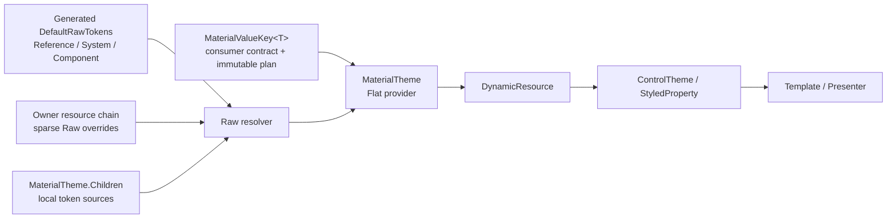

# Material 3 多层 Token 目标架构

> **文档状态：目标架构。** 本文描述本轮重构完成后应满足的系统契约，不描述当前仓库已经完成的实现。
> 迁移期间旧的 `ResolvedTheme + component Defaults/adapter` 路径与新路径可能并存；两者并存不改变本文的目标语义。

## 1. 目标

新架构在 Avalonia 原生资源系统之上表达 Material 3 的 Reference、System、Component 多层 token，
并把组件模板真正需要的值通过 `DynamicResource` 交给控件。

它需要同时满足：

- token 是强类型、可诊断的稳定身份，不以字符串拼接作为主要协议；
- Reference → System → Component 的 alias 在局部 scope 中可以重新绑定；
- 一个 scope 只覆盖自己声明的 token，未声明项继续沿 Avalonia 资源树查找；
- `ThemeVariant`、资源优先级和变化通知服从 Avalonia 的既有语义；
- ControlTheme 使用 consumer-ready 的值，不需要了解 Raw token graph；
- 第一版以正确性和可观测性为先，不维护跨资源请求的 Raw/Flat cache。

本文将这种结构称为 **boundary-relative flatten provider**：`MaterialTheme` 是 Raw graph 与 Flat value
之间的解析边界，Flat 值相对于该 `MaterialTheme` 的 placement 求值。

## 2. 总体模型



一次典型请求按以下顺序发生：

1. 控件以 `MaterialValueKey<T>` 发起 `DynamicResource` 查询。
2. Avalonia 沿控件的资源链找到最近的、能够处理该 Flat key 的 `MaterialTheme`。
3. `MaterialTheme` 以自己的 `Owner` 为 Raw 查找起点，并全程透传本次请求的 `ThemeVariant`。
4. Value plan 读取一个或多个 `MaterialToken<T>`；每个 Raw hop 都重新从同一 `Owner` 查找定义。
5. 如果整个 Owner 资源链都没有定义该 Raw key，resolver 才使用 generated `DefaultRawTokens`。
6. literal、alias 或 recipe 被递归求值，Value plan 最终产生 consumer-ready 的非空 `T`。
7. `DynamicResource` 把结果应用到 Setter 或属性，并负责在资源或实际主题变化时重新查询。

这不是把整份主题预先拍平成快照。Flat 值只在收到具体 key 请求时求值。

## 3. 两类 key、两种职责

### 3.1 Raw：`MaterialToken<T>`

Raw token 描述 Material 设计层的事实与依赖：

```text
Reference  → palette tone、base metric、primitive
System     → semantic color、type scale、shape、motion role
Component  → 某一组件的 semantic slot
```

其定义是强类型的 literal、alias 或受约束 recipe。Raw token 可被 scope 覆盖，并公开给 typed override
和 alias authoring，但不是 ControlTheme 属性的直接 `DynamicResource` 协议：普通 Raw resource lookup
无法判断何时完整 Owner 链已经 miss，因而不能安全进入终端 `DefaultRawTokens`。需要原样值的消费槽也应
声明 `DirectRaw<T>` 的 `MaterialValueKey<T>`。详细模型见 [Raw Token 模型](raw-token-model.md)。

### 3.2 Flat：`MaterialValueKey<T>`

Flat key 是稳定的消费端契约。它携带不可变 resolution plan，将一个或多个 Raw token 投影为 Avalonia
消费端需要的类型，例如：

```text
MaterialToken<double>                       → double
MaterialToken<Color>                        → IBrush
MaterialToken<Color> + opacity              → IBrush
多个 dimension token                        → Thickness
shape role                                  → MaterialShape
```

Flat 与 Raw 使用不同的 key 类型，保证 MaterialTheme 在处理 Flat 请求时，可以安全地通过 Owner 再次
查找 Raw key，而不会把同一个 Flat 请求递归回自己。

Flat key 对应稳定的消费槽，不要求与 Component Raw token 一一对应，也不等同于某个临时 adapter record。
详细 schema 见 [Material Value](material-values.md)。

## 4. 解析边界与资源优先级

`MaterialTheme` 必须作为 `ResourceProvider` 放入某个 resource host 的 `MergedDictionaries`。同一个实例只
代表一个 placement，并只有一个 Owner。

对于某一 Flat 请求，最近命中的 MaterialTheme 确立解析边界。此后所有 Raw hop 都从该 placement 的
Owner 开始，而不是从最初发起 `DynamicResource` 的控件开始：

```text
requesting control
    └─ Avalonia 查找最近的 Flat provider
          └─ MaterialTheme placement / Owner
                └─ 每个 Raw hop 从这个 Owner 重新查找
```

因此该语义是 **boundary-relative**，不是 requester-relative。

### 4.1 可见性反例

```text
Root.Resources
    MaterialTheme

Panel.Resources
    System.Primary = Red

Panel
    Button  -- requests Button.ContainerBrush
```

Button 与 Root MaterialTheme 之间的 `System.Primary` 不可见。Root MaterialTheme 解析 Flat key 时从 Root
Owner 开始，不会向下回看 Panel。

需要局部 Raw override 时，该 scope 必须同时建立新的 MaterialTheme placement：

```text
Panel.Resources
    System.Primary = Red
    MaterialTheme
```

这不是实现缺陷，而是公开的 scope 契约。它让解析起点稳定，并避免 resolver 捕获具体请求控件。

### 4.2 单个 Raw hop 的查找顺序

概念顺序如下：

```text
placement Owner.TryFindResource
    → Owner 的普通资源、ThemeDictionaries 与 MergedDictionaries（按 Avalonia 顺序）
        → 查找经过当前 MaterialTheme 时查询其 Children（later child wins）
    → ancestor resource hosts / ancestor MaterialTheme placements
    → Application/global resources
    → DefaultRawTokens（仅全链 miss 后）
```

实际的 host、字典、merged dictionary 与祖先顺序由 Avalonia 决定；Material token runtime 不复制一套
资源树算法。`DefaultRawTokens` 是 resolver 的终端 fallback，不是每个 MaterialTheme 的本地资源层。

## 5. ThemeVariant 契约

请求携带的 `ThemeVariant?` 是唯一权威来源。MaterialTheme 不读取 Owner 的当前主题来替换它，也不把
`Default` 强制折叠为 Light。

同一次 Flat 求值中：

- 原始 query theme 原样传给所有 Raw hop；
- 每个 Raw key 独立执行 `exact → InheritVariant 链 → Default`；
- 某一 hop 从 inherited variant 命中，不会改变后续 hop 的原始 query theme；
- Light、Dark、自定义 variant 与未来 variant 使用同一套机制。

例如 `HighContrastDark → Dark` 查询中，Component token 可以从 Dark 命中 alias，而 alias 指向的 System
token 仍必须先尝试 HighContrastDark。过早把 query theme 归一化为 Dark 会漏掉更具体的 System override。

MaterialTheme 的详细行为见 [MaterialTheme 与 Placement](material-theme.md)。

## 6. 模块职责

| 模块 | 负责 | 不负责 |
|---|---|---|
| Raw descriptors | typed identity、path、layer、value type | baseline definition、Avalonia 属性投影、控件状态 |
| `DefaultRawTokens` | built-in 完整默认图、终端 fallback | 遮蔽 scope override、为动态 key 臆造默认值 |
| Raw source/override | 当前 scope 的稀疏 definition | 补齐整份主题 |
| Raw resolver | 资源链查询、alias/recipe、类型、层级、循环 | variant/size/state policy |
| `MaterialValueKey<T>` | 稳定消费身份、声明式 Raw dependencies、纯投影 | 查 requester、Bounds、时间或服务 |
| `MaterialTheme` | Flat 边界、local Children、无状态解析、通知 | 持久 Flat/Raw cache、控件行为 |
| ControlTheme/style | variant、size、pseudo-class 对 Flat key 的选择 | 解析 Raw graph |
| Presenter/control | interaction、Bounds、RTL、动画 | 重新实现 token cascade |
| Avalonia | resource tree、theme dictionary、precedence、变化重查 | Material token 类型与层级规则 |

## 7. 第一版冻结的不变量

以下规则是实现和测试必须共同维护的架构不变量：

1. **Raw/Flat key domain 隔离。** Raw key 不能被误认为 Flat key，反之亦然。
2. **单 placement。** 一个 MaterialTheme 实例不共享给多个 Owner，也不使用转发 proxy 模拟共享。
3. **边界稳定。** 一次 Flat 求值的所有 Raw hop 使用同一个 placement Owner。
4. **主题稳定。** 所有 hop 使用同一个原始 query theme；fallback 只影响当前 key 的命中。
5. **稀疏覆盖。** source miss 必须继续查找；`Clear` 表示删除本层定义。
6. **默认图最后。** 只有 Owner 整条资源链 miss，才能查询 `DefaultRawTokens`。
7. **非法命中不回退。** null、错误类型、非法层级、未声明 recipe dependency 与 cycle 都是错误，不是 miss。
8. **已识别 Flat key fail-fast。** 解析失败不能返回 `false` 并静默落到祖先 Flat provider。
9. **final value 非 null。** `null` 只表示 authoring facade 的 Clear，不是合法 resolved value。
10. **无持久解析 cache。** 第一版不跨请求保存 Raw/Flat 结果；单次 resolution session 可以 memoize。
11. **通知不重复。** MaterialTheme 只因自身 Children 的结构或内容变化广播；Owner 与 theme 变化由
    `DynamicResource` 观察。
12. **Flat plan 纯且可检查。** 第一版只允许 Flat → Raw，不允许 Flat → Flat 或任意捕获环境的 delegate。
13. **Raw 不直接消费。** Raw key 只用于 source/override/alias/resolver；ControlTheme 的资源请求使用
    Material Value key，包括原样返回 Raw 的 Direct plan。

## 8. 明确排除的设计

以下方案不属于目标架构：

- 最近的 whole-theme object 整包获胜；
- 每个 scope 预先构建所有 component value 的巨大 snapshot；
- 以单一 `RawToken enum + object?` 取代 typed descriptor；
- 为所有 Component Raw token 机械生成一一对应的 Flat enum；
- 根据 Owner 当前主题维护单份 `_raw` 或 `_flat`；
- Flat recipe 读取 requester、控件状态、Bounds、RTL、服务或时间；
- Children miss 后立即使用本地 defaults，从而截断祖先 override；
- 依赖 Avalonia 隐式转换来定义 Color、Thickness、Shape 等跨类型契约。

## 9. 目标消费形态

组件的 ControlTheme 最终只接触 Flat key：

```xml
<Setter Property="Background"
        Value="{DynamicResource {x:Static tokens:ButtonValueKeys.FilledContainerBrush}}" />

<Style Selector="^:disabled">
    <Setter Property="Background"
            Value="{DynamicResource {x:Static tokens:ButtonValueKeys.FilledDisabledContainerBrush}}" />
</Style>
```

variant、size 与 state 仍由 ControlTheme selector 或轻量组件 policy 选择对应 key；MaterialTheme 不从
资源请求中猜测这些控件输入。需要 Bounds、RTL 或动画进度的晚期计算仍由 Presenter 完成。

## 10. 文档地图

- [Raw Token 模型](raw-token-model.md)：typed identity、definition、layer、default graph 与 resolver。
- [Material Value](material-values.md)：Flat schema、resolution plan、consumer-ready 类型与投影边界。
- [MaterialTheme 与 Placement](material-theme.md)：资源节点、Owner、Children、主题与事件生命周期。
- [Generator](generator.md)：JSONC 输入、default graph、typed API 和编译期校验。
- [Authoring 与 XAML](authoring-and-xaml.md)：全局/局部 placement、override、Clear 与消费示例。
- [诊断与测试](diagnostics-and-testing.md)：错误分类、cycle path、scope/theme/lifecycle 测试矩阵。
- [迁移计划](migration-plan.md)：vertical slice、兼容期、旧路径退出与性能门槛。
