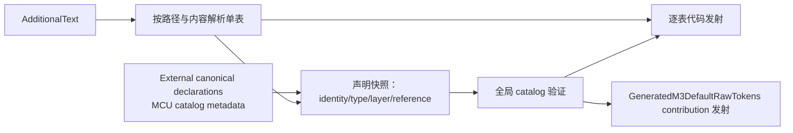

# Token Generator 与默认定义目录

> 本文描述重构完成后的目标设计。除特别标为“当前”的内容外，文中的 API 名称与输出形态尚未实现，
> 不能当作当前库的使用说明。

Generator 的职责是把带来源信息的 token facts 编译成强类型、可检查的 Raw token 图。它不解析
Avalonia 资源树，不生成控件行为，也不为 Material value 建立全局枚举或缓存表。

相关文档：

- [Raw Token 模型](raw-token-model.md)
- [Material value](material-values.md)
- [MaterialTheme](material-theme.md)
- [MaterialColorUtilities 集成](material-color-utilities.md)
- [诊断与测试](diagnostics-and-testing.md)
- [迁移计划](migration-plan.md)

## 1. 需要保留的现有基础

当前的 [`TokenTableGenerator`](../../src/Material3Expressive.TokenGenerator/TokenTableGenerator.cs)
已经具备应当延续的基础：

- 以 Roslyn `IIncrementalGenerator` 读取 `AdditionalTexts`；
- 本地 token table 只接受 `.ref.jsonc`、`.sys.jsonc` 与 `.comp.jsonc`；
- JSONC 支持注释与尾随逗号；
- 每张表独立解析、独立发射，声明 catalog 单独参与全局验证；
- 保留 `source`、`version`、`provenance` 与成员级说明；
- 生成强类型 `MaterialToken<T>` descriptor 与 typed override facade；
- 在编译期检查引用存在性、值类型、依赖层级与循环。

新架构是在这些能力上补齐 M3E contribution，并参与 composed 默认 Raw 图，而不是把 generator 改写成
文本拼接器。当前 emitter
可参见 [`TableEmitter`](../../src/Material3Expressive.TokenGenerator/Emit/TableEmitter.cs)，当前表格式说明
可参见 [Token tables](../reference/token-tables.md)。后者描述的是现状；本页定义目标。

## 2. 职责边界

### 2.1 Generator 负责

1. 读取并校验 Reference、System、Component 三层 token facts。
2. 生成稳定、强类型的 Raw token identity。
3. 生成 literal、alias 与受约束 recipe 构成的默认定义图。
4. 将本项目拥有的默认定义汇总为只读的 generated contribution，并让统一 `DefaultRawTokens` 组合它与
   MCU 等外部 domain contribution。
5. 生成 XAML/C# 友好的稀疏 typed override facade。
6. 保留可追溯来源，并为结构错误提供确定性的编译诊断。

### 2.2 Generator 不负责

- 不执行 Avalonia resource lookup，也不从 Owner 推断有效主题；generated contribution 只按传入的
  `queryTheme` 执行确定性的 baseline variant fallback；
- 不解析控件的 variant、size、state、pseudo-class、bounds 或 flow direction；
- 不生成 `ResolvedTheme.Components` 或任何全量 resolved component snapshot；
- 不将 Raw graph 提前拍扁为最终值；
- 不生成中央 `FlatToken` enum、`FlatTokens` 列表或 `Flat -> Raw` switch；
- 不维护 Flat cache；
- 不重新生成 MCU-owned Reference palette/System color descriptor 或转录 `DynamicScheme` 算法；
- 不把任意 C# 表达式嵌入 JSON，也不生成组件行为 DSL。

这些边界保证 token transcription 仍然是事实层，控件消费契约仍由组件拥有。

## 3. 输入模型

| 文件后缀 | 根 `kind` | 层级 | 主要内容 |
|---|---|---|---|
| `.ref.jsonc` | `referenceTokens` | Reference | M3E-owned primitive、基础 metric；MCU color palette identity 不在此重复声明 |
| `.sys.jsonc` | `systemTokens` | System | M3E-owned 跨组件 semantic role；MCU system colors 由外部 catalog 声明 |
| `.comp.jsonc` | `componentTokens` | Component | 上游组件 token 的忠实转录 |

文件后缀是可发现的分类，根 `kind` 是语义声明；两者必须一致。表中引用使用结构化的
`@Table.Member`，不能退化成运行时字符串查找。

外部 canonical declaration metadata 是只读的编译输入，不是第四种本地 token table。它由 domain
package 提供，用于解析和验证 `@` 引用或 color-role shorthand，M3E generator 不为其中的 key 发射
descriptor/default。

`provenance` 至少保留当前四种来源：

- `androidx-token`
- `compose-default`
- `m3-spec`
- `avalonia-policy`

来自不同来源的事实可以进入同一张依赖图，但不能隐去来源差异。为了适配 Avalonia 而新增或修正的值，
必须标为 `avalonia-policy`，并在邻近位置记录原因。

### Component JSON 的硬边界

`.comp.jsonc` 只描述上游 Raw facts。下列内容不得写入其中：

- “Filled Button 在 disabled 状态应使用哪个 value key”；
- `Color + Opacity -> IBrush`；
- 四个 spacing token 如何组合为 `Thickness`；
- control property、selector、template 或 presenter 行为；
- Compose 修正和 Avalonia 特有交互策略。

这些内容属于 [Material value](material-values.md) 或组件 C# policy。这样更新上游 token 数据时，不会
意外改写控件行为。

## 4. 增量管线

目标管线继续保持“单表增量、全图校验”的结构：



实现必须满足：

- 修改一张表的 literal 时，不重新解析无关表；
- 只有影响 identity、type、layer 或 reference 的变化才使全图结构验证失效；
- 输出按稳定顺序排列，不依赖文件系统枚举顺序；
- 错误表不产生部分可用的 descriptor/default 输出；
- 同一次编译中，descriptor 与 generated contribution 必须来自同一份已验证声明快照，并记录所验证的
  external declaration version。

## 5. 生成输出

对于 token-set 表，目标输出分为四类：

| 输出 | 可见性 | 作用 |
|---|---|---|
| `XxxTokens` | internal | 忠实保存 raw transcription 与 provenance |
| `XxxTokensKeys` | public | 稳定、强类型的 `MaterialToken<T>` identity |
| `XxxTokensOverrides` | public | 稀疏 typed authoring source/provider |
| `GeneratedM3DefaultRawTokens` entries | internal/shared | M3E-owned identity 与 variant 对应的不可变 baseline definition contribution |

descriptor 的公开契约是 identity、`Path`、`Layer` 与 `ValueType`。默认定义是 catalog 数据，不应要求
调用方从 descriptor 上读取；这样 identity 与默认策略可以独立演进。迁移期间可以暂时适配当前
[`MaterialToken<T>.DefaultDefinition`](../../src/Material3Expressive/Foundation/Tokens/Runtime/MaterialToken.cs)，
但目标 resolver 以 composed `DefaultRawTokens` 为唯一默认图入口。

typed override facade 继续提供：

- 与 token 类型一致的 `TokenDefinition<T>?` 属性；
- compiled XAML 可用的 literal converter；
- literal、alias 与 `Clear`；
- 稀疏语义：未设置即 miss，不复制整套默认值。

同一种 generated facade 必须支持两种安装形态：作为 `MaterialTheme.Children` 中的
`IMaterialTokenSource`，或作为 `ThemeDictionaries`/普通 `MergedDictionaries` 中的独立 Raw
`ResourceProvider`；具体实现也可以使用一个语义等价的 generated adapter。source 形态的 mutation 必须
有不依赖 Owner 的 `Changed` 通知，provider 形态则使用 Avalonia 的资源通知。同一实例一次只能用于一个
authoring placement，不能同时作为 child 又挂进 resource dictionary，也不能被多个 placement 共享。

## 6. `DefaultRawTokens` catalog composition

### 6.1 语义

`DefaultRawTokens` 是完整 Raw graph 的统一最终兜底，不是一个资源 scope，也不是 resolved value cache。
它组合 M3E generator 输出与显式导入的 domain contributions；第一版的外部 contribution 是 MCU colors：

```text
MaterialTheme placement 从 Owner 查找某个 Raw key
    → 当前 scope / 同 scope provider / 祖先全部 miss
    → DefaultRawTokens.TryGetDefinition(key, queryTheme)
    → literal、alias 或 recipe
```

每个 alias/recipe dependency 都重新按同一 placement Owner、同一个原始请求 `ThemeVariant` 执行上述
流程。catalog 不读取 `Owner`，也不把 `queryTheme` 归一化成 Owner 的实际主题；它只为当前 key 在
catalog 内按 `exact → InheritVariant 链 → Default` 选择 baseline definition。`null` 与
`ThemeVariant.Default` 使用 Default baseline。

catalog 必须满足：

- 构造后不可变，可被所有 `MaterialTheme` placement 共享；
- key 使用 descriptor identity，而不是 path string；
- 同一个 key 可以声明 Default、Light、Dark 或 custom variant 的不同 baseline definition；
- variant fallback 对每一个 key 独立执行，不能把一次命中的父 variant 写回并替代原始
  `queryTheme`；
- lookup 不产生副作用，不发出 `ResourcesChanged`；
- 保存 definition graph，不保存 resolved value；
- 所有内置、可最终解析的静态 key 都有定义；
- 发射可合入 composite catalog 的 membership/missing-policy metadata，使 runtime 能区分 built-in
  catalog 缺损与 source-required custom key；
- catalog 缺项属于 generator/库错误，不能静默回退到 `default(T)`。

概念 API 可以是：

```csharp
internal static class DefaultRawTokens
{
    public static bool TryGetDefinition(
        MaterialToken key,
        ThemeVariant? queryTheme,
        out ITokenDefinition definition);

    public static bool RequiresCatalogDefinition(MaterialToken key);
}
```

具体实现可以由按表分片的只读字典、生成的 type-safe dispatch 与 imported contribution dispatch 组成。
它不是供应用作者修改的 `ResourceDictionary`，也不得为每个 `MaterialTheme` 复制一份。Contributor 顺序
不提供 override precedence；同一 canonical key 被重复声明为 owned 必须在构建或初始化时失败。

### 6.2 默认图必须保持层次

Generator 与 imported contribution 共同保留的是：

```text
Component token → System token → Reference token / algorithm-input leaf → literal / immutable context
```

而不是：

```text
Component token → 已解析后的 Color/double/shape
```

只有保留依赖关系，较近 scope 对 System 或实际声明为 dependency 的 Reference token override 才能重新
绑定祖先或默认 Component alias。MCU System role 依赖内部 Color Context，不承诺依赖某个公开 tone key。

### 6.3 Theme-dependent leaves

主题算法产生的 palette/system 值由外部 domain 拥有时，generator 不应复制算法。MCU color integration
使用一个稀疏 ColorScheme source 提供内部 Color Context leaf，并由 MCU catalog recipes 从该 immutable
context 读取 palette/system colors。`DefaultRawTokens` 仍需通过 MCU contribution 提供 terminal baseline
context，使没有显式 scheme source 的默认主题形成可诊断、可终止的图。

例如 `HighContrastDark.InheritVariant = Dark` 时，catalog 查询某个 key 的顺序是
`HighContrastDark → Dark → Default`。如果该 definition alias 到另一 key，下一跳仍然携带原始
`HighContrastDark`，而不是携带本次命中的 `Dark`。换言之，catalog 是 variant-aware 的默认定义图，
不是“默认主题计算结果的快照”。

MCU 的 immutable `ResolvedColorScheme`/Color Context 可以在 source 内预建 Light/Dark `DynamicScheme`；
这是固定 scheme input 的算法 memoization，不是 generator 输出、placement snapshot 或 Raw/Flat cache。
完整边界见 [MaterialColorUtilities 集成](material-color-utilities.md)。

### 6.4 外部 canonical declarations

MCU-owned key 不进入 M3E 的本地声明输出。Generator 必须读取 versioned external declaration metadata，
至少获得 path、layer、value type、owner、canonical symbol/factory 与 provenance。具体载体可以是 package
提供的 build-time manifest 或等价的 Roslyn-visible metadata，但 runtime 不能靠 path string 合并 identity。

Component color role 应直接发射对 MCU canonical singleton 的 alias。完整性、类型、层级与 cycle 验证以
composed graph 为准；缺失 MCU contribution 或 external declaration version 不兼容时，应给出编译诊断，
不能临时生成一个 M3E wrapper key 补洞。

Generated contribution 必须同时记录 required domain contribution id/version；`DefaultRawTokens` 初始化时
验证依赖闭包，避免把漏装 MCU contribution 误报成普通 source-required token。

## 7. `MaterialValueKey<T>` 与 generator

第一阶段不生成 Flat/material value schema。Button 在组件目录内用 C# 手写
`MaterialValueKey<T>` 与 immutable plan，以实际消费验证以下 operator：

- direct Raw value；
- `Color -> IBrush`；
- `Color + Opacity -> IBrush`；
- 多个 dimension -> `Thickness`；
- shape、typography 与 presenter-owned profile。

稳定以后，才可以引入独立的 `*.values.jsonc`。它必须：

1. 与 `.comp.jsonc` 分离，明确标为 Avalonia consumption policy；
2. 只允许有限、版本化的标准 operator；
3. 静态声明全部 typed Raw dependencies；
4. 生成独立的 `MaterialValueKey<T>` singleton 与 immutable plan；
5. 在编译期验证输入/输出类型；
6. 禁止任意 C# expression、反射调用、服务查找与 requester 状态读取。

即使加入该格式，也不生成中央 Flat enum/list/`ToRaw`。每个 value key 自带 plan，MaterialTheme 通过
key 的 descriptor 类型识别并求值。新增组件不应修改一个全局 switch。

## 8. Custom key 策略

有限 enum 无法表达 `ReferencePaletteTokens.Custom(name, tone)` 或
`SystemColorTokens.Custom(role, name)`。目标架构继续采用参数化、强类型 descriptor family；颜色 family
由 MCU canonical catalog 拥有，其他 domain 可以采用同一模式：

- family factory 按规范化参数 intern key，确保相同逻辑 key 获得稳定 identity；
- custom name 沿用当前大小写不敏感规则，tone/role 在构造时校验；
- 固定出现在 JSONC 中的 custom key 可由 generator 发射 factory 调用；
- 运行时才出现的 custom name 不要求 generator 预枚举，也不能塞入中央 enum；
- theme source 可以按 family metadata 动态提供 definition/value；
- 若资源链与合法默认 provider 均不能提供该 custom key，则明确报告 missing token，不能伪造颜色或
  使用 `default(T)`。

生成期已知的 parameterized family 必须同时声明其 missing policy：哪些 canonical family member 拥有
catalog baseline，哪些只允许 theme source 动态提供。应用运行时创建且未注册的扩展 descriptor 默认
视为 source-required。这个分类属于 catalog/family metadata，不是 descriptor 上的默认 definition。

当前 M3E 过渡期参数化 identity 的实现可参考
[`ReferencePaletteTokens`](../../src/Material3Expressive/Foundation/Tokens/Runtime/ReferencePaletteTokens.cs)
与 [`SystemColorTokens`](../../src/Material3Expressive/Foundation/Tokens/Runtime/SystemColorTokens.cs)。
迁移时应把 canonical intern table 移入 MCU Avalonia，并让 M3E compatibility facade 返回 MCU 的同一
descriptor instance；不能保留第二份 table，也不能将其转换成 generated enum 成员。

MCU custom color key family 可以由 MCU contribution 提供通用 recipe，但仍要求可见 Color Context 声明
对应 named palette；缺失时必须报告配置错误，不能返回 Transparent。它与任意应用 extension key 完全
没有 catalog definition 的 source-required 情况应分别诊断。

应用作者自行创建的扩展 token 同样不进入生成 catalog。由于 descriptor 只承载 identity，不承载默认
definition，应用必须通过使用处可见的 scope source/override 提供它；否则解析应以 missing token
fail-fast。

## 9. 编译期验证

当前 `M3ETOK001`–`M3ETOK004` 的职责继续保留：

| 诊断 | 含义 |
|---|---|
| `M3ETOK001` | JSON/schema/value/provenance 无效 |
| `M3ETOK002` | table name 重复 |
| `M3ETOK003` | 引用不存在、类型不兼容、逆层依赖或循环 |
| `M3ETOK004` | 文件后缀与根 `kind` 不一致 |

目标验证至少覆盖：

- table/member identity 唯一；
- alias 两端 `T` 完全一致；
- recipe dependencies 存在且类型符合 operator 签名；
- `Reference -> Reference`、`System -> System/Reference`、
  `Component -> Component/System/Reference` 的方向限制；
- 完整 dependency graph 的 cycle，并报告实际环路；
- 每个 generated Raw key 与每个 external catalog-owned dependency 都能在 composed default catalog 中
  找到 definition；
- external canonical declaration 的 owner/version/type/layer 与发射目标一致，且没有重复 identity owner；
- `*.values.jsonc` 启用后，operator 名称、版本、输入与输出类型均合法。

不要为了赶迁移把这些错误推迟到运行时。运行时诊断是对手写 override 和动态 custom key 的防线，
不是 generator 验证的替代品。

## 10. 测试与完成条件

Generator 目标阶段完成时，应有以下测试：

- incremental tracking：无关表不重新解析/发射；
- snapshot：descriptor、override facade、provenance 与 generated contribution 输出稳定；
- graph：跨表存在性、类型、层级和完整 cycle path；
- completeness：所有 generated Raw descriptor 与 MCU-owned canonical dependency 都能按受支持的 query
  variant fallback 在 composed `DefaultRawTokens` 中获得定义；
- variant：每 key exact → `InheritVariant` → Default，且 alias/recipe hop 保留原始 query theme；
- identity：standard/custom parameterized key 稳定且不会冲突；
- external identity：M3E facade/generator reference 与 MCU API 指向同一 descriptor instance；
- compiled-XAML：typed override literal 与 alias 可编译；
- values schema（启用后）：每个标准 operator 的正例和错误类型诊断；
- determinism：不同输入枚举顺序产生相同输出。

只有这些条件满足后，组件迁移才可以依赖新的默认 catalog。Generator 阶段本身不代表消费路径已经从
`ResolvedTheme`/`TokenReader` 切换；实际切换顺序由 [迁移计划](migration-plan.md) 管理。
