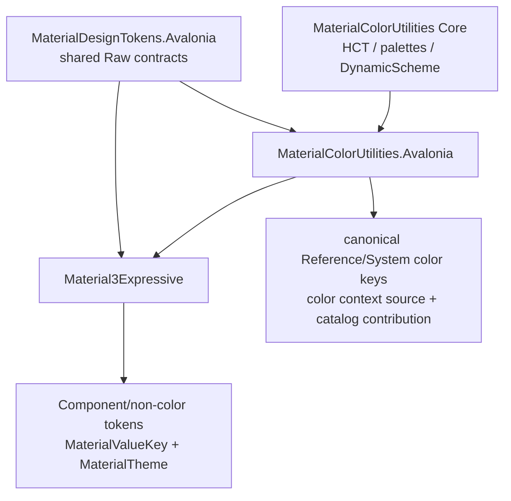

# MaterialColorUtilities 集成边界

> **状态：已接入 Foundation，组件消费迁移中。** 本文定义
> [`MaterialColorUtilities`](../../modules/MaterialColorUtilities/)（下称 MCU）与新 Token runtime 的所有权、
> package 依赖、scope 与缓存边界。本文不是 MCU standalone API 的完整使用说明。

## 1. 决策

本轮采用“**保留 MCU 算法与 Avalonia authoring，替换 Token-facing adapter**”的方案：

- MCU Core 继续是 HCT、tonal palette、`DynamicScheme` 和 dynamic color role 的唯一算法实现；
- MCU Avalonia 继续拥有 `ColorScheme`、custom color authoring 与 immutable resolved snapshot；
- MCU Avalonia 新增共享 Raw-token contract 的实现，拥有 canonical Reference palette 与 System color key；
- Material3Expressive（下称 M3E）组合 MCU 的 color catalog contribution，并让 Component color token alias
  直接指向 MCU 的 canonical System key；
- M3E 的新消费路径不再依赖 inherited `ResolvedSchemeProperty` 或 requester-relative `$self` binding；
- MCU standalone markup/binding API 由 MCU 自己维护；M3E 新路径不消费它们。

三个候选方案的结论如下：

| 方案 | 优点 | 主要问题 | 结论 |
|---|---|---|---|
| 原样接入当前 MCU Avalonia 集成 | 初期改动最小 | inherited snapshot、`$self` binding、透明色 fallback 与 boundary-relative Raw resolver 不一致 | 不作为 M3E 新路径 |
| M3E 只引用 MCU Core，自行重写 Reference/System token | M3E 内部表面统一 | 重复 MCU 的角色算法、custom color、版本与平台语义，形成第二颜色事实源 | 拒绝 |
| MCU Avalonia 实现共享 Raw contract | 算法与 key 各有唯一 owner，同时兼容新 scope 模型 | 需要抽取小型共享契约并迁移现有 facade | **采用** |

这与当前 coverage 决策一致：palette 与 system color 的事实由 MCU 唯一拥有，M3E 不复制一份颜色表。
现状说明见 [Token coverage](../reference/token-coverage.md)。

## 2. 当前接入形态

M3E 活动路径是：

```text
mutable ColorScheme
    → IMaterialTokenSource in MaterialTheme.Children
    → internal MCU Color Context Raw token
    → MCU Reference/System color recipes
    → M3E component aliases / Material Value plans
```

相关实现包括：

- [`ColorScheme`](../../modules/MaterialColorUtilities/MaterialColorUtilities.Avalonia/Schemes/ColorScheme.cs)
- [`ResolvedColorScheme`](../../modules/MaterialColorUtilities/MaterialColorUtilities.Avalonia/Tokens/ResolvedColorScheme.cs)
- [`McuColorDefaultTokens`](../../modules/MaterialColorUtilities/MaterialColorUtilities.Avalonia/Tokens/McuColorDefaultTokens.cs)
- 当前 [`MaterialTheme`](../../src/Material3Expressive/Foundation/Theming/MaterialTheme.cs)

保留的 MCU 职责是：

- `ColorScheme` 的可绑定 seed、contrast、spec version、platform 与 custom colors；
- MCU Core 的 `DynamicScheme` 计算；
- scheme mutation 后整体替换 immutable snapshot 的模型；
- snapshot 内部对 palette、role 或 standalone brush 的 memoization。

M3E 活动路径已经退出：

- 通过 inherited attached property 为每个 requester 选择 scheme；
- 通过 `$self`/application fallback binding 取得颜色；
- M3E 自己创建与 MCU 概念重复的 Reference/System color key；
- `MaterialTheme.TryGetResource` 直接 claim 每个标准颜色并返回 snapshot 值；
- custom color 缺失时用 `Transparent` 伪装成合法 Material token 值。

`ResolvedColorScheme` 仍是固定 scheme input 的 MCU 算法 snapshot，不是 M3E Flat cache。它不再承担
M3E whole-theme transport 或 requester-relative resource protocol。

## 3. Package 与依赖方向

为避免 MCU 反向依赖 M3E，应抽出一个小型、中立的 Avalonia Raw-token contract assembly。本文暂称它为
`MaterialDesignTokens.Avalonia`；最终 package 名称可以调整，但边界应保持最小。

共享 contract 至少包含：

- `MaterialToken<T>` 与非泛型 descriptor base；
- `TokenDefinition<T>` 的 Literal/Alias/Recipe 封闭模型；
- `TokenLayer`、recipe dependency/context contract；
- `IMaterialTokenSource`；
- immutable default-catalog contribution contract 与 missing-policy metadata。

它不需要包含 M3E 的组件 catalog、ControlTheme、presenter 或 `MaterialTheme`。第一版也不要求把
`MaterialValueKey<T>` 放进共享 package；MCU color integration 只需要 Raw contract，Flat 消费契约仍由
M3E 拥有。

目标依赖方向如下（箭头从被依赖项指向使用者）：



不允许的方向是 MCU Avalonia 引用 M3E runtime。否则 MCU standalone 集成会被迫携带整个组件库，并形成
package cycle 或所有权倒置。

## 4. Canonical key identity 与所有权

Avalonia resource key 的主协议是对象 identity。两个 descriptor 即使 `Path` 完全相同，也不是同一个
resource key；不能靠 path string 在运行时“合并”它们。

最终所有权如下：

| 身份/定义 | Canonical owner |
|---|---|
| Reference tonal palette color keys | MCU Avalonia |
| System color role keys | MCU Avalonia |
| color-key markup factories 与 canonical System/Reference identity | MCU Avalonia |
| color-context internal key 与 color recipes | MCU Avalonia |
| Component color slots | M3E generator/组件 |
| non-color Reference/System/Component keys | 对应 M3E 或未来 domain package |
| `MaterialValueKey<T>` 与 consumer projection | M3E/组件 |

因此 M3E generator 遇到 `Primary`、`OnSurface` 等 System color 引用时，必须发射对 MCU canonical singleton
的引用，而不是构造一个同 path 的 M3E key。

迁移期可以保留 M3E 旧静态 facade，但它必须：

1. 转发并返回 MCU 的**同一个 descriptor instance**；
2. 标为 compatibility/obsolete；
3. 不保留独立 intern table；
4. 不以 path equality 做 bridge。

默认 catalog 合成时，同一个 key 只能有一个 owner。两个 contribution 声称拥有同一 descriptor 属于构建
或启动期错误，不定义“后注册者覆盖前注册者”的 precedence。应用 override 的 precedence 仍只发生在
Avalonia resource tree 中。

## 5. Color Context：连接 scheme 与 Raw graph 的唯一叶子

MCU source 不应作为 dense provider 直接发布所有标准 Reference/System color。它只提供一个 MCU 内部的
Reference-layer algorithm-input token，概念上称为：

```csharp
internal static class McuColorContextTokens
{
    internal static MaterialToken<IMcuColorContext> Current { get; }
}
```

`IMcuColorContext` 是已按本次 query theme 选择好的 immutable value。它可以读取 palette tone 和 system
role，但不再接收 Owner、requester 或 `ThemeVariant`：

```csharp
internal interface IMcuColorContext
{
    Color GetPaletteColor(RefPaletteToken palette, double tone, string? customName);
    Color GetSystemColor(SysColorToken role, string? customName);
}
```

准确的类型名与可见性可在实现时调整。约束是 recipe 得到一个固定、不可变、已选择 variant 的输入，不能
在 `Evaluate` 中回头访问资源树或读取当前控件状态。

### 5.1 Scheme source

目标 MCU Avalonia integration 让 `ColorScheme` 本身实现 `IMaterialTokenSource`，或提供一个仅包装它的
轻量 source。该 source：

- 只识别 `McuColorContextTokens.Current`；
- 没有显式 scheme 时返回 miss，使祖先 source 继续可见；
- 按收到的原始 `queryTheme` 选择 immutable color context；
- scheme input 变化时整体替换 snapshot，并发出一次 `Changed`；
- 不直接 claim `SystemColorTokens.Primary` 等标准 color key。

mutable ColorScheme/source 遵守与其他 `MaterialTheme.Children` 相同的单 authoring placement 约束；可以共享
的是 immutable snapshot/input data，不是一个同时挂到多个 placement 的 source instance。

概念逻辑为：

```csharp
bool TryGetRawToken(MaterialToken key, ThemeVariant? queryTheme, out object? definition)
{
    if (key != McuColorContextTokens.Current || Scheme is null)
    {
        definition = null;
        return false;
    }

    definition = Token.Literal(GetSnapshot().SelectContext(queryTheme));
    return true;
}
```

source 可以预建 Light/Dark context，也可以惰性创建；这是 MCU 内部算法策略，不改变 Raw lookup 语义。

### 5.2 Terminal baseline

MCU catalog contribution 为 `Current` 提供 Material baseline context，使用 MCU 的默认 Tonal Spot seed、
contrast、spec version 与 platform。它只在完整 Owner resource chain 都 miss 后生效。

这意味着 target `MaterialTheme` 不应为了“保证有颜色”而给每个 placement 自动塞入一个本地默认
`TonalSpotScheme`。未设置 scheme 的嵌套 placement 应继承祖先 context；整个应用都未设置时才使用 MCU
terminal baseline。`<MaterialTheme />` 仍然可以呈现标准默认外观，但不会截断祖先的品牌 scheme。

这会有意改变当前 `MaterialTheme` constructor 自动创建 baseline `TonalSpotScheme` 的实现方式：默认视觉值
不变，但默认值的归属从 placement-local mutable object 移到 MCU terminal catalog。

### 5.3 解析序列

以 Button container color 为例：

```text
Component.FilledButton.ContainerColor
    → alias MCU System.Primary
    → 完整 Owner resource chain 查找 System.Primary override
    → miss 后由 MCU catalog 取得 System.Primary recipe
    → recipe 依赖 McuColorContext.Current
    → 从相同 placement Owner 查找 Current
        → local ColorScheme source
        → ancestor ColorScheme source
        → MCU terminal baseline context
    → context 使用 MCU Core 计算 System.Primary
```

这个模型同时保证：

- 完整 resource chain 中的显式 System/Reference override 先于 MCU baseline recipe；
- 空的局部 placement 可以继承祖先 scheme；
- 每个局部 placement 不需要复制一整套默认颜色；
- MCU recipe 只读取声明过的 Raw dependency，保持纯求值；
- Component token 直接依赖 MCU canonical System identity。

## 6. MCU catalog contribution 与 `DefaultRawTokens`

`DefaultRawTokens` 不再被定义为“仅由 M3E generator 发射的静态类”，而是 resolver 面前的统一、不可变、
进程级 catalog：

```text
DefaultRawTokens
    = generated M3E definitions
    + imported MCU color catalog contribution
```

概念组合可以是：

```csharp
var defaults = CompositeRawTokenCatalog.Create(
    McuColorDefaultTokens.Instance,
    GeneratedM3DefaultTokens.Instance);
```

这里的顺序不是 override precedence。每个 canonical key 只有一个 owner；composite 只做 dispatch、完整性
检查和统一诊断。

M3E generated contribution 必须记录它所依赖的 domain contribution id/version。Composite 初始化时先验证
MCU contribution 已安装且版本兼容；不能等第一次 color lookup miss 后把它误判为 source-required custom。

MCU contribution 提供：

- canonical Reference palette key family；
- canonical System color key family；
- 与这些 key 使用同一 identity 的 XAML factory；逐 token authoring 使用通用 `TokenOverride`；
- `McuColorContextTokens.Current` 的 terminal baseline；
- Reference key 到 `Current.GetPaletteColor(...)` 的纯 recipe；
- System key 到 `Current.GetSystemColor(...)` 的纯 recipe；
- standard/custom family 的 ownership、missing policy 与 provenance metadata。

M3E generated contribution 提供：

- Component defaults；
- typography、shape、motion、elevation、state 等非 MCU-owned Raw defaults；
- 对 MCU System key 的 alias，但不复制其 definition。

所有 contribution 都必须构造后不可变，不订阅 Owner，不发布资源通知，也不保存 resolved placement value。
resolver 仍然只在完整 Owner resource chain miss 后查询这个 composite catalog。

## 7. `DynamicScheme` 算法边界

Material Design 的 Reference → System 是层级与所有权关系，但 MCU 的 dynamic system role 不一定能表示为
固定的逐 tone alias：

```text
System.Primary → Reference.Primary.40
```

只对某些固定 scheme/contrast 情况近似成立。真实 `DynamicScheme` 还考虑 contrast、tone-delta pair、背景
关系、variant、platform 与 spec version。将这些规则重新转录成大量 M3E Raw recipes 会形成第二套算法，
也会在 MCU 更新时漂移。

因此目标 graph 为：

```text
Reference palette token → MCU Color Context (Reference-layer leaf)
System color token      → MCU Color Context (Reference-layer leaf)
Component color token   → MCU System color token
```

这仍遵守 Component → System → Reference 的依赖方向，但不承诺每个 System role 都物化为对某个公开
Reference tone token 的 alias。

不同定制入口的语义必须明确：

| 定制 | 结果 |
|---|---|
| 替换 `ColorScheme`，修改 seed、contrast、platform/spec version，或切换请求 variant | MCU 重新建立/选择 color context，全部相关 System role 随之重算 |
| 覆盖某个 System color Raw token | 只替换该语义 role；所有 alias 到它的 Component token 重新绑定 |
| 覆盖某个 Reference tone Raw token | 只影响直接消费该 Reference key 的 graph；不承诺重建 MCU `DynamicScheme` |
| 覆盖某个 Component color Raw token | 只改变该组件语义槽 |

特别是，任意一组 Reference tone override 不足以反向构造 seed、contrast 与完整 `DynamicScheme`。如果作者
希望所有 System role 形成协调的新方案，应提供/修改 `ColorScheme`，而不是覆盖若干 tone 后期待 MCU
推断一份新 scheme。

## 8. ThemeVariant、scope 与变化通知

Color context source 接收 resolver 原样传入的 `ThemeVariant?`：

- 不读取 `Owner.ActualThemeVariant` 替换请求参数；
- Light/Dark 由 MCU `ColorScheme` 的 variant policy 选择；
- custom variant 沿 `InheritVariant` 解析到 Light/Dark 时得到对应 context；
- 某一 color hop 的 variant fallback 不改写 resolution session 保存的原始 query theme；
- Reference palette 可以复用 variant-independent palette，但不能因此丢弃请求 theme。

`ThemeVariant.Default` 或无法归入 Light/Dark 的 custom variant 如何生成颜色，是 MCU source 对该 context key
的确定性策略；它不等于 MaterialTheme 把整条 session 强制归一化为 Light。

scope 行为如下：

| 当前 placement | 祖先 placement | 结果 |
|---|---|---|
| 无 ColorScheme source | 有 | 继承祖先 color context |
| 有显式 ColorScheme source | 有 | 当前 context 获胜 |
| 无 | 无 | 完整链 miss 后使用 MCU terminal baseline |
| 有单个 System override | 任意 | override 先于 MCU System recipe |
| 有本地 ColorScheme，祖先有显式 System override | 有 | 祖先 override 仍先于 terminal recipe；本地 context 提供其余未覆盖 roles |

最后一行是 context-only sparse source 的有意语义：设置局部 scheme 不等于清空整条祖先 Raw cascade。
如果未来确实需要“隔离并重置整个 color domain”，应设计一个显式 isolation/dense color source，并规定它
claim 哪些 key；不能让普通 `ColorScheme` 在不透明的情况下切换两种行为。第一版不引入该 isolation API。

scheme 的 seed、contrast、platform、spec version 或 custom color 集合变化时，source 替换 immutable snapshot，
并通过 `Changed` 让其 placement 只广播一次 `ResourcesChanged`。Avalonia 随后让现有 `DynamicResource`
重新查询；source 与 MaterialTheme 都不需要维护跨请求 Flat materialization cache。

## 9. Custom colors 与失败语义

MCU 继续拥有参数化 custom family：

```text
ReferencePaletteTokens.Get(Custom, tone, "Brand")
SystemColorTokens.Get(Custom, "Brand")
SystemColorTokens.Get(OnCustom, "Brand")
...
```

相同的规范化名称必须取得相同 descriptor；当前大小写不敏感 identity 语义应保留。

custom key 可以由 MCU catalog 提供通用算法 recipe，但它**没有无条件的 baseline color**：当前可见 color
context 必须声明对应 named custom palette。缺失时，新 Material resolver 应抛出结构化的
`MissingMcuCustomColor`/configuration error（名称可调整），至少包含 custom name、role/palette、tone、
query theme 与 dependency path。

一旦较近的 Color Context 获胜，其中缺少该 name 就是 invalid configuration，不能退回祖先 context 拼接
另一套 seed/custom palette。显式的同 key Raw override 仍然会在进入 MCU default recipe 前正常获胜。

不能在新 Raw 路径中返回 `Colors.Transparent`、透明 brush 或 `default(Color)`。这些值无法区分“作者真的
指定透明色”和“配置缺失”，还会把错误扩散到所有下游 component value。

实现 adapter 时应调用 MCU 的 `TryGetColor`/`TryGetPaletteColor` 形态，并把 `false` 转成上述结构化错误；
不能调用带 Transparent fallback 的 convenience getter 后把结果当成成功。

MCU standalone 兼容 API 可以暂时保持现有 Transparent fallback，以免立即产生 breaking change；但文档
和测试必须明确这是 legacy binding 行为，不是新 Token resolver 的语义。

## 10. Cache 边界

允许保留的 MCU 内部状态：

- 从固定 `ColorScheme` input 构建的 immutable Light/Dark `DynamicScheme` snapshot；
- snapshot 内对 `(role, variant)`、palette tone 或 standalone brush 的 memoization；
- scheme 变化后整体替换、不会跨新 snapshot 复用的算法缓存。

禁止的状态：

- 缓存某个 placement/Owner 对 Raw key 的 resource winner；
- 缓存 `System.Primary` 是否被某个祖先 override；
- 跨 `ResourcesChanged` 保存 Material Value/Flat 结果；
- 让 MCU snapshot 捕获 requester、Owner、resource host 或 `MaterialTheme`。

前一组是 **source-internal algorithm memoization**；后一组才是第一版架构禁止的 Raw/Flat resolver cache。
两者必须在命名、测试与 profiling 中分开统计。

## 11. Standalone compatibility

迁移期保留 MCU 当前的：

- `ColorScheme` 与 `ResolvedColorScheme`；
- `MaterialColor.Scheme` / `MaterialColor.ResolvedScheme`；
- `MdSysColor`、`MdRefPalette` 与 `ColorTokenBinding`。

M3E 新路径不调用这些 inherited/binding 入口，只消费 MCU Raw source、canonical keys 与 catalog contribution。
同一个 ControlTheme slot 不能同时由 legacy binding 和 `MaterialValueKey<T>` 写入。

后续可以让 standalone markup API 在内部复用同一 snapshot/context factory，减少重复代码；是否让它也改用
resource provider 是 MCU 自己的 breaking-change 决策，不是 M3E Token 重构的前置条件。

## 12. Generator 契约

M3E generator 不再生成 MCU-owned color descriptor/default。它必须能读取一个外部 canonical declaration
catalog；该 catalog 至少提供 path、layer、value type、owner、canonical symbol/factory 与版本 provenance。
具体传输可以是 package 提供的 build-time manifest 或等价的 Roslyn-visible metadata，但不能靠硬编码
path string 在 runtime 配对。

对 Component JSONC 中的 color role，generator 应：

1. 在 MCU declaration catalog 中验证 role/custom family 存在；
2. 发射对 MCU canonical descriptor 的引用；
3. 将 Component default 生成成 alias，而不是提前求得 `Color` literal；
4. 在完整性验证中把 MCU contribution 与 M3E generated contribution 视为同一个 composed graph；
5. 保留外部 owner/version provenance，方便 MCU 升级时诊断不兼容变化。

生成产物还应记录 required contribution id/version，供 composite catalog 在初始化时验证依赖闭包。

MCU key 的 path、type 或 layer 变化属于跨 package schema change，必须显式版本化；不能由 M3E generator
静默创建一个旧形状的兼容 key。

## 13. 测试矩阵

MCU 集成至少覆盖：

- M3E facade 与 MCU API 返回同一 canonical descriptor instance；
- composite catalog 无重复 owner，缺少 MCU contribution 时给出明确诊断；
- 无本地 scheme 的嵌套 placement 继承祖先 context；
- 全链无 scheme 时使用 MCU terminal baseline；
- 局部 scheme 只影响所在 placement subtree，不影响 sibling；
- 局部 scheme 不隐式清空祖先显式 System override，未覆盖 roles 使用局部 context；
- seed、contrast、platform、spec version 与 custom color mutation 各触发一次资源广播并刷新值；
- Light、Dark、`Default` 与 custom-inherits-Dark 请求和 MCU Core 的直接结果一致；
- System override 优先于 MCU recipe，并使 Component alias 重新绑定；
- Reference override 不会被错误地当成重建 `DynamicScheme` 的输入；
- named custom color 存在时 Reference/System family 均解析，缺失时新 resolver fail-fast；
- legacy standalone binding 的兼容 fallback 与新 resolver 的失败语义彼此隔离；
- snapshot memoization 不缓存 resource winner，scheme 替换后不会返回旧值；
- attach/detach、source 复用限制与 GC 不泄漏订阅。

更完整的统一矩阵见 [诊断与测试](diagnostics-and-testing.md)。

## 14. 迁移顺序

推荐把 MCU workstream 嵌入总迁移阶段：

1. **M1：共享契约。** 抽出 Raw descriptor、definition、recipe、source 与 catalog contribution contract；
   MCU Core 不依赖它。
2. **M2：MCU canonical catalog。** 在 MCU Avalonia 建立 canonical color keys、Color Context、default
   contribution、XAML key factory 和外部 declaration metadata；逐 token authoring 使用通用
   `TokenOverride`，不保留 M3E forwarding facade。
3. **M2/M3：composite defaults。** M3E generator 停止拥有 color key，`DefaultRawTokens` 组合 MCU 与
   generated M3E contribution。
4. **M3：scheme source。** `ColorScheme` 或 adapter 以 sparse source 接入 `MaterialTheme.Children`；移除
   新路径对 inherited `ResolvedSchemeProperty` 的依赖。
5. **M4：Button vertical slice。** 同时验证 scheme mutation、scope inheritance、System override、
   Light/Dark/custom variant 和 custom-missing failure。
6. **M8/M9：清理。** 删除 M3E 内部的独立 color intern table 与 legacy binding consumer；保留 MCU
   standalone API，除非 MCU 自己另行发布 breaking migration。

任何阶段都不应先让 M3E 重新实现 MCU 算法作为临时 bridge。迁移细节与回滚边界见
[迁移计划](migration-plan.md)。
