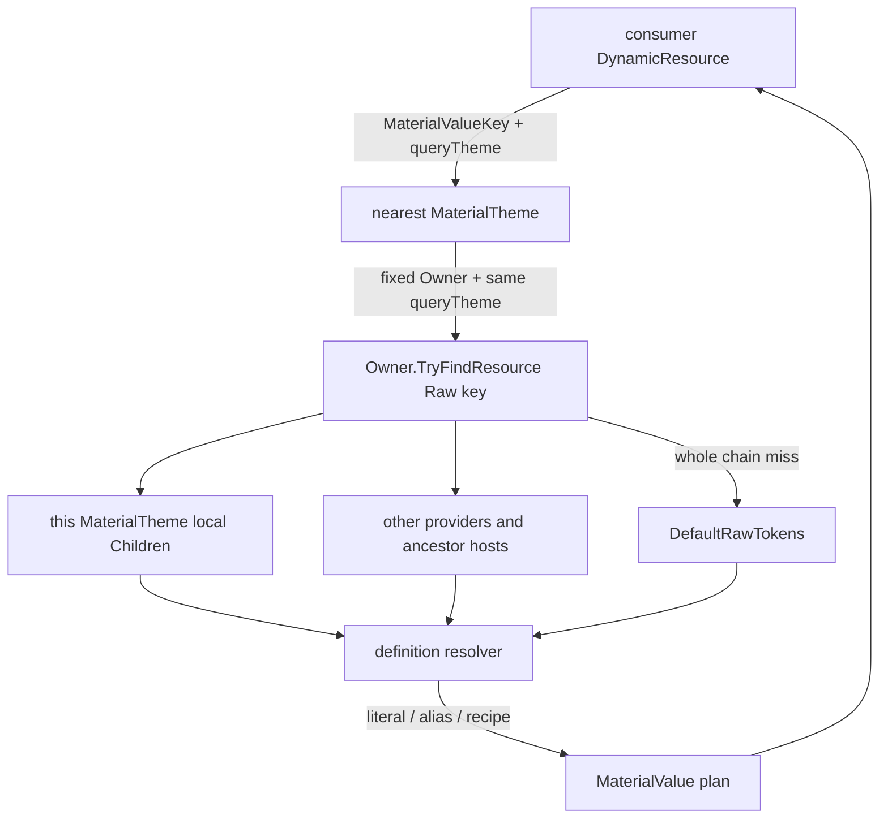
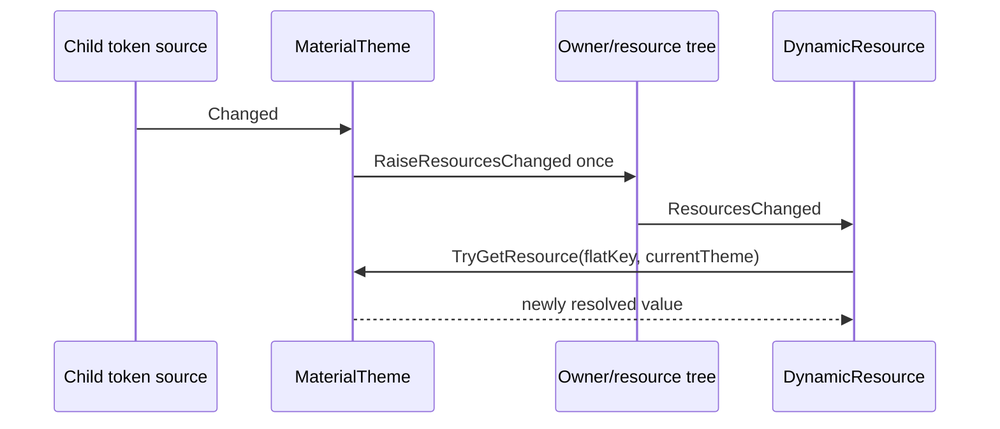

# MaterialTheme 与 Placement

> **文档状态：目标架构模块规格。** 本文规定新 `MaterialTheme` 作为 Avalonia `ResourceProvider` 时的
> placement、资源查找、ThemeVariant 与变化通知语义。示例 API 是约束性伪代码，不要求实现逐字一致。

## 1. 定位

`MaterialTheme` 是一个 placement-local 的 **boundary-relative flatten provider**。它承担两项职责：

1. 作为 Raw key provider，暴露其 `Children` 中声明的本地、稀疏 token definitions；
2. 作为 Flat key provider，从自己的 Owner 出发解析 Raw graph，返回 consumer-ready value。

它不是：

- 一份预先解析好的全主题 snapshot；
- requester-local resolver；
- 可被多个 scope 共享的 authoring object；
- variant、size、interaction state 或 geometry policy；
- Owner 资源事件的转发器；
- 持久 Raw/Flat cache。



## 2. Placement 与 Owner

### 2.1 必须放入 MergedDictionaries

`MaterialTheme` 是 `ResourceProvider`，必须作为 merged dictionary/provider 挂到明确的 resource host：

```xml
<Application.Resources>
    <ResourceDictionary>
        <ResourceDictionary.MergedDictionaries>
            <m3:MaterialTheme />
        </ResourceDictionary.MergedDictionaries>
    </ResourceDictionary>
</Application.Resources>
```

也可以由一个 scope API 完成同样的安装，但最终语义必须等价于一个真实 placement。不能把
`MaterialTheme` 作为普通 value 塞进 `Application.Resources`，也不能仅靠 inherited property 传播它。

### 2.2 单 Owner、单 placement

一个 MaterialTheme 实例只代表一个 placement：

- 同一时刻只能有一个 `Owner`；
- 不允许把同一个实例加入多个 `MergedDictionaries`；
- 不创建 forwarding provider/proxy 来伪装多 placement 共享；
- authoring 代码不应依赖 detach 后把同一实例移动到无关 host，移动主题应创建新实例。

Avalonia `ResourceProvider` 已阻止同时拥有多个 Owner。同一个 host 如果确实包含多个不同实例，其
provider 优先级仍由 Avalonia 的 merged dictionary 顺序决定；常规 authoring 应使用一个 placement 的
`Children` 完成组合，避免制造多重 Flat 边界。

热重载或宿主内部重建造成的正常 detach/reattach 可以由实现安全处理，但它不是“共享实例”的公共契约。

### 2.3 生命周期要求

实现必须满足：

```csharp
public override bool HasResources => true;

protected override void OnAddOwner(IResourceHost owner)
{
    base.OnAddOwner(owner);
    // 不从 owner 读取或构建主题快照；不订阅 owner 事件。
}

protected override void OnRemoveOwner(IResourceHost owner)
{
    // 清理由 placement 产生的短期状态（如有）。
    base.OnRemoveOwner(owner);
}
```

必须调用 base，因为 Avalonia 依赖它通知资源挂载/卸载。Owner 为空时，Raw 的本地 source 查询可以是纯
操作；Flat 求值没有合法解析边界，应抛出可诊断错误，不能猜测 Application 或全局 host。

## 3. Children：本地稀疏 Raw sources

`MaterialTheme.Children` 是 placement 内的 authoring composition。每个 child 提供按 Raw key 查询的
稀疏定义，并在内容变化时发出 `Changed`：

```csharp
interface IMaterialTokenSource
{
    bool TryGetRawToken(
        MaterialToken token,
        ThemeVariant? queryTheme,
        out object? definition);

    event EventHandler? Changed;
}
```

接口名称和签名可以调整，但语义不能退回“按当前主题枚举并预聚合整张表”。按 key 查询允许 source
自身实现 theme-aware lookup，也让 miss 保持稀疏。

### 3.1 Later child wins

Children 越靠后优先级越高。查询必须从后向前，在首次命中时停止：

```csharp
bool TryGetLocalRaw(
    MaterialToken token,
    ThemeVariant? queryTheme,
    out object? definition)
{
    for (var i = Children.Count - 1; i >= 0; --i)
    {
        if (Children[i].TryGetRawToken(token, queryTheme, out definition))
        {
            ValidateLocalDefinitionHit(Children[i], token, definition, queryTheme);
            return true;
        }
    }

    definition = null;
    return false;
}
```

不能倒序遍历后继续无条件赋值；那会让前面的 base source 最终覆盖后面的 override。

一个 child 内部按 `exact → InheritVariant → Default` 处理 query theme。Child precedence 高于更早 child
的 variant specificity：后置通用 override 的 Default 定义应当能够覆盖前置 base source 的 Dark 定义。

### 3.2 Miss、Clear 与非法命中

必须区分：

| 状态 | 含义 | 行为 |
|---|---|---|
| miss | child 没有该 key | 继续更早 child/资源链 |
| Clear | 删除本 child 的定义 | 对外表现为 miss |
| 命中合法 definition | 本层拥有该 key | 停止 source 查询 |
| 命中 null | 配置错误 | 抛错，不回退 |
| 命中错误类型 | 配置错误 | 抛错，不回退 |

因此 `null` 只能是 typed authoring facade 上“清除 override”的输入语法，不能进入资源系统成为一个
成功命中的 resolved definition 或 final value。

### 3.3 DefaultRawTokens 不属于 Children

`DefaultRawTokens` 是 generator 生成的、不可变共享 catalog。它在逻辑上由 resolver 内置，但不是隐式
插入每个 MaterialTheme.Children 的 base source。

下面的实现是错误的：

```csharp
// 错误：当前 placement 会用 baseline 截断祖先 override。
if (!TryGetLocalRaw(token, theme, out definition))
    return DefaultRawTokens.TryGetDefinition(token, theme, out definition);
```

反例：

```text
Root MaterialTheme.Children
    System.Primary = Red

Child MaterialTheme.Children
    （没有 System.Primary）
```

Child placement 解析 `System.Primary` 时必须能得到 Root 的 Red。如果 Child 在本地 miss 后立即返回默认
Blue，祖先 override 将永远不可见。

## 4. TryGetResource 的两条分支

概念实现如下：

```csharp
public override bool TryGetResource(
    object key,
    ThemeVariant? queryTheme,
    out object? value)
{
    switch (key)
    {
        case MaterialToken raw:
            // 只提供本 placement 的 Children。
            // 不查询 Owner，不查询 ancestors，不查询 DefaultRawTokens。
            return TryGetLocalRaw(raw, queryTheme, out value);

        case MaterialValueKey flat:
            // 已识别 Flat key 后，要么成功，要么抛出诊断异常。
            value = ResolveFlat(flat, RequireOwner(), queryTheme);
            return true;

        default:
            value = null;
            return false;
    }
}
```

Raw branch 只查询 Children 是避免自递归的关键。Flat resolver 调用 `Owner.TryFindResource(rawKey, ... )`
时，资源搜索会再次经过当前 MaterialTheme；这次 key 属于 Raw domain，MaterialTheme 只查本地 Children，
miss 后把控制权交回 Avalonia，让同一 host 的其他资源和 ancestors 继续查找。

### 4.1 Raw miss 不能在 MaterialTheme 内爬树

以下做法会递归或复制 Avalonia precedence，因此禁止：

```csharp
// 错误：Raw branch 不应再次从 Owner 发起同一个 Raw key 查询。
if (!TryGetLocalRaw(raw, theme, out value))
    return Owner.TryFindResource(raw, theme, out value);
```

Raw branch 返回 `false` 即可。外层正在执行的 Avalonia resource lookup 会自然继续。

### 4.2 已识别 Flat key 不能静默 miss

一旦当前 MaterialTheme 识别 `MaterialValueKey`，它就是该请求的解析边界。若 plan、Raw definition、类型、
层级或 cycle 非法，应抛出结构化 Material resolution exception，而不是返回 `false`：

```text
错误实现：当前 Flat 解析失败 → false → 祖先 MaterialTheme 返回另一个值
正确实现：当前 Flat 解析失败 → 带 key/theme/path 的异常
```

静默回退会绕过局部 boundary，隐藏配置错误，并让相同资源图因祖先是否存在而得到不同结果。

## 5. Flat 解析算法

第一版不建立持久 Flat cache。每次 `TryGetResource(MaterialValueKey, ...)` 创建一次短生命周期
resolution session：

```csharp
object ResolveFlat(
    MaterialValueKey key,
    IResourceHost placementOwner,
    ThemeVariant? queryTheme)
{
    var session = new MaterialResolutionSession(
        placementOwner,
        queryTheme);

    var result = key.Plan.Evaluate(session);
    return ValidateFinalValue(key, result); // non-null and exact/assignable type
}
```

Value plan 只能读取事先声明的 Raw dependencies。session 可在这一次 Flat 请求中 memoize 重复 Raw
dependency，但请求结束后即丢弃；MaterialTheme 不保存按 key、theme 或 generation 索引的结果。

持久 cache 不是第一版的隐藏实现选项。只有 benchmark 证明按需解析成为真实瓶颈后，才能另行设计至少
包含 Flat key、原始 query theme 与资源 generation 的 cache，并重新验证失效、内存与通知顺序；在此之前
不得以性能猜测改变本文的无状态语义。

Raw token 求值概念算法：

```csharp
object ResolveRaw(MaterialToken token)
{
    DetectCycleOrEnter(token);

    try
    {
        var definition = FindDefinition(token);
        ValidateDefinitionTypeAndLayer(token, definition);

        return definition switch
        {
            Literal literal => ValidateLiteral(token, literal.Value),
            Alias alias     => ResolveRaw(alias.Target),
            Recipe recipe   => EvaluateDeclaredRecipe(recipe),
            _               => throw UnsupportedDefinition(token)
        };
    }
    finally
    {
        Leave(token);
    }
}

object FindDefinition(MaterialToken token)
{
    if (placementOwner.TryFindResource(token, queryTheme, out var definition))
        return ValidateResourceHit(token, definition);

    if (DefaultRawTokens.TryGetDefinition(token, queryTheme, out definition))
        return ValidateDefault(token, definition);

    throw DefaultRawTokens.RequiresGeneratedDefinition(token)
        ? MissingGeneratedDefault(token)
        : MissingSourceRequiredToken(token);
}
```

每个 alias/recipe dependency 都重新执行 `FindDefinition`，但 `placementOwner` 与 `queryTheme` 始终是
session 构造时的原值。

## 6. ThemeVariant

### 6.1 请求参数是唯一权威

`TryGetResource` 收到的 `queryTheme` 来自 Avalonia 资源请求。MaterialTheme 必须原样透传，禁止以 Owner
状态覆盖它：

```csharp
// 错误
queryTheme ??= (Owner as StyledElement)?.ActualThemeVariant;

// 错误
if (queryTheme == ThemeVariant.Default)
    queryTheme = ThemeVariant.Light;
```

全局 Owner 可能是 Light，而某个 `ThemeVariantScope` 中的 requester 是 Dark；同一个全局 MaterialTheme
必须同时正确服务这两个请求。

### 6.2 每个 Raw hop 独立 fallback

对每个 theme-aware source 以及 `DefaultRawTokens` 中的单个 Raw key，查找顺序与 Avalonia
ThemeDictionary 对齐：

| query theme | 当前 key 的候选顺序 |
|---|---|
| `null` | Default |
| `Default` | Default |
| Light | Light → Default |
| Dark | Dark → Default |
| custom | custom → `InheritVariant` 链 → Default |

传给 provider/definition 的仍是原始 query theme。fallback 命中不会修改 session theme。

反例：

```text
HighContrastDark.InheritVariant = Dark

Component.Container 在 Dark 中命中 Alias(System.Primary)
System.Primary 在 HighContrastDark 中有 override
```

解析 alias 后必须再次用 HighContrastDark 查询 `System.Primary`，从而命中 override。如果第一跳后把
session theme 改为 Dark，结果就会错误。

## 7. 事件与失效

### 7.1 MaterialTheme 只广播自身变化

MaterialTheme 需要订阅：

- `Children` 的增、删、替换、重排；
- 已挂载 child 的 `Changed`。

这些变化发生时只调用一次：

```csharp
private void OnLocalDefinitionsChanged(object? sender, EventArgs e)
{
    RaiseResourcesChanged();
}
```

collection 变化时必须先对 old children 退订，再对 new children 订阅，并在 detach/dispose 路径中清理。
批量 authoring API 可以合并多次 local mutation 为一次广播，但不能遗漏最终通知。

### 7.2 不订阅 Owner

MaterialTheme 不订阅：

- `Owner.ResourcesChanged`；
- `Owner.ActualThemeVariantChanged`；
- descendants 的任何事件。

原因是 Avalonia `DynamicResource` 已经观察资源变化与目标的实际主题变化，并会重新发起查询。MaterialTheme
若监听 Owner.ResourcesChanged 后再次 `RaiseResourcesChanged()`，自己的 child 通知会经 Owner 同步传播
回来，造成重复通知甚至重入循环。

无持久 cache 后也不存在“Owner 变化时主动 Rebuild”的需要。

### 7.3 变化序列



主题变化不经过 MaterialTheme 的自定义事件链：

```text
requester ActualThemeVariantChanged
    → DynamicResource 重新查询
    → 同一 MaterialTheme 收到新的 queryTheme
    → 无状态求值
```

## 8. DefaultRawTokens 的终端语义

`DefaultRawTokens` 必须是完整、不可变、可共享的 generated graph，并允许同一个 Raw key 拥有
variant-specific baseline definition。它的查找点只有一个：

```text
placementOwner.TryFindResource(rawKey, queryTheme) == false
    → DefaultRawTokens.TryGetDefinition(rawKey, queryTheme)
```

catalog 对该 key 使用相同的 `exact → InheritVariant 链 → Default` 规则；resolver 仍传入 session 保存的
原始 query theme，而不是某个上游 hop 已经 fallback 后的 variant。

其结果仍然可能是 alias 或 recipe，而不是已拍平 literal。下一跳再次先查 Owner 资源链，因而默认 alias
能够被 scope 中的下游 token override 重新绑定：

```text
Default Component.Container
    → Alias(System.Primary)

Owner resource chain
    System.Primary = Red

结果
    Component.Container = Red
```

如果 `DefaultRawTokens` 对一个受支持的 Raw key 也 miss，这是 generator/catalog 完整性错误。不得返回
透明色、0、空字符串或其他哨兵值掩盖问题。对于没有 generated baseline 的动态/custom key，catalog
的独立 membership metadata 必须把它分类为 source-required missing；resolver 不能把两类缺失混成同一
异常，也不能靠 `Path` 字符串猜测。

## 9. 边界相对语义

### 9.1 为什么不是 requester-relative

Flat 请求是从控件发出的，但 MaterialTheme 无需、也不应知道 requester。Avalonia 只把 key 与 theme
传给 `IResourceProvider.TryGetResource`，没有把最初 requester 作为解析上下文交给 provider。

因此解析起点只能是稳定的 placement Owner。这样可获得：

- 纯粹的 ResourceProvider 契约；
- 不捕获控件的 plan/recipe；
- placement 级清晰隔离；
- 后续如果加入 cache，也有稳定的边界 identity；
- 测试可以直接构造 host tree 验证。

代价是控件与最近 MaterialTheme 之间的 Raw override 不可见。局部 token 定制必须把 override 与新的
MaterialTheme placement 放在同一个或更外层、且对该 placement Owner 可见的 scope。

### 9.2 正确与错误 placement

```text
错误：
Root [MaterialTheme]
  Panel [Raw override]
    Button [Flat request]

正确：
Root [MaterialTheme]
  Panel [Raw override + MaterialTheme]
    Button [Flat request]
```

详细 XAML authoring 约定见 [Authoring 与 XAML](authoring-and-xaml.md)。

## 10. 错误边界

MaterialTheme 必须把“没有这个资源”和“这个 Material value 配置错误”分开：

| 情况 | `TryGetResource` 结果 |
|---|---|
| key 既非 Raw 也非 Flat | `false` |
| Raw key 未在本地 Children 定义 | `false`，交还 Avalonia cascade |
| Raw key 本地命中合法 definition | `true` |
| Flat key 成功解析 | `true` |
| Flat key 的 Raw 链最终缺失 | throw |
| 命中 null/错误类型 | throw |
| alias/recipe 层级非法 | throw |
| cycle 或未声明 dependency | throw |
| Flat plan 返回 null/错误类型 | throw |

异常至少携带：Flat key path、query theme、placement/Owner 描述、当前 Raw token、完整 dependency path 与
实际值类型。详细诊断要求见 [诊断与测试](diagnostics-and-testing.md)。

## 11. 不变量清单

实现评审时应逐项确认：

1. 一个实例只有一个 placement，不存在共享 proxy。
2. `HasResources` 为 true；Owner attach/detach 调用 base。
3. Raw 与 Flat 使用不同 key domain。
4. Raw branch 只查本地 Children，miss 时返回 false。
5. Children 后置优先，首次命中即停止。
6. Flat branch 固定 placement Owner 与原始 query theme。
7. 每个 Raw hop 都从相同 Owner 重新查找。
8. 每个 hop 独立执行 exact → inherit → default。
9. Owner 整条资源链 miss 后才使用 `DefaultRawTokens`。
10. 已识别 Flat key 的错误不会退到祖先 Flat provider。
11. final value 非 null 且类型符合 key 契约。
12. 不保留跨请求 Raw/Flat cache。
13. MaterialTheme 不订阅 Owner 资源或主题事件。
14. Children 变化只产生一次有效资源广播，并正确退订旧 child。

这些规则是第一版 vertical slice 的验收条件，而不是可推迟的性能优化项。
