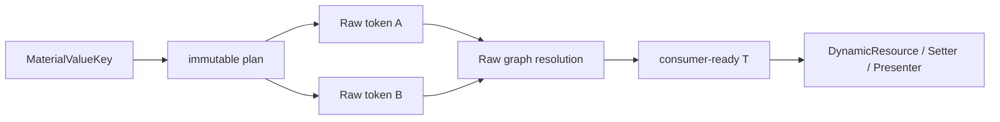

# Material Value 与 Flat Schema

> **状态：Foundation runtime 已实现，组件 schema 迁移中。** 本文定义 Raw token graph 与 Avalonia
> 消费端之间的 Flat schema。
> API 片段用于冻结语义，不代表当前仓库已经提供相应类型。Raw definition 与 fallback 规则见
> [Raw Token 模型](raw-token-model.md)，完整数据流见[架构总览](architecture-overview.md)。

## 1. 核心决策

`MaterialValueKey<T>` 是一个显式声明的、consumer-ready 的稳定资源 key：

```text
MaterialValueKey<T>
    = 稳定消费身份
    + consumer-ready 输出类型 T
    + internal immutable resolution plan
```

它不是 Raw token 的另一个名字，也不是所有 Component token 的机械镜像。只有真实消费槽需要
Material Value key；一个 plan 可以直接读取一个 Raw token，也可以纯粹地组合多个 Raw token。



“consumer-ready”比“必须是 Avalonia primitive”更准确：普通属性可以直接接收 `IBrush`、`Thickness`
或 `double`；确实由 Presenter 原子消费的 `MaterialShape`、typography role/profile 也可以是合理输出。
Material Value 不应把依赖 Bounds、RTL 或动画进度的工作提前求值。

## 2. 为什么不与 Component Raw 一一对应

真实组件存在多种映射：

| Raw 与消费槽的关系 | 示例 |
|---|---|
| 1 Raw → 1 Value | container height `double` → `double` |
| 多 Raw → 1 Value | disabled color + opacity → `IBrush` |
| 多 Raw → 复合 Value | leading/top/trailing/bottom space → `Thickness` |
| 1 Raw → 多个 Value | 同一颜色服务于不同、可独立演进的消费槽 |
| Raw role → 晚期对象 | shape role → Presenter 根据 Bounds/RTL 构造 geometry |

如果为每个 Component Raw 自动生成同名 Flat key：

- 控件仍需在 Setter/Adapter 中重复平台投影；
- 无法表达多 Raw 原子组合；
- Raw schema 的调整会无意义地扩大公开资源 API；
- 当前碰巧相同的消费槽会被错误地绑定为一个长期兼容性契约。

因此 Flat schema 的单位是**稳定消费槽**，不是 Raw token 行，也不是当前某个临时 defaults record。

## 3. Key descriptor

概念 API 如下：

```csharp
public abstract class MaterialValueKey
{
    public string Path { get; }
    public Type ValueType { get; }

    internal IMaterialValuePlan Plan { get; }
}

public sealed class MaterialValueKey<T> : MaterialValueKey
{
    internal MaterialValueKey(
        string path,
        IMaterialValuePlan<T> plan);
}
```

key 必须满足：

1. 由组件 catalog 暴露为 `public static readonly` singleton；
2. 使用对象引用作为资源 identity，不重写基于 `Path` 的值相等；
3. `Path` 仅用于诊断、调试和工具输出；
4. `Path` 与 `T` 是公开兼容性契约；
5. plan 是 internal、不可变的实现细节，可以在不改变消费语义时演进；
6. plan 的输出必须非 `null` 且可赋给声明的 `T`。

不保留中央 `FlatToken enum`，也不生成一个全局 `FlatToken → RawToken` 大映射。各组件 catalog 可以
独立增加 value key；新增组件不需要修改全局 enum 或 dispatch switch。v1 是否向应用作者开放自定义
value key factory 是单独的 API 决策，不能靠公开任意 `Func` 或 public constructor 绕过 plan 约束。

## 4. 第一版 plan 模型

第一版只支持两类 plan：

```text
DirectRaw<T>
    一个 MaterialToken<T> → T

RawRecipe<T>
    一组预先声明的 typed Raw dependencies → T
```

概念接口：

```csharp
internal interface IMaterialValuePlan<out T>
{
    IReadOnlyList<MaterialToken> Dependencies { get; }
    T Evaluate(MaterialValueContext context);
}

internal sealed class MaterialValueContext
{
    public T Get<T>(MaterialToken<T> token);
}
```

Direct plan 仍可在内部走同一执行器，只是 dependencies 恰好有一个且结果原样返回。

禁止公开以下形态：

```csharp
// 不属于目标 API
new MaterialValueKey<T>(context => arbitraryCode());
```

任意 `Func` 可以捕获可变对象、读取未声明资源或访问环境，导致依赖无法检查、错误难以定位，未来也
无法安全判断缓存边界。公开或 generated factory 应只提供有限的标准 operator；特殊手写 recipe 也
必须通过 internal、显式 dependency contract 接入。

## 5. Plan 不变量

所有 plan 必须遵守：

- dependencies 在构造 key 时完整声明；
- 只允许 Raw dependency，第一版禁止 Flat → Flat；
- `context.Get` 只能读取已声明 dependency；
- 所有 dependency 从同一个 `MaterialTheme` placement Owner 查找；
- 所有 dependency 原样使用同一个资源请求 theme；
- 不读取 requester、Owner 属性、Bounds、FlowDirection、服务、时钟或随机状态；
- 相同 Raw 输入产生相同结果；
- 输出非 `null`，类型与 `MaterialValueKey<T>` 的 `T` 一致。

禁止 Flat → Flat 可以让依赖图保持单向：

```text
consumer → Material Value → Raw graph
```

这避免第二套可循环 alias graph，也让 override、诊断与未来优化只需要理解一个 Raw resolution
session。若两个 Value 需要相同计算，应共享 internal operator/recipe 实现，而不是互相引用 key。

## 6. 解析流程与缓存

控件通过标准 Avalonia `DynamicResource` 请求 `MaterialValueKey<T>`。最近的 `MaterialTheme`
placement 识别该 key，执行其 plan：

```text
DynamicResource(MaterialValueKey<T>, requestTheme)
    → nearest MaterialTheme placement
    → create one resolution session
    → resolve every declared Raw dependency from placement.Owner
    → full Raw tree miss 时调用 DefaultRawTokens.TryGetDefinition(raw, requestTheme)
    → evaluate plan
    → validate non-null T
    → return T
```

一次 Value 请求内，Raw resolver 会 memoize 重复 dependency 和公共子图；请求结束即丢弃 session。
第一版不做跨资源变化、跨 theme 或跨 Value 请求的持久 Flat cache。`DynamicResource` 自身负责在资源
或 theme 变化后重新查询；`MaterialTheme` 无需维护一份容易失效的 Flat snapshot。

DefaultRawTokens 对每个 Raw key 按 `exact → InheritVariant chain → Default` 选择 baseline definition；
某个 key 从 inherited/default 命中不会改变 session 的原始 `requestTheme`。plan 的其他 dependency，
以及 alias/recipe 的后续 hop，都仍以原始 theme 重新开始各自的完整 Raw 查找。

解析失败对于已被当前 placement 识别的 Value key 是错误，不能返回 miss 让 Avalonia 悄悄改用祖先
Flat provider。异常至少应包含 value path、Raw dependency path、请求 theme、placement 和底层 token
解析路径。

## 7. 标准投影

### 7.1 Direct Raw

Raw 类型已经可供 consumer 使用时，直接返回：

```csharp
public static readonly MaterialValueKey<double> SmallContainerHeight =
    MaterialValue.FromRaw(
        "Value.Button.Small.ContainerHeight",
        ButtonSmallTokensKeys.ContainerHeight);
```

Direct 不意味着必须为每个 Raw token 生成 key；只有某个稳定消费槽需要它时才声明。

### 7.2 Color 与 Brush

对 Brush 属性应显式输出 `IBrush` 或约定的 immutable brush 类型，不依赖 Avalonia 恰好存在的
`Color → IBrush` DynamicResource 转换特例：

```csharp
public static readonly MaterialValueKey<IBrush> FilledContainerBrush =
    MaterialValue.SolidBrush(
        "Value.Button.Filled.ContainerBrush",
        FilledButtonTokensKeys.ContainerColor);
```

需要 `Color` 的 consumer 可以另有 `MaterialValueKey<Color>`。同一个 Raw color 服务两个不同类型的
消费槽并不要求共享 Flat identity。

### 7.3 Color + Opacity

disabled/state-layer 等值通常由多个 Raw token 构成：

```csharp
public static readonly MaterialValueKey<IBrush> FilledDisabledContainerBrush =
    MaterialValue.SolidBrush(
        "Value.Button.Filled.DisabledContainerBrush",
        FilledButtonTokensKeys.DisabledContainerColor,
        FilledButtonTokensKeys.DisabledContainerOpacity);
```

operator 应明确 alpha 的组合与 clamp 规则，并保持输入 token 可分别 override。输出是一次查询中的
immutable consumer value，而不是修改共享 brush。

### 7.4 Thickness

`double` 不会自动转换为 `Thickness`，多边距也往往来自多个 token：

```csharp
public static readonly MaterialValueKey<Thickness> SmallContentPadding =
    MaterialValue.Thickness(
        "Value.Button.Small.ContentPadding",
        left: ButtonSmallTokensKeys.LeadingSpace,
        top: ButtonSmallTokensKeys.TopSpace,
        right: ButtonSmallTokensKeys.TrailingSpace,
        bottom: ButtonSmallTokensKeys.BottomSpace);
```

常量与 Raw dependency 的混合必须由受控 operator 明确表达，而不是隐藏在任意 delegate 中。

### 7.5 Shape

如果形状确实是固定半径，Value 可以输出 `CornerRadius`。如果最终 geometry 依赖 Bounds、RTL、交互
状态或动画，Value 应输出 `ShapeRole`、`MaterialShape` 或不可变 shape profile，由 Presenter 晚期
求值：

```text
Raw ShapeRole
    → MaterialValueKey<MaterialShape>
    → Presenter(Bounds, FlowDirection, animation progress)
    → geometry
```

Material Value plan 不能读取这些控件实例状态。

### 7.6 Typography

Typography 可以按真实消费方式选择：

- Setter 分别消费 `FontSize`、`FontFamily`、`FontWeight` 时，使用 leaf keys；
- 一个 semantic typography property 原子接收 role/profile 时，使用 immutable composite key。

不能为了适配当前某个临时 adapter，永久固化一个过宽的 typography snapshot。输出 profile 时，其
所有 Raw dependencies 仍须显式列出。

## 8. Variant、Size 与 State 边界

Material Value resolver 不知道发起请求的是哪个控件，因此不得读取：

- `ButtonVariant`、`ButtonSize`；
- `IsEnabled`、`IsChecked`、pressed/hover/focus pseudo-class；
- Bounds、FlowDirection、动画进度。

这些轴由 ControlTheme selector、组件 policy 或 Presenter 选择**不同的显式 Value key**：

```text
Filled.ContainerBrush
Filled.DisabledContainerBrush
Tonal.ContainerBrush
Small.ContentPadding
Large.ContentPadding
```

不定义一个会查看 requester 并自行猜测 variant/state 的 `ButtonBackground` key。也不机械生成完整的
`Variant × Size × State` 笛卡尔积：只有真正受某个轴影响的消费槽才声明对应 key。

`ThemeVariant` 是例外，因为它已经是 Avalonia 资源查询参数；plan 不读取控件属性，而是让所有 Raw
dependency 原样使用该查询参数。详细规则见 [MaterialTheme 与资源边界](material-theme.md)。

## 9. Leaf 与 Profile 粒度

选择粒度时依次应用以下规则：

1. 普通 Setter 可以独立消费、独立覆盖时，优先 leaf key；
2. 多个字段必须原子更新，并且确有一个属性或 Presenter 接收该 immutable profile 时，允许 profile key；
3. 不因当前 Adapter 使用某个 transport record，就把该 record 固化为 Flat API；
4. 两个消费槽即使当前读取同一个 Raw token，只要语义上可能独立演进，也应使用不同 key；
5. key 数量由真实 ControlTheme/Presenter consumption 驱动，而不是 Raw table 行数驱动。

一个简单判断是：删除现有 adapter 后，这个 key 是否仍对应一个清晰、稳定的接收位置。如果答案
是否定的，它通常不应成为公开 Material Value。

## 10. XAML 消费与 presentation escape hatch

典型消费使用 key singleton：

```xml
<Setter Property="Background"
        Value="{DynamicResource {x:Static tokens:ButtonValueKeys.FilledContainerBrush}}" />
```

完整 placement 与 authoring 示例见 [Authoring 与 XAML](authoring-and-xaml.md)。

应用也可以在普通 Avalonia `ResourceDictionary` 中直接以同一个 `MaterialValueKey<T>` 提供最终值。
若该资源位于 consumer 与最近 `MaterialTheme` 之间，Avalonia 会先命中它：

```xml
<SolidColorBrush
    x:Key="{x:Static tokens:ButtonValueKeys.FilledContainerBrush}"
    Color="#FFFF00FF" />
```

这是 presentation-level escape hatch，适合最终视觉值的局部替换。它有意绕过 Raw graph、alias
重绑定和 plan 投影，不是 Material token customization 的首选 API。需要保持 Material 语义、theme
适配或多消费槽一致性时，应覆盖 Raw token，而不是 Flat value。

作者应为直接 Flat override 提供与 `T` 兼容的非 `null` 值。它遵循普通 Avalonia 资源优先级和变化
通知，不会被写回 Raw graph。由于普通 `ResourceDictionary` 会在 `MaterialTheme` 之前返回该资源，
`MaterialTheme` 无法验证它，也无法为错误值补充 Raw dependency path；`null` 可能被
`DynamicResource` 当成 unset，某些不同类型还可能被目标属性转换接受，因此 v1 **不保证**产生类型
诊断。唯一可保证的是这次资源命中不会因值不符合 key 契约而重新落到祖先 Flat provider。若需要
Material resolver 的非空/类型检查与结构化诊断，应使用 Raw override，让 value plan 仍由
`MaterialTheme` 执行；若要对 escape hatch 强制检查，则需要另行设计 analyzer 或 typed authoring helper。

## 11. 声明与生成策略

第一阶段在组件旁用 C# 手写少量 `XxxValueKeys`，至少通过 Button 纵向切片验证：

- Direct Raw；
- Color → Brush；
- Color + Opacity → Brush；
- 多尺寸 → Thickness；
- Shape 的早期/晚期边界；
- Typography leaf/profile 粒度。

不要立即把 Flat schema 塞回现有 `.comp.jsonc`。Raw JSON 描述上游 token facts，而 Value schema 描述
Avalonia 消费契约，两者生命周期不同。标准 operator 与命名稳定后，可以引入独立的
`*.values.jsonc` manifest；该格式只能选择有限、可验证的 operator，不接受任意 C# expression。

generator 的职责边界见 [Generator](generator.md)。迁移顺序见[迁移计划](migration-plan.md)。

## 12. 规范性不变量

1. `MaterialValueKey<T>` 表示稳定消费槽，输出 consumer-ready `T`；
2. key 是静态 singleton，以引用为资源 identity，`Path` 用于诊断；
3. 不为全部 Component Raw 自动生成一一对应 Value key；
4. v1 plan 仅允许 Direct Raw 或声明式纯 multi-Raw recipe；
5. 不公开任意 `Func` projector；
6. dependencies 只能是 Raw token，禁止 Flat → Flat；
7. plan 的所有读取使用同一个 placement Owner 和原始 request theme；
8. plan 不访问 requester、Bounds、FlowDirection、服务或时间；
9. Material Value plan 的输出必须非 `null`，resolver 错误不能通过退回祖先 Flat provider 隐藏；
10. v1 仅做单次 session memoization，不做持久 Flat cache；
11. Variant、Size、state selection 留在 ControlTheme/组件 policy/Presenter；
12. 普通 Flat resource override 是 presentation escape hatch，不参与 Raw graph。
