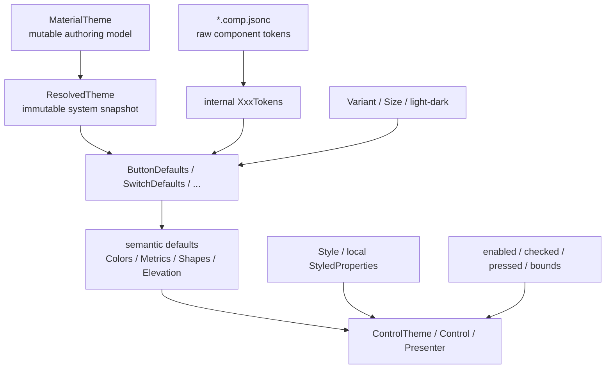

# 新 Theme/Token 架构设计

> 本文记录的是当前主题/token 架构的职责边界。所有既有 component-default consumers 的
> defaults 已迁移到各自的 C# owner；`.default.jsonc`、component snapshot 与通用 component
> override bag 均不再存在。

可以归纳为四个核心层次：



## 1. MaterialTheme：主题创作层

`MaterialTheme` 是用户可以修改和绑定的 authoring model，包含：

```text
ColorScheme
TypographyScheme
ShapeScheme
MotionScheme
RippleTheme
```

不包含：

```text
Components
ComponentTokenOverrides
ButtonColorOverrides
ButtonSizeOverrides
```

当前主题作用域仍采用 nearest whole-theme wins。逐 subsystem 继承和 partial overlay 已推迟到未来，不影响这次 component token 重构。

## 2. ResolvedTheme：系统主题运行时快照

`ResolvedTheme` 是从 `MaterialTheme` 构建的 immutable system snapshot，包含：

```text
ResolvedColorScheme
ResolvedTypographyScheme
ResolvedShapeScheme
ResolvedMotionScheme
ResolvedRippleThemeConfiguration
```

它表示：

> 当前主题作用域中的 system semantics 最终是什么。

它不包含：

- raw system token 副本；
- component tokens；
- component defaults；
- component overrides；
- Button Variant/Size；
- light/dark 当前选择；
- enabled、pressed、checked；
- bounds、RTL、pointer 类型；
- `ResolvedTheme.Components`。

`isDark` 由控件所在运行时环境提供，同一个 `ResolvedTheme` 可以同时服务 light 和 dark 消费者。

第一版不必引入 component cache。如果之后性能测试证明有必要，可以增加完全私有的 snapshot-scoped memoization，但它不属于 `ResolvedTheme` 的语义模型。

## 3. `.comp.jsonc`：上游 raw token 层

`.comp.jsonc` 继续保存 AndroidX/Material 生成的原始 component token facts，例如：

```text
ButtonLargeTokens
FilledButtonTokens
OutlinedButtonTokens
SwitchTokens
```

generator 只为 `.comp.jsonc` 生成 internal raw token 类型：

```text
comp.jsonc
    → internal ButtonLargeTokens
```

它不自动生成：

```text
ResolvedButtonLargeTokens
ButtonLargeTokensOverrides
```

raw token 的责任是忠实记录：

- upstream value；
- source/version；
- system role reference；
- dimension、opacity、elevation 等静态值。

它不是公共组件定制 API。

`FilledButtonTokens`、`ButtonLargeTokens` 等 raw tables 仍由 generator 生成；
`ButtonDefaults` / `ToggleButtonDefaults` 与其他组件的 Defaults 在 C# 中完成
variant/size/state 映射。不会生成 `ResolvedButtonLargeTokens`、
`ButtonLargeTokensOverrides` 或任何 component override bag。

## 4. Component Defaults：组件策略层

每个组件拥有自己的 Defaults：

```text
ButtonDefaults
ToggleButtonDefaults
SwitchDefaults
SliderDefaults
```

它负责：

- 根据 Variant 选择 raw token table；
- 根据 Size 选择 metrics；
- 通过 `ResolvedTheme` 解析 system color、shape、typography、motion；
- 实现 Compose Defaults 中的 corrections；
- 实现 Avalonia platform adaptation；
- 输出组件真正需要的 semantic records。

例如：

```csharp
ButtonDefaults.Colors(theme, variant, isDark);
ButtonDefaults.Metrics(size);
ButtonDefaults.Shapes(size);
ButtonDefaults.Elevation(variant);
ButtonDefaults.ShapeMotion(theme);
```

不会生成一个包含所有 axis 的巨大 snapshot：

```text
variant × size × state × light/dark × bounds
```

而是按真实依赖分别解析：

| 输出 | 依赖 |
|---|---|
| `ButtonColors` | theme + variant + light/dark |
| `ButtonMetrics` | size |
| `ButtonShapes` | size（输出 `ShapeRole`；presenter 再由 theme 解析 geometry） |
| `ButtonElevation` | variant |
| 当前 elevation | profile + enabled + interaction |
| 当前 corner radius | shape + pressed/square + bounds |

`ButtonDefaults` 本身保持纯粹和无状态：

- 不订阅主题；
- 不持有 Control；
- 不监听 interaction；
- 不修改 StyledProperty；
- 不负责生命周期。

## 5. 控件和 presenter：运行时状态层

Control、template 和 presenter 负责晚期状态选择：

```text
theme / variant / size 改变
    → 重新取得 semantic defaults

enabled / checked / pressed 改变
    → 从已有 semantic profile 中选择当前值

bounds / RTL 改变
    → 解析最终 geometry
```

例如 presenter 保存 `ButtonElevation` 和 `ButtonShapes`，interaction 改变时只选择当前 elevation/shape，而不重新解析整个主题。

## 6. 公共定制能力：Avalonia 原生机制优先

公共定制入口分为：

| 需求 | 入口 |
|---|---|
| 全局品牌系统 | `MaterialTheme` schemes |
| 某个子树的组件外观 | scoped `Style` / `ControlTheme` |
| 单个控件 | local StyledProperties |
| enabled/disabled/checked 状态 | pseudo-class Style |
| presenter 内部的复杂状态合同 | component-specific semantic property/profile |
| 完全改变结构 | 自定义 template / `ControlTheme` |

不提供统一的 generic token override bag。

普通视觉值优先使用现有 Avalonia 属性：

```text
Background
Foreground
BorderBrush
BorderThickness
Padding
MinHeight
Typography properties
```

只有普通 Style 无法触达的能力，才增加组件特定的 semantic API，例如：

```text
ButtonElevation
ButtonShapes
StateLayerBrush
SwitchColors
SliderColors
```

这些 API 由组件需求决定，而不是 generator 根据 raw token schema 自动生成。

预期优先级是：

```text
local value
    > app Style / ControlTheme
    > library Material ControlTheme
    > component Defaults
    > raw component tokens + ResolvedTheme
```

## 7. `.default.jsonc` 已删除

架构删除了 `componentDefaults` 这一生成层，并将其内容迁移到组件 Defaults C#。

但其中的价值必须保留：

- Compose correction；
- AndroidX source/version；
- variant/size mapping；
- Avalonia adaptation；
- intentional deviation；
- 对应测试。

也就是：

> 删除 defaults token artifact，不是删除 default policy；default policy 转由组件 owner 负责。
>

每个组件的 Defaults 都是 component-owned policy。ToggleButton 的 checked/unchecked color
contract 仍是独立的 C# semantic record；这不是由 JSON schema 或通用 overrides 机制推导出来的。
