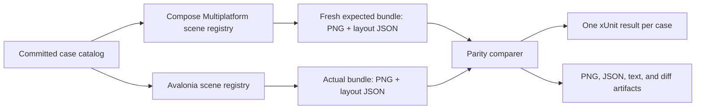

# Visual parity testing plan

Status: initial harness implemented. This document is the design and migration record; use
[visual-parity.md](visual-parity.md) for the current commands, artifacts, and contributor workflow.

The pinned Compose Multiplatform artifact is the executable parity reference, not the newer
AndroidX implementation source baseline. Their separate responsibilities are defined in
[upstream-baselines.md](upstream-baselines.md).

This document defines the replacement for the existing visual testing system. The official
Compose Multiplatform Material 3 implementation is the sole executable reference. Avalonia is
always the implementation under test.

The system is intentionally a parity harness, not a general screenshot-regression framework.
There are no approved Avalonia baselines, no candidate-recording workflow, and no mechanism that
can promote an Avalonia rendering to the expected result.

## 1. Decisions

The following decisions are part of the test contract:

- Generate a new Compose expected result at the beginning of every parity run.
- Do not commit generated Compose PNGs or Avalonia PNGs as long-lived baselines.
- Do not perform Avalonia-against-Avalonia regression testing in this system.
- Use a Compose Multiplatform Desktop/JVM producer instead of an Android emulator.
- Pin every Compose and Material 3 dependency to an exact version.
- Initially target `org.jetbrains.compose.material3:material3:1.12.0-alpha03`, whose Material 3
  implementation corresponds to Jetpack Compose Material 3 `1.5.0-alpha22`.
- Pin the compatible Compose Multiplatform plugin/runtime version as well; the initial target is
  `1.12.0-beta02`.
- Render both implementations at a scale factor of `2.0`: one logical dp/DIP is two physical
  pixels. This is equivalent to 320 dpi on the Compose side and 192 dpi on the Avalonia side.
- Keep `fontScale` at `1.0`.
- Capture both a PNG and machine-readable layout data for every case.
- Capture text line metrics, baselines, and an advance/layout bounding box for every UTF-16 text
  position when the underlying control exposes them.
- Compare named nodes directly. Do not infer container, icon, or text geometry from screenshots
  when the frameworks can report it.
- Do not automatically translate, resize, crop-to-content, or otherwise align the two images
  before comparison. A positional difference is a parity difference.
- During early development, parity failures are diagnostic and the CI job may be non-required.
  The test result itself must still report a mismatch as a failure.
- Before final delivery, the same parity job becomes required and all cases must satisfy the
  checked-in comparison contract.

The version pin is deliberately replaceable. Updating to a later Compose Multiplatform Material 3
artifact is a normal, explicit dependency update, but a single parity run never mixes reference
versions.

## 2. Goals and non-goals

### Goals

The harness must:

1. Answer whether a particular Avalonia component rendering agrees with the official Compose
   implementation for the same inputs.
2. Explain a failure in terms of structure, geometry, text layout, or raster output instead of
   returning only a whole-image score.
3. Reproduce the same scene contract on both sides: content, state, theme, viewport, density,
   locale, direction, font, and time.
4. Make upstream Material 3 version changes visible and auditable.
5. Be simple enough that adding a component case normally requires one Compose scene, one
   Avalonia scene, and one shared case entry.

### Non-goals

The first implementation will not provide:

- Avalonia self-regression or snapshot approval;
- a generic cross-platform UI description language;
- automatic image registration or best-fit alignment;
- a full matrix of operating systems and densities;
- glyph-outline or glyph-ID comparison;
- exhaustive video/per-display-frame motion comparison;
- arbitrary screenshots of application windows;
- a committed library of generated expected images.

Static states remain the broad coverage priority. Deterministic motion is represented by a small
set of source-authored checkpoints with an exact shared timeline, not by recording a live video.

### Complexity guardrails

The first implementation has only four runtime operations:

1. generate Compose expected output;
2. capture Avalonia actual output;
3. compare the two bundles;
4. write test and report artifacts.

There is no import step, reference store, approval state, candidate state, database, service, or
baseline-management CLI. A new abstraction should be added only when at least two real cases need
it. Phase 1 deliberately implements one complete vertical slice before any catalog-wide migration.

## 3. System model

The committed test inputs are the case catalog, the two scene registries, the environment
contract, the font, and the comparison profiles. The images and measured layouts are run
artifacts.



The word **expected** means “generated by the pinned Compose implementation for this run.” It does
not mean a reviewed or approved screenshot stored in the repository.

The complete end-to-end parity check is a cross-process conformance test. The serializers,
framework adapters, comparison algorithms, and report model are ordinary unit-testable code.

## 4. Proposed repository structure

The existing test projects may be repurposed during the migration; a new project is not required
for every directory shown below.

```text
tests/
  VisualParity/
    cases.json
    comparison-profiles.json
    schema/
      case-catalog.schema.json
      capture-result.schema.json

  ComposeReference/
    build.gradle.kts
    src/desktopMain/kotlin/
      Main.kt
      cases/
      capture/
      probes/

  Material3Expressive.VisualTesting/
    Contracts/
    Avalonia/
    Comparison/
    Reporting/

  Material3Expressive.VisualTests/
    Unit/
    Parity/

tools/
  visual-parity/
    run.ps1
```

Responsibilities are intentionally narrow:

- `VisualParity` contains neutral data contracts, not UI construction instructions.
- `ComposeReference` is a command-line expected-result producer.
- `Material3Expressive.VisualTesting` captures Avalonia and compares two result bundles.
- `Material3Expressive.VisualTests/Unit` tests the harness without starting Compose.
- `Material3Expressive.VisualTests/Parity` exposes one xUnit case per conformance scene.
- `tools/visual-parity/run.ps1` is the authoritative end-to-end entry point.

## 5. Case catalog and scene identity

The shared catalog describes only facts that must be identical on both sides. It must not become a
generic UI DSL. Compose code and Avalonia code remain independent implementations of the same
case.

An illustrative catalog entry is:

```json
{
  "id": "button/filled/medium/enabled/light",
  "scene": "filled-medium-button",
  "theme": "light",
  "viewportDp": {
    "width": 240,
    "height": 96
  },
  "locale": "en-US",
  "layoutDirection": "ltr",
  "content": "Label",
  "state": {
    "enabled": true
  },
  "requiredNodes": [
    {
      "id": "component",
      "kind": "container"
    },
    {
      "id": "label",
      "kind": "text"
    }
  ],
  "comparisonProfile": "component-with-text"
}
```

The catalog may contain primitive, serializable inputs such as a selected index, text value,
enabled state, size name, or theme name. It must not describe framework-specific controls,
modifiers, templates, styles, or layout panels.

Each side maintains a registry from the stable case ID or scene key to its own scene builder:

```text
case ID -> Compose @Composable scene
case ID -> Avalonia Control scene
```

Contract validation must fail before capture when:

- the catalog contains a duplicate ID;
- either registry is missing a requested case;
- either registry contains an undeclared case;
- a required node ID is duplicated or absent;
- the viewport or environment is unsupported;
- a case requests an unknown comparison profile.

A case should normally render one component in one state. Small token boards are acceptable, but
large component galleries are discouraged because they dilute image metrics and make failures
harder to locate.

## 6. Canonical environment

The initial environment contract is:

| Property | Value |
|---|---|
| Logical scale | `2.0` |
| Compose density | `Density(2.0f, 1.0f)`; 320 dpi equivalent |
| Avalonia render scaling | `2.0`; 192 dpi equivalent |
| Pixel relation | `1 dp = 1 DIP = 2 physical px` |
| Font scale | `1.0` |
| Locale | `en-US` |
| Layout direction | `LTR` |
| Color space | sRGB |
| Background | Explicit, opaque case background |
| Font | Repository-pinned Roboto file |
| Execution | Headless/offscreen, canonical Windows x64 environment |

Higher density does not remove renderer differences, but it gives the comparison twice the
spatial resolution and reduces the effect of rounding a logical coordinate to a single output
pixel. Both sides must render natively at 2×; neither image is rendered at 1× and then upscaled.

The expected manifest records at least:

- case-catalog hash;
- Compose Multiplatform plugin/runtime version;
- every resolved `org.jetbrains.compose.material3:material3*` version;
- the documented Jetpack Material 3 lineage;
- Kotlin and JDK versions;
- Skiko/Skia version;
- OS and architecture;
- density and font scale;
- locale and layout direction;
- viewport in logical units and physical pixels;
- font filename and SHA-256;
- theme/color-contract identifier and SHA-256;
- capture schema version;
- every generated file path, dimensions, and SHA-256.

The Avalonia capture records the corresponding Avalonia, SkiaSharp, .NET, OS, architecture, font,
and environment values. A missing or unexpected value is a contract failure, not an image
difference.

Gradle dependency locking and dependency verification should be enabled. Dynamic versions and
version ranges are not permitted in the reference producer.

## 7. Per-run artifact lifecycle

Every invocation creates a unique directory:

```text
artifacts/visual-parity/<run-id>/
  expected/
    manifest.json
    cases/<case-id>/
      image.png
      layout.json
  actual/
    manifest.json
    cases/<case-id>/
      image.png
      layout.json
  results/
    <case-id>/
      result.json
      overlay.png
      diff.png
      heatmap.png
  index.html
```

The Compose producer renders all requested cases sequentially in one JVM/Gradle invocation. It
writes `expected/manifest.json` only after every requested case is complete and all hashes have
been calculated. The C# side refuses an expected directory with a missing, partial, stale, or
incompatible manifest.

The expected directory is never silently reused from a previous run. Gradle, Kotlin, NuGet, and
build outputs may be cached; generated expected PNG and layout files may not.

CI may retain the complete run directory as a downloadable artifact. Retention is for diagnosis
and auditability, not for using the files as future expected results.

## 8. Compose Multiplatform expected producer

### 8.1 Rendering

The reference producer is a Desktop/JVM command-line program. It uses `ImageComposeScene` to
render directly into an `org.jetbrains.skia.Image`; it does not open a visible desktop window.

For each case it:

1. Calculates `widthPx = viewportWidthDp * 2` and `heightPx = viewportHeightDp * 2`.
2. Creates a scene with the exact pixel size, `Density(2.0f, 1.0f)`, and requested layout
   direction.
3. Installs the pinned theme, color contract, font family, locale, and case content.
4. Advances composition and layout until the scene and probe registry are stable.
5. Renders at an explicit time value.
6. Encodes the Skia image as PNG.
7. Snapshots the probe registry into `layout.json`.
8. Disposes the scene before starting the next case.

`ImageComposeScene` is experimental API. All direct usage must be isolated behind one small
adapter so a future Compose upgrade has one migration point.

Scenes are rendered sequentially because a scene is not a concurrent capture surface and shared
font/rendering state can otherwise make failures nondeterministic. A new Gradle process is not
started for each xUnit case.

### 8.2 Stable-state rules

Static properties should establish static states directly: for example, `enabled = false`,
`selected = true`, or `isError = true`.

For focus, hover, press, and animated states:

- prefer real framework input/focus APIs when the visual depends on an interaction source;
- advance a controlled clock rather than waiting for wall-clock time;
- define and record the requested semantic terminal state (for example `focused = true`) in the
  case contract, advance to that observed state within a bounded controlled-clock phase, then
  capture it after explicit terminal and commit frames;
- fail if the scene does not settle within a bounded number of frames.

Motion cases use the protocol in [animation-parity.md](animation-parity.md): one fresh scene per
checkpoint, one trigger at logical time zero, a producer-owned frame schedule replayed from the
beginning, and an exact final capture timestamp. Compose frame and coroutine clocks are controlled;
Avalonia component-owned `MotionGroup` instances are manual before scene construction. Native
Avalonia transitions, composition animations, and wall-clock timers are unsupported unless a
future adapter explicitly places them under the same contract. No case may use an arbitrary delay
such as “sleep for 500 ms.”

### 8.3 Geometry probes

Composable content that matters to parity is registered with a stable node ID. A small test
wrapper uses `Modifier.onGloballyPositioned` and `LayoutCoordinates.boundsInRoot()` to record the
final root-relative bounds.

Examples of useful nodes are:

- `component`;
- `container`;
- `content`;
- `icon`;
- `label`;
- `supporting-text`;
- `indicator`;
- `state-layer`.

The producer records actual measured bounds. The catalog does not contain expected x/y/width/
height values, and the C# test does not reverse-engineer those values from the PNG.

Every node has a unique ID within the case and records:

- kind and optional parent ID;
- root-relative layout bounds;
- optional root-relative clip bounds;
- visibility;
- optional comparison-region expansion, such as extra space around a shadow.

Coordinates are emitted as unrounded floating-point physical pixels. Integer rounding is applied
only when a bitmap crop is created: left/top round outward with `floor`, right/bottom with `ceil`.

### 8.4 Text probes

Text owned by the test scene is wrapped so its `Text` composable reports `TextLayoutResult`
through `onTextLayout`.

For each text node, the producer records:

- the exact string and its UTF-16 length;
- text layout size;
- first and last baseline in root coordinates;
- line count;
- overflow and ellipsis state;
- for every line: UTF-16 start/end, visible end, left, right, top, bottom, and baseline;
- paragraph and bidirectional direction where available;
- one advance/layout bounding box for every UTF-16 offset.

Character boxes are collected in a batch with
`TextLayoutResult.multiParagraph.fillBoundingBoxes(TextRange(0, text.length), ...)`, or through a
small compatibility adapter if that API changes. The returned boxes are local to the text layout;
the text node's root position is added before serialization.

These are layout/advance boxes, not glyph-ink outlines. Their horizontal extent represents the
character's layout range and their vertical extent normally represents the containing line. This
is the correct level for comparing alignment, advances, wrapping, and baseline placement.

Offsets are explicitly UTF-16 code-unit offsets, not user-perceived characters. Surrogate pairs,
combining sequences, and ligatures may assign the full width to one offset and zero width to
continuation offsets. Zero-width boxes must be retained rather than discarded.

For internal editable text, the producer should obtain `TextLayoutResult` through Compose
semantics, including `GetTextLayoutResult`, when the official component exposes it. If a specific
official component does not expose fine-grained text layout:

1. record the nearest reliable text/container bounds;
2. compare the text bitmap region;
3. mark fine-grained text metrics as unavailable in the result;
4. do not copy or fork Material internals merely to gain access to private layout state.

## 9. Capture-result schema

Both implementations serialize the same logical schema. A shortened example is:

```json
{
  "schemaVersion": 8,
  "caseId": "button/filled/medium/enabled/light",
  "coordinateSpace": {
    "unit": "physical-pixel",
    "origin": "root-top-left",
    "xDirection": "right",
    "yDirection": "down",
    "scale": 2.0
  },
  "viewportPx": {
    "width": 480,
    "height": 192
  },
  "nodes": [
    {
      "id": "component",
      "kind": "container",
      "boundsInRootPx": {
        "left": 112.0,
        "top": 32.0,
        "right": 368.0,
        "bottom": 160.0
      }
    },
    {
      "id": "label",
      "kind": "text",
      "boundsInRootPx": {
        "left": 176.0,
        "top": 64.0,
        "right": 304.0,
        "bottom": 128.0
      },
      "textLayout": {
        "text": "OK",
        "encoding": "utf-16",
        "firstBaselineInRootPx": 104.0,
        "lastBaselineInRootPx": 104.0,
        "lineCount": 1,
        "lines": [
          {
            "index": 0,
            "startUtf16": 0,
            "endUtf16": 2,
            "visibleEndUtf16": 2,
            "leftPx": 176.0,
            "rightPx": 208.0,
            "topPx": 72.0,
            "bottomPx": 112.0,
            "baselinePx": 104.0,
            "ellipsized": false
          }
        ],
        "characterBoxes": [
          {
            "utf16Offset": 0,
            "codeUnit": "004F",
            "lineIndex": 0,
            "boundsInRootPx": {
              "left": 176.0,
              "top": 72.0,
              "right": 194.0,
              "bottom": 112.0
            }
          },
          {
            "utf16Offset": 1,
            "codeUnit": "004B",
            "lineIndex": 0,
            "boundsInRootPx": {
              "left": 194.0,
              "top": 72.0,
              "right": 208.0,
              "bottom": 112.0
            }
          }
        ]
      }
    }
  ]
}
```

The JSON schema is versioned. Unknown schema versions fail with an upgrade message; fields are not
silently ignored when they influence comparison.

Schema v8 also permits an optional `motion` object. It records the scenario/checkpoint, trigger
events, `first-controlled-motion-frame` origin, 100ns unit, duration scale, elapsed time, complete
delivery-frame list, final capture index, schedule SHA-256, and clock-coverage declarations. Both
sides compare those fields exactly before geometry or raster policy runs. Static cases omit it.

## 10. Avalonia actual capture

The Avalonia side uses Avalonia Headless with the real Skia renderer. It must not use the headless
stub drawing implementation.

For each case it:

1. Builds the Avalonia scene from the same case entry.
2. Creates an exact logical root size in DIPs.
3. Measures, arranges, applies templates, and drains the dispatcher.
4. Establishes the requested control state.
5. Settles layout and controlled animation within a bounded loop.
6. Renders the same visual tree to an exact 2× Skia render target.
7. Captures registered node and text data from that visual tree.
8. Writes the actual PNG and layout JSON.

Using an exact 192-dpi `RenderTargetBitmap`, or an equivalently verified headless surface with
`RenderScaling = 2.0`, avoids depending on the host monitor's DPI. The logical root remains the
case's dp/DIP viewport; the bitmap has twice the width and height in pixels.

### 10.1 Geometry probes

An Avalonia case registers the actual controls that correspond to required node IDs. After layout,
the probe transforms each control's bounds into the root coordinate space and multiplies the
result by the verified render scale.

The full visual transform must be used when a node can be transformed. Merely adding parent
offsets is insufficient for animated scale, translation, or rotation.

Registration is preferred over broad visual-tree heuristics. For templated internals, a
case-specific resolver may locate a named or uniquely typed presenter after template application;
failure to resolve exactly one node is a contract error.

Container and icon sizes therefore require no duplicated Material arithmetic in the test. Compose
reports its measured nodes and Avalonia reports its measured nodes; the comparer evaluates the
two results.

### 10.2 Text probes

The initial Avalonia adapters support both:

- `TextBlock.TextLayout`;
- `TextPresenter.TextLayout`.

For each UTF-16 offset, `TextLayout.HitTestTextPosition(offset)` provides the caret/advance
rectangle. The adapter translates this rectangle by the text layout's actual draw origin and then
transforms it into root physical pixels.

The draw origin is not always the control's top-left corner. The adapter must account for padding,
vertical content alignment, presenter placement, and transforms. Unit tests must cover these
conditions.

Line count, line bounds, ranges, baseline, height, width, and ellipsis/overflow information are
read from `TextLayout` and its `TextLines`. The resulting JSON uses the same UTF-16 indexing and
root-coordinate conventions as Compose.

Walking `ShapedTextRun.GlyphRun.GlyphInfos` and building glyph geometry is deliberately outside
the first implementation. Glyph clusters and glyph outlines are renderer-specific and are less
portable than caret/advance positions. Glyph ink is validated by the text-region PNG comparison.

## 11. Comparison pipeline

Each case is compared in a fixed order. All findings are accumulated so one failure does not hide
the rest.

### 11.1 Contract and metadata

These checks are exact:

- schema version;
- case ID and catalog hash;
- requested case set;
- viewport dimensions;
- density and font scale;
- locale and direction;
- theme and color-contract hash;
- font hash;
- expected Compose/Material 3 versions;
- image dimensions;
- required node IDs and kinds;
- text content and UTF-16 length.

An infrastructure or contract mismatch stops raster comparison because the two results do not
represent the same experiment.

### 11.2 Geometry

For every named node, compare left, top, right, bottom, width, and height in physical pixels. The
report includes the signed delta for every edge and identifies the largest deviation.

There is no whole-image offset search and no per-node recentering. A component shifted by one
pixel must remain visible as a one-pixel geometry error.

Layout tolerances are centralized in a small comparison profile, expressed in physical pixels.
They are not embedded as arbitrary values in individual test methods. At 2×, an allowance of one
physical pixel represents half a logical dp/DIP.

### 11.3 Text layout

The following values are structural and should normally match exactly:

- text;
- UTF-16 length;
- line count;
- line start, end, and visible-end offsets;
- ellipsis state;
- character-to-line assignment.

The following values use the text-layout tolerance from the comparison profile:

- first and last baselines;
- line edges and line baselines;
- each character box edge;
- each character advance width.

The report shows the first differing offset, the maximum difference, and a bounded table of all
violations. Long text must not generate an unreadable assertion message; the complete data remains
in `result.json`.

Raw UTF-16 boxes are the first-stage contract. Complex-script cases may later add a derived
grapheme/cluster-union comparison, but the original per-offset data remains in the artifact. Until
a shared, pinned grapheme segmentation implementation exists, complex scripts can be gated on
line metrics and text-region pixels without pretending that platform cluster boundaries are
identical.

### 11.4 Region images

Raster gating is performed on named regions, not a single diluted whole-frame average.

For each node, the comparison rectangle is the root-coordinate union of the expected and actual
node bounds, expanded by the fixed padding defined by its node kind or comparison profile. Both
images are cropped with that same rectangle. This preserves positional errors instead of
independently cropping and resizing each component.

At minimum the raster comparer reports:

- changed-pixel count and ratio;
- mean and maximum channel delta;
- bounding box of changed pixels;
- expected, actual, overlay, binary diff, and heatmap images.

Pixels are decoded consistently in sRGB and compared after compositing against the same explicit
opaque background. Comparison profiles may distinguish flat containers/icons, text, and shadows,
because their anti-aliasing noise floors differ.

The full-frame comparison is retained as a diagnostic summary. It is not the sole acceptance
metric.

### 11.5 Tolerance policy

This section records the architectural intent. The current schema, owner-selection rules,
calibration procedure, and review checklist are maintained in
[`comparison-profiles.md`](comparison-profiles.md).

The repository contains a small versioned set of comparison profiles. The desired shape is:

```text
default geometry
flat color/container
icon
text
shadow
```

Per-case overrides are exceptional and require a reason in the case catalog. Exclusion masks,
automatic alignment, and unexplained “known flaky pixels” are not accepted.

Final numeric raster thresholds must be calibrated before the parity job becomes a required gate.
Calibration consists of:

1. repeated same-input captures to establish the deterministic renderer noise floor;
2. synthetic one-pixel geometry, baseline, color, and glyph-position mutations to prove that the
   profile detects meaningful errors;
3. review of representative flat, icon, text, and shadow cases;
4. checking the selected values into `comparison-profiles.json`.

Calibration validates the harness; it is not an Avalonia regression-baseline workflow.

## 12. xUnit structure

### 12.1 Fast unit and contract tests

These tests run without Gradle and without the full Compose producer:

- case-catalog and capture-result JSON round trips;
- rejection of unknown schema versions;
- duplicate/missing case and node detection;
- incomplete expected-manifest rejection;
- expected file hash and dimension validation;
- image-dimension mismatch;
- one-pixel x/y/width/height geometry changes;
- absence of automatic image alignment;
- missing and duplicate required nodes;
- one-pixel baseline change;
- line-count, range, wrapping, overflow, and ellipsis changes;
- UTF-16 surrogate and zero-width continuation handling;
- per-character box aggregation and reporting;
- flat, icon, text, and shadow comparison-profile selection;
- aggregation of multiple failures into one result;
- report and artifact path generation;
- Avalonia `TextBlock` draw origin with padding and vertical alignment;
- Avalonia `TextPresenter` draw origin and wrapping;
- transformed Avalonia node bounds.

Synthetic images and hand-authored small JSON fixtures are sufficient for comparer unit tests.
They must not depend on a checked-in rendering of the product.

The Compose project should likewise unit test catalog parsing, manifest hashing, UTF-16
serialization, and probe-registry validation.

### 12.2 End-to-end parity cases

The integration suite exposes one parameterized xUnit theory row per case. Conceptually:

```csharp
[Collection("Visual parity")]
[Trait("Category", "VisualParity")]
public sealed class ComposeParityTests(ComposeParityFixture fixture)
{
    public static TheoryData<string> Cases => /* one named, filterable row per case */;

    [AvaloniaTheory]
    [MemberData(nameof(Cases))]
    public void MatchesPinnedCompose(string caseId)
    {
        var result = new ParityRun().CompareCase(fixture.Expected, caseId, fixture.ArtifactRoot);

        fixture.RecordResult(result);
        Assert.True(result.Comparison.IsMatch, result.Comparison.Summary);
    }
}
```

The exact attributes may differ with the installed xUnit/Avalonia adapter, but the behavior is
required:

- one discoverable result per case;
- no Gradle launch per theory row;
- nonparallel execution for Avalonia's shared headless application;
- complete artifact output before the assertion;
- one aggregate assertion after all checks for the case.

Parity tests are categorized separately from fast unit tests. The collection fixture generates and
validates the full expected bundle once before the selected Avalonia rows run; it must not silently
skip generation or use stale output.

## 13. Authoritative command

The intended developer entry point is:

```powershell
.\tools\visual-parity\run.ps1
```

Useful optional arguments may include:

```powershell
.\tools\visual-parity\run.ps1 -Case "button/*"
```

The script:

1. resolves and validates the repository root;
2. creates a unique run directory;
3. validates the exact dependency and environment contract;
4. invokes Gradle once to generate the requested Compose expected bundle;
5. validates the completed expected manifest and hashes;
6. passes the expected and run directories to the .NET process;
7. runs the selected xUnit parity cases;
8. builds the HTML index even when one or more cases fail;
9. returns the original test exit code;
10. optionally opens the report.

The script must not delete or overwrite a broad artifact directory. Cleanup, when requested, is
limited to an explicitly resolved run directory.

## 14. Reporting

The HTML report starts with the actionable result, not a single similarity percentage.

For each case it contains:

- pass/fail and failure categories;
- warning status and both normal/temporary raster diagnostics when a case is warning-accepted;
- the exact reference and runtime versions;
- environment and font hashes;
- expected and actual images side by side;
- overlay, diff, and heatmap;
- node geometry table with signed edge deltas;
- text line, baseline, and character-box differences;
- raster metrics by named region;
- links to raw PNG and JSON artifacts.

Failures are classified as:

- `Infrastructure`;
- `Contract`;
- `Geometry`;
- `TextLayout`;
- `Raster`;
- `UnregisteredDeviation`.

An explicit `RasterWarning` is not a failure: it means all structural checks passed, the normal
raster policy rejected the image, and a documented temporary warning policy accepted the same
expected-derived owners. Warnings remain visible in the report and artifacts and are never
classified as semantic raster equivalence.

For motion cases, reporting keeps the exact timeline-contract result separate from the captured-
frame raster result. A frame-level `RasterWarning` cannot soften a timestamp, schedule, trigger,
capture-index, or clock-coverage mismatch and must not be described as approximate clock parity.

The report must remain useful when every case is failing during early development.

## 15. Development and CI policy

The comparer has one definition of pass/fail in every environment. Development stage changes only
whether the CI job is required:

### Diagnostic stage

- parity mismatches remain failed xUnit cases;
- documented raster warnings pass xUnit while remaining visible in the parity command output, the
  actual manifest, and `comparison.json` (and in generated reports when enabled);
- the CI job uploads the complete report;
- the job may be marked non-required while components are still being brought into parity;
- infrastructure and contract failures are visually distinguished from product mismatches.

### Delivery gate

- the same job becomes required;
- all requested cases must run;
- no unexplained or anonymous exclusions are allowed;
- every remaining renderer-specific tolerance is narrow, global by node kind, and justified;
- intentional product deviations are tracked explicitly; they are never represented by an
  approved Avalonia image baseline.
- temporary raster warnings are reviewed and removed or converted to a justified normal policy
  before the affected family is considered strictly closed.

Changing from diagnostic to gate mode must not regenerate or approve any baseline. It is a CI
policy change only.

## 16. Version upgrades

Upgrading the official target is an explicit change:

1. update the exact Compose Multiplatform and Material 3 pins;
2. update dependency locks and verification metadata;
3. record the new Jetpack Material 3 lineage;
4. run the full parity command, which generates new expected output automatically;
5. inspect systematic upstream differences;
6. update the Avalonia implementation and case contract where the upstream API genuinely
   changed;
7. merge only when the intended gate policy is satisfied.

No image-baseline update commit is needed. The dependency change itself identifies why the
expected rendering changed.

## 17. Recommended implementation order

### Phase 1: one vertical slice

- Finalize the two JSON schemas and comparison profiles.
- Convert `ComposeReference` to Desktop/JVM.
- Capture one filled-button case at 2× with component and label probes.
- Capture the matching Avalonia case.
- Compare metadata, geometry, text, and the component region.
- Produce a minimal HTML report.

This phase proves the complete architecture before porting the case catalog.

### Phase 2: stable foundations

Add:

- color-role probes;
- representative typography;
- filled button;
- icon button;
- card;
- checkbox.

These cases exercise flat color, shape, icon, text, and selection without requiring complex input
or popup behavior.

### Phase 3: text-heavy and composite controls

Add:

- filled and outlined text fields;
- navigation bar;
- navigation rail;
- tabs;
- longer and multiline text.

This phase completes `TextPresenter`/editable-text adapters and validates nested-node reporting.

### Phase 4: states and broader coverage

Add representative:

- disabled, selected, error, focused, hovered, and pressed states;
- light and dark themes;
- component sizes and variants;
- RTL and additional locale/text probes;
- popup and overlay components where their host geometry is deterministic.

Motion sequences use the separate deterministic-checkpoint extension below.

### Phase 5: deterministic motion extension

- Add the versioned motion contract to capture schema v8.
- Make Compose the canonical schedule producer with controlled frame and coroutine clocks.
- Enter an Avalonia `MotionTestClockScope` before constructing each motion scene and replay the
  complete Compose schedule from zero.
- Prove the vertical slice with exact start/middle/end linear-tween checkpoints.
- Add component animation checkpoints only after their static geometry is already trustworthy.
- Record native Avalonia transitions/composition and MaterialSymbol `DoubleTransition` as
  unsupported until they have a controlled-clock adapter.

### Phase 6: required delivery gate

- calibrate and review comparison profiles;
- close or explicitly document all deviations;
- make the parity CI job required;
- verify that every public component family has the agreed representative coverage.

## 18. Definition of done

The replacement system is complete when:

- one command generates a fresh Compose expected bundle and runs Avalonia parity;
- the reference producer uses the exact pinned Compose Multiplatform Material 3 artifact;
- both sides render the same logical viewport natively at 2×;
- both sides emit compatible PNG and layout JSON artifacts;
- required component, icon, and text bounds come from framework layout data;
- supported text nodes include line metrics, baselines, and every UTF-16 advance box;
- all comparison occurs in root physical-pixel coordinates without automatic alignment;
- the xUnit suite exposes one truthful result per case;
- unit tests prove the schema, adapters, comparer, and failure reporting;
- supported motion cases replay a manifest-backed timeline from a fresh tree and compare its
  metadata before raster output;
- unsupported animation time sources are declared rather than sampled from wall-clock execution;
- CI always publishes an actionable report;
- no Avalonia baseline, approval manifest, or candidate workflow remains;
- final delivery runs the parity suite as a required gate.

## 19. Primary API references

- [Compose Multiplatform Desktop UI testing](https://www.jetbrains.com/help/kotlin-multiplatform-dev/compose-desktop-ui-testing.html)
- [Compose Multiplatform testing](https://www.jetbrains.com/help/kotlin-multiplatform-dev/compose-test.html)
- [`ImageComposeScene` source](https://github.com/JetBrains/compose-multiplatform-core/blob/jb-main/compose/ui/ui/src/skikoMain/kotlin/androidx/compose/ui/ImageComposeScene.skiko.kt)
- [Compose layout callbacks and coordinates](https://developer.android.com/reference/kotlin/androidx/compose/ui/layout/package-summary)
- [`TextLayoutResult`](https://developer.android.com/reference/kotlin/androidx/compose/ui/text/TextLayoutResult)
- [`MultiParagraph.fillBoundingBoxes`](https://github.com/JetBrains/compose-multiplatform-core/blob/jb-main/compose/ui/ui-text/src/commonMain/kotlin/androidx/compose/ui/text/MultiParagraph.kt)
- [Avalonia 12.1 `TextLayout`](https://github.com/AvaloniaUI/Avalonia/blob/12.1.0/src/Avalonia.Base/Media/TextFormatting/TextLayout.cs)
- [Avalonia 12.1 `TextBlock`](https://github.com/AvaloniaUI/Avalonia/blob/12.1.0/src/Avalonia.Controls/TextBlock.cs)
- [Avalonia 12.1 `TextPresenter`](https://github.com/AvaloniaUI/Avalonia/blob/12.1.0/src/Avalonia.Controls/Presenters/TextPresenter.cs)
