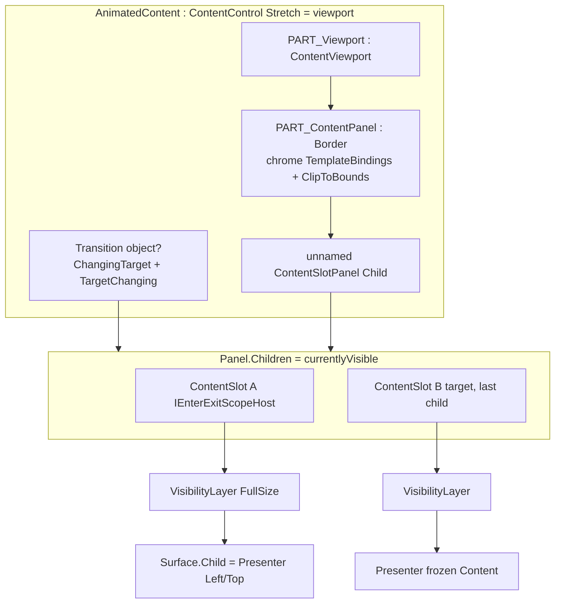

> **历史设计稿**：本文早于 2026-10 的动画基础重构，仅作历史参考，名称与行为可能已过时。现行用法见 [`docs/usage`](../usage/README.md)；迁移见 [迁移指南](../usage/migration-from-visual-animation-scope.md)。主要改名：`VisualAnimationScope` → `AnimationScope`（`AnimationScope.Get`），`SharedAnimationFrameClock` → 内部 `FrameClock`，`IAnimationFrameClock` → `IFrameSource`，`AnimationScope<T>` → `AnimationRun<T>`。

# AnimatedContent 与 Crossfade 落地实现设计

> 生命周期、时钟与诊断条目已由 [VisualAnimationScope](usage/visual-animation-scope.md) 替代；下文旧附加 API 仅保留为设计历史。

| 字段 | 值 |
| --- | --- |
| Author | TBD |
| Date | 2026-09-08 |
| Status | Draft（revision 3） |
| 范围 | `ComposeAnimation.Avalonia` 的 `AnimatedContent` / `Crossfade` 垂直切片；不实现 SharedTransition、DeferredAnimatedContent、veil、Lookahead |
| 上游对照 | `androidx.compose.animation.AnimatedContent` / `Crossfade` / `AnimatedEnterExitImpl` / `targetEnterExit` |

---

## Overview

本仓库已有可用的 `AnimatedVisibility`：单内容、单 `Transition<EnterExitState>`、`VisibilityLayer` / `VisibilityMotion` 负责 fade/slide/scale/expand，`AnimatedVisibilityScope` 用 `BeginPreparation()` 卡住首帧 layout，退出完成才卸内容。`docs/CURRENT_STATUS.md` 明确列出 `AnimatedContent` / `Crossfade` 未开始；`docs/SHARED_CONTENT_SEMANTICS.md` 也指出 AnimatedContent 是共享边界所缺的双内容宿主——本设计只把这个宿主落地，不实现 SharedTransition。

Compose 的 `AnimatedContent` **不是**「会换 Content 的 AnimatedVisibility」。它是：**一个父 `Transition<S>` 下的 N 个 enter/exit 槽**，外加容器级 `SizeTransform`。默认效果是 Material fade-through（220ms delay 90 的 fade+scaleIn 0.92 `togetherWith` 90ms fadeOut，再加 spring+clip 的 SizeTransform），不是对称 crossfade。`Crossfade` 在本端口中是同一套槽宿主的预设：`FadeIn(spec) togetherWith FadeOut(spec)` 且 `SizeTransform = null`。禁止第二套引擎，禁止包装 `Avalonia.Animation.CrossFade` 或 `TransitioningContentControl`。

实现上有三条必须先写对的不变量，否则默认 fade-through 根本播不出来、clip 在 Stretch 下是空操作：

1. **两阶段目标切换**：在子 `SynchronizeWithParent` / `VisibilityMotion.Configure` 快照 Exit 之前，把本次 `ContentTransform` 的 Enter/Exit/zIndex 写到已有槽上。目标槽的 `Exit=None` 不得在 demote 的那次 Configure 里被读到。
2. **内层 `Border` `PART_ContentPanel`**：chrome TemplateBindings + `ClipToBounds` 与动画尺寸在同一 Border 上；`Child` 是槽 Panel；host Stretch 只是视口。
3. **`ContentTransform` 省略 SizeTransform ≠ 传入 null**；`Using` 复制；没有可变静态 `Default`。

本文按可编码粒度给出：文件与类型、槽生命周期（方法级）、measure/arrange、模板与逻辑树、完整 API 默认值、测试、demo，以及可独立合入的 PR 切分。

---

## Background & Motivation

### 当前状态（已核对源码）

| 能力 | 现状 | 关键符号 |
| --- | --- | --- |
| 单内容 enter/exit | 已完成 | `AnimatedVisibility.CreateScope` / `EndScope` / `Synchronize` |
| 作用域 | 已完成 | `AnimatedVisibilityScope`：`Bind` / `Own` / `BeginPreparation` / `Measured` |
| 视觉层 | 已完成 | `VisibilityLayer.MeasureOverride` 创建 `VisibilityMotion`；`SetFullSize`；`LayoutSize`；`_fullSize` 尚未对外 |
| 效果声明 | 已完成 | `EnterTransition` / `ExitTransition`：`FadeIn`/`FadeOut`/`ScaleIn`/`SlideIn*`/`Expand*` |
| 子效果 | 已完成但绑死 AV | `AnimateEnterExit`：`GetVisualAncestors().OfType<AnimatedVisibility>()` |
| 父 Transition | 已完成 | `VisibilitySource.From` / `CreateChildTransition` |
| 准备租约 | 已完成 | `Transition.BeginPreparation`；scope 构造即持有 `_gate`，首次 `Measured()` 释放 |
| Size 动画 | 仅 per-content expand/shrink | `VisibilityMotion.ChangesSize`；**没有**容器级 SizeTransform |
| 多内容 | 未开始 | AV 在 `Content`/`ContentTemplate`/`Source`/clock 变化时 `Synchronize(reset: true)` 直接 `Disconnect` |
| SharedTransition 双内容宿主 | 未开始 | 本设计不实现 |
| 内部目标钩子 | 已有 | `Transition<T>.TargetChanging` 在赋值 `_targetState` / `Segment` **之前**触发；`ReconfigureAnimations` 才同步子过渡。SharedTransition 用它在后代看到新目标前抢 lease |

`AnimateEnterExit` 今天写死祖先类型：

```25:26:ComposeAnimation.Avalonia/AnimatedVisibility/AnimateEnterExit.cs
            ResolveScope = () => this.GetVisualAncestors().OfType<AnimatedVisibility>().FirstOrDefault()?.Scope,
```

`GetVisualAncestors()` **不含** `this`。槽必须是内容的**视觉**祖先（逻辑-only 不够）。`AnimatedContent` 不得实现 `IEnterExitScopeHost`。

`StyledElement` 在已有逻辑父时再 `SetParent` 会抛 `InvalidOperationException("The Control already has a parent.")`。`ContentControl.ContentChanged` 会把 `ILogical` Content 加进 host `LogicalChildren`。这不是“可能重父”，是确定的崩溃路径，必须在 PR 3 用具体策略拆掉。

AV 的 `CreateScope` Map **不是** Compose `targetEnterExit`：`_wasVisible` 在 **Map 参数** 为 visible 时置位，而不是看 `parent.CurrentState`。抽取时不得声称两者相同。

### 痛点

1. 页面/状态切换只能瞬间换 `Content`，或手动叠两个 `AnimatedVisibility`——后者没有共享父 `Transition<S>`，也没有容器 SizeTransform，中断时不能复用同一棵视觉树。
2. Avalonia 的 `TransitioningContentControl` 只有两个 `ContentPresenter`，新动画会 `_currentTransition?.Cancel()`，中断丢退出内容；Compose 则保留所有正在退出的内容。
3. `Avalonia.Animation.CrossFade` 走 `IPageTransition` + 样式引擎，与 Runtime `Transition` 时间线、preparation、seek 全部不兼容。
4. 默认 `Layoutable.MeasureOverride` 取子级 max，`ArrangeOverride` 把每个子级 arrange 进 `finalSize`。`Layoutable.ArrangeCore` 在 `HorizontalAlignment=Stretch`（默认）时把控件尺寸拉成 **available**，不是 `DesiredSize`。因此只报告动画 `DesiredSize` 并不能让 `ClipToBounds` 裁到动画尺寸。

### 上游行为摘要（实现必须对齐）

`AnimatedContent.kt` 默认 `transitionSpec`：

```kotlin
(fadeIn(tween(220, delayMillis = 90)) +
    scaleIn(initialScale = 0.92f, animationSpec = tween(220, delayMillis = 90)))
    .togetherWith(fadeOut(animationSpec = tween(90)))
```

另加 `SizeTransform()`：`clip = true`，`spring(stiffness = Spring.StiffnessMediumLow)`（400）。Compose 构造函数是 `sizeTransform: SizeTransform? = SizeTransform()`——**省略参数 = Default；显式 `null` 保持 null**。

槽集合 `currentlyVisible`：

- 父 `currentState == targetState` 时收成只剩当前状态。
- 目标状态始终在列表末尾（同 zIndex 时后放置，即画在上面）。
- 相同 `contentKey` 替换而不新建槽（无动画）；上游把这当成**不是**一次 content transform 的目标变化。
- 中断回到已在列表中的状态：复用 composition / 视觉树。这是宿主核心，不是附加功能。
- 每个槽是一次 `AnimatedEnterExitImpl(parent, visible = { it == stateForContent })`。
- `targetEnterExit` 把 `S` 映射到 `EnterExitState`，含 seeking 与基于 **currentState** 的 `hasBeenVisible`。
- `KeepUntilTransitionsFinished` 是 `ExitTransition` 的 `hold` 位，**只对 AnimatedContent 有意义**。
- `SizeModifierNode.lastSize`：中断时从上次动画容器尺寸接到新目标尺寸。
- SizeTransform 的 `targetSize` 来自内容的 **full size**（AV scope `targetSize`），不是 expand 的 layout size。

`Crossfade.kt` 上游是父 `Transition` 上的 `animateFloat` + `Box`，**没有** enter/exit 子过渡。本端口**故意**不用第二套引擎：Crossfade = 同一槽宿主 + fade togetherWith fade + `SizeTransform = null`。可见差异：槽内可以使用 `AnimateEnterExit`；尺寸行为仍是「过渡期间 max(children)，退出卸掉后立刻落到剩余内容」。

---

## Goals & Non-Goals

### Goals

1. 非泛型 XAML 控件 `AnimatedContent : ContentControl`，`Content` 即目标状态；每槽冻结 Content；共享 `ContentTemplate`。
2. 类型安全走 `ContentSource` + 已有 `Transition<T>`，**不**做 `AnimatedContent<T>` 控件。
3. 默认 Material fade-through + SizeTransform，时序与 Compose 一致；**两阶段写 Exit**，16ms 时 outgoing 仍在且正在 fade。
4. `Crossfade` 为同一宿主的薄封装：`ResolveCurrentTransform()` 始终返回 fade togetherWith fade + `SizeTransform=null`。不在 `OnPropertyChanged` 里回写继承的 StyledProperty。
5. 抽出 `IEnterExitScopeHost`，`AnimateEnterExit` 找最近宿主，AV 测试保持全绿。Mapper **分 AV / AC 两种 hasBeenVisible 规则**。
6. 内层 **`Border` `PART_ContentPanel`** 的 layout size **就是** 动画尺寸（加 chrome）；`ClipToBounds` 打在该 Border 上；其 Child 是槽 Panel。host Stretch 是视口。`ContentAlignment` 默认 `TopStart` 对齐该 Border。
7. 入场首测沿用 `AnimatedVisibilityScope` 构造时的 preparation lease。
8. Identity 中断复用属于垂直切片。自定义 `ContentKeySelector`、Hold、zIndex、Source 连接在其后。ContentKey 跳过必须连父 `UpdateTarget` / SizeTransform 一起跳过。
9. `slideIntoContainer` / `slideOutOfContainer` **不出现在 v1 公开接口**；PR 6 再加方法。闭包每次读取 live `CurrentSize`。
10. Headless 测试 + Scratchpad demo + 文档。

### Non-Goals（v1 明确不做）

- `DeferredAnimatedContent` / `MutableContentTransform` / veil / `pendingTargetState` 槽
- Lookahead
- `MaxInterruptionRetention`（上游只用于 DeferredAnimatedContent）
- 包装 `IPageTransition` / `TransitioningContentControl` / `Avalonia.Animation.CrossFade`
- SharedElement / SharedBounds 控件
- `animateContentSize` 独立 modifier
- 泛型 `AnimatedContent<T>` XAML 控件
- 用 per-slot `ExpandIn`/`ShrinkOut` 驱动容器尺寸（expand 仍可画，但 `targetSizeMap` 只用 full size）
- 公开接口上的 `NotImplementedException`
- 可变静态 `ContentTransform.Default`

---

## Key Decisions

| # | 决定 | 理由 |
| --- | --- | --- |
| K1 | AnimatedContent = N 个 enter/exit 槽 + 父 `Transition<object?>` + 容器 SizeTransform | 上游对每个 `currentlyVisible` 调 `AnimatedEnterExitImpl`；AV 在 Content 变化时 `Disconnect` |
| K2 | 默认 ContentTransform = fade-through，工厂每次 `CreateFadeThrough()` 新实例 | 复制上游时序；禁止可变单例 |
| K3 | Crossfade **是** `AnimatedContent` 子类，但只覆盖 `ResolveCurrentTransform()`；另提供 `Crossfade.CreateTransform(spec)` | 同一槽引擎 + `<ca:Crossfade>` 标签；**不**在 OnPropertyChanged 回写 `ContentTransform`/`TransitionSpec`（会跟 binding/style 打架） |
| K4 | 不包装 `TransitioningContentControl` | 仅 2 presenter，中断 `Cancel()` |
| K5 | 不使用 `Avalonia.Animation.CrossFade` / `IPageTransition` | 另一套时钟 |
| K6 | 控件非泛型；`ContentSource.From<T>(Transition<T>)` 与 `From<T>(MutableTransitionState<T>, …)` | 与 `VisibilitySource` 对称 |
| K7 | 每槽冻结 Content + 当时的 `ContentTemplate`；presenter 禁止绑定 host `ContentProperty` | outgoing DataContext 不得变成最新 VM |
| K8 | `IEnterExitScopeHost` 由 `AnimatedVisibility` 与 **`ContentSlot`** 实现；host 不实现 | `AnimateEnterExit` 必须挂槽 scope；槽必须是视觉祖先 |
| K9 | Mapper 分模式：AV = 参数置位 `_hasBeenVisible`（今日行为）；AC = Compose `currentState` 置位。AV 路径无 pending | 二者不是同一函数；PR 1 必须用测试钉住 AV reverse-enter |
| K10 | `targetSizeMap` 永远存槽 **full size**（`VisibilityLayer.FullSize`）。`ContentSlot` 向 panel **报告** FullSize，但 **arrange** `VisibilityLayer` 到 `LayoutSize`（`Layer.DesiredSize`），用 expand 锚点对齐在 full rect 内，让现有层 clip 作用在 expand 样本上 | 只报告 FullSize 却把 layer arrange 成 FullSize 时，层 Bounds=全尺寸，`ClipToBounds` 裁不到 expand。不剥掉用户 Expand，也不把 expand 样本喂给 SizeTransform |
| K11 | 动画 clip 节点是 **`Border`（`PART_ContentPanel`）**：TemplateBinding chrome + `ClipToBounds`。其 `Child` 才是槽 `Panel`。Viewport 把该 Border arrange 成动画 DesiredSize。host Stretch = 视口。槽 presenter Left/Top | `Panel` 没有 Border/Padding。chrome 与 clip 必须在同一 Border 上，否则 Background/Padding 是空操作 |
| K12 | 公开 `TargetContentZIndex` 保持 `float`（Compose 对齐）；`Visual.ZIndex = (int)Math.Round(z, MidpointRounding.AwayFromZero)`。同 int 时 **`Panel.Children` 顺序**（目标在末尾）是唯一判别 | 小数会塌缩；2.4 与 2.6 都是 2，必须测 |
| K13 | `KeepUntilTransitionsFinished` 为 `ExitTransition` public static；`HoldExit.Apply => e.Hold = true`；不改 `ApplyGroup` | 与 `+` 共享同一 `VisibilityEffects` 时 OR 自然发生。AV **忽略** Hold，测试放 PR 1 |
| K14 | v1 `IAnimatedContentTransitionScope` **没有** slide 方法。PR 6 再往**同一**接口加方法（我们是唯一实现者；lambda 消费方源兼容） | 禁止公开 `NotImplementedException` |
| K15 | 无槽数量上限 | 父 idle 时收成 1 |
| K16 | **保留 `ContentControl`。** `OnPropertyChanged(Content)` 在 `base` 之后立刻把 `ILogical` 新值从 host `LogicalChildren` 移除，逻辑父只通过已入树的槽 presenter 建立。Abort：若 PR 3 的 `control.Parent` 测试仍抛双父，才改为 `TemplatedControl` 并复制 Content 属性（公开 API 不变） | `SetParent` 在已有父时抛错。这是 Key Decision，不是 PR 3 惊喜 |
| K17 | SizeTransform = 父 Transition 上的 `CreateDeferredAnimation<Size>` + `_lastSize`；size map 按 **`ContentSlot` 实例** 索引 | `ReplaceState` 后对象身份 ≠ Segment.InitialState |
| K18 | 入场 preparation 复用 scope `_gate` | 挡住 incoming `Exit=None` / `DurationScale=0` |
| K19 | **两阶段目标切换**同时覆盖 `UpdateTargetCore` **与** `SeekCore`。`ChangingTarget` 在 `TargetChanging` 时已是新目标；`CreateScopeView.InitialState` = **赋值前的 `parent.TargetState`（旧目标）**，不是 `CurrentState`。Seek 在 `IsSeeking=true` 且 `RevokePreparationsForSeeking` 之后、赋值 `_targetState` 之前同样触发该钩子。**不**从 `SeekCore` 触发 `TargetChanged`。`SharedTransition.BeforeTargetChange` 在 `IsSeeking` 时直接 return | A→B 再切 C 时 spec 是 (B,C)。Seek 今天不走 `TargetChanging`，会再次用 `Exit=None` 快照。Seek 已撤销 lease；`BeginPreparation` 在 seeking 时会抛 |
| K20 | 同 key：`UpdateTarget` 都不调用，只 `ReplaceState`；SizeTransform 不跑；layout 后 `IsIdle` | 上游“同 key 不是 target-state change” |
| K21 | `DisposeSlot` **只有两个合法调用方**，都对 `_currentlyVisible.ToArray()` 迭代：(1) `EvaluateSlotDisposal`（正常路径；seeking 时 `continue`）(2) seeking 重建（tooling：当前状态不在列表时卸掉非 current 再 `CreateSlot(Current)`）。禁止第三处。Seeking 重建后**不 return**，继续把 Target 放到末尾 | Evaluate 在 seeking 时不卸槽，所以 tooling 跳变必须有第二条路径，否则泄漏 |
| K22 | `ContentTransform`：三参构造省略 SizeTransform = `SizeTransform.CreateDefault()`；四参 `null` 保持 null。`Using` **复制**。无静态可变 `Default`。XAML 无参 + `{get;set;}` | 否则 Crossfade / `Using(null)` 画死 API |
| K23 | `ContentTransform.Using` 是类型上的复制方法；scope **不再**提供同名 mutating `Using` | Compose 的 `using` 是 scope 扩展且改的是刚 `togetherWith` 出来的新对象 |
| K24 | 卸槽不得清 `_lastSize`。SizeFor(initialState) 优先 `_lastSize` | Exit=None 可在 measure 前卸 outgoing |
| K25 | `ContentKeySelector` v1 **仅 C#**（公开文档写明，不是 Open Question） | XAML 字符串/枚举已有相等性 |

---

## Proposed Design

### 1. 文件与类型布局

全部新类型放在根命名空间 `ComposeAnimation`。

```
ComposeAnimation.Runtime/
  TransitionOfT.cs                               # PR 3：internal ChangingTarget

ComposeAnimation.Avalonia/
  AnimatedVisibility/
    IEnterExitScopeHost.cs                       # NEW PR 1
    EnterExitStateMapper.cs                      # NEW PR 1，internal，HasBeenVisibleMode
    AnimatedVisibility.cs                        # IEnterExitScopeHost；Map → AV 模式 mapper
    AnimateEnterExit.cs                          # OfType<IEnterExitScopeHost>()
    AnimatedVisibilityScope.cs                   # 不变
    VisibilityMotion.cs                          # VisibilityLayer 暴露 FullSize；其余不变
    VisibilitySource.cs                          # 不变
    VisibilityTransitions.cs                     # HoldExit.Apply => e.Hold = true
  AnimatedContent/
    ContentTransform.cs                          # PR 2
    ContentSource.cs                             # PR 3 冻结公开类型；PR 4 接上 host.Source
    ContentSlot.cs                               # internal IEnterExitScopeHost
    ContentSlotPanel.cs                          # internal 槽 Panel；Measure 返回动画尺寸
    ContentViewport.cs                           # internal；Stretch 视口，按 ContentAlignment 放置 PART_ContentPanel Border
    AnimatedContentScope.cs                      # v1 无 slide 方法
    AnimatedContent.cs
    Crossfade.cs                                 # 覆盖 ResolveCurrentTransform

ComposeAnimation.Test/
  AnimatedContentTest.cs
  CrossfadeTest.cs
  ContentTransformTest.cs                        # PR 2
  AnimatedVisibilityTest.cs                      # PR 1 回归 + Hold 忽略 + reverse-enter

Scratchpad/AnimatedContentDemo/
docs/ANIMATED_CONTENT.md
docs/CURRENT_STATUS.md
docs/ANIMATED_VISIBILITY.md                      # 祖先查找；Hold 对 AV 无操作；AnimateEnterExit 会叠 fade
```

不重命名 `VisibilityLayer`。测试已按类型查找它。

### 2. 架构与两阶段时序



```mermaid
sequenceDiagram
  participant User
  participant AC as AnimatedContent
  participant P as Transition object?
  participant Out as ContentSlot outgoing
  participant Mot as VisibilityMotion
  participant In as ContentSlot incoming
  participant Box as Border PART_ContentPanel

  User->>AC: Content = B
  Note over AC: 同 key？ReplaceState，禁止 UpdateTarget
  AC->>AC: Relinquish ILogical Content from host LogicalChildren
  AC->>P: UpdateTarget(B)
  P->>P: ChangingTarget = B
  P->>AC: TargetChanging  Segment 仍是旧的
  AC->>AC: ResolveCurrentTransform using ChangingTarget
  AC->>Out: Exit = transform.Exit  Hold/Fade 此时已写入
  P->>P: _targetState=B Segment=(A,B)
  P->>Out: SynchronizeWithParent Map → PostExit
  Out->>Mot: Configure 读 _getExit 已是 fadeOut 不是 None
  P->>AC: TargetChanged
  AC->>AC: ReconcileSlots：缺 key(B) 则 CreateSlot
  Note over In: ctor Layer；Surface.Child=Presenter<br/>Panel.Children.Add(slot)<br/>然后 Content/Template + UpdateChild
  Note over AC: Reconcile 不卸槽
  AC->>Box: InvalidateMeasure
  Box->>In: Measure 目标槽优先；Measured 释放 _gate
  Box->>Out: Measure outgoing（若尚未卸）
  Box-->>Box: lastSize / SizeTransform 采样
  AC->>AC: EvaluateSlotDisposal（正常卸槽；seeking 走 Reconcile 第二条路径）
  Note over Out: Exit=None 的 outgoing 可在本轮卸<br/>_lastSize 已从上一帧保留
```

### 3. 共享 enter/exit 抽取（PR 1）

#### 3.1 `IEnterExitScopeHost`

```csharp
public interface IEnterExitScopeHost
{
    AnimatedVisibilityScope? Scope { get; }
}
```

`AnimateEnterExit`：

```csharp
ResolveScope = () => this.GetVisualAncestors()
    .OfType<IEnterExitScopeHost>()
    .FirstOrDefault()?.Scope;
```

`ContentSlot` 必须出现在视觉树上（Issue 5 的构造顺序）。注释：只找视觉祖先。

`AnimateEnterExit` 默认 FadeIn/FadeOut 会叠在槽的 fade-through 上（Compose `animateEnterExit` 同样）。写进 `ANIMATED_VISIBILITY.md`。

#### 3.2 `EnterExitStateMapper<T>` — 两种 hasBeenVisible

```csharp
internal enum HasBeenVisibleMode { Argument, ParentCurrent }

internal sealed class EnterExitStateMapper<T>(
    Transition<T> parent, Func<T, bool> visible, HasBeenVisibleMode mode)
{
    private bool _hasBeenVisible;

    public EnterExitState Map(T state)
    {
        if (parent.IsSeeking)
            return visible(state) ? EnterExitState.Visible
                 : visible(parent.CurrentState) ? EnterExitState.PostExit
                 : EnterExitState.PreEnter;

        if (mode == HasBeenVisibleMode.Argument)
        {
            // 今日 AnimatedVisibility.CreateScope：参数为 true 时置位。无 pending。
            if (visible(state)) { _hasBeenVisible = true; return EnterExitState.Visible; }
            return _hasBeenVisible ? EnterExitState.PostExit : EnterExitState.PreEnter;
        }

        // Compose targetEnterExit：看 parent.CurrentState。v1 不含 pending。
        if (visible(parent.CurrentState)) _hasBeenVisible = true;
        if (visible(state)) return EnterExitState.Visible;
        return _hasBeenVisible ? EnterExitState.PostExit : EnterExitState.PreEnter;
    }
}
```

AV：`new EnterExitStateMapper<bool>(parent, v => v, HasBeenVisibleMode.Argument)`，删除 `_wasVisible`。

AC：`HasBeenVisibleMode.ParentCurrent`。`visible` 用槽 key：`s => KeysEqual(s, slot.State)`（`ReplaceState` 后仍正确，因为读 `slot.State`）。

**不要**把 pending 分支接到 AV 上。Deferred 落地时再开 AC 模式的 pending。

PR 1 测试：

- 现有 `ScopeCreated_CanReverseTargetBeforeFirstLayout` 必须仍绿。
- **新增** `EnterThenStepThenReverse_UsesPostExitNotPreEnter`：进入、`Step(16)`、反向；opacity 走 Exit spec（fade），不是 PreEnter 卡在 0。

#### 3.3 Hold

**不改** `VisibilityEffects.ApplyGroup`（它只 `child.Apply(effects)`，last-writer-wins 各通道）。

```csharp
public abstract class ExitTransition
{
    public static ExitTransition KeepUntilTransitionsFinished { get; } = new HoldExit();
    private sealed class HoldExit : ExitTransition
    {
        internal override void Apply(VisibilityEffects e) => e.Hold = true;
    }
}
```

`new FadeOut() + KeepUntilTransitionsFinished` 共享一份 `VisibilityEffects`，`Hold = true` 与 Fade 并存。

AV **忽略** Hold。真实 `EndScope` 谓词（照抄 `AnimatedVisibility.Synchronize`，禁止“简化”掉动画完成检查）：

```csharp
var idle = scope.IsReady && !transition.IsPreparing && !transition.IsRunning &&
    transition.CurrentState == transition.TargetState &&
    transition.Animations.All(x => x.IsFinished) &&
    transition.Transitions.All(IsFinished);
if (idle && !parent.TargetState && transition.TargetState == EnterExitState.PostExit && !parent.IsSeeking)
    EndScope();
```

PR 1 必须包含：`Exit = FadeOut + KeepUntilTransitionsFinished` 仍按 fade 时长卸内容。写进 `ANIMATED_VISIBILITY.md`：该静态成员对 AV 无操作。

#### 3.4 `VisibilityLayer.FullSize`

```csharp
internal Size FullSize => _fullSize; // Surface.DesiredSize，在 motion LayoutSize 之前
```

AC 的 `ContentSlot.MeasureOverride` 向 panel **报告 FullSize**，不是 `Layer.DesiredSize`（后者在 expand 时是 `LayoutSize`）。

### 4. ContentTransform / SizeTransform（PR 2）

```csharp
public sealed class ContentTransform
{
    public ContentTransform()
    {
        Enter = EnterTransition.None;
        Exit = ExitTransition.None;
        SizeTransform = SizeTransform.CreateDefault();
    }

    /// <summary>省略 SizeTransform = CreateDefault()。要 null 请用四参构造。</summary>
    public ContentTransform(EnterTransition enter, ExitTransition exit, float targetContentZIndex = 0f)
        : this(enter, exit, targetContentZIndex, SizeTransform.CreateDefault()) { }

    /// <summary><paramref name="sizeTransform"/> 为 null 就是不要尺寸动画。</summary>
    public ContentTransform(EnterTransition enter, ExitTransition exit,
        float targetContentZIndex, SizeTransform? sizeTransform)
    {
        Enter = enter ?? throw new ArgumentNullException(nameof(enter));
        Exit = exit ?? throw new ArgumentNullException(nameof(exit));
        TargetContentZIndex = targetContentZIndex;
        SizeTransform = sizeTransform; // null 保持 null
    }

    public EnterTransition Enter { get; set; }
    public ExitTransition Exit { get; set; }
    public float TargetContentZIndex { get; set; }
    public SizeTransform? SizeTransform { get; set; }

    public ContentTransform Using(SizeTransform? sizeTransform)
        => new(Enter, Exit, TargetContentZIndex, sizeTransform); // 复制

    public static ContentTransform CreateFadeThrough()
    {
        var enterSpec = new TweenSpec<double>(
            TimeSpan.FromMilliseconds(220), TimeSpan.FromMilliseconds(90));
        var exitSpec = new TweenSpec<double>(TimeSpan.FromMilliseconds(90));
        return (new FadeIn { Spec = enterSpec }
                + new ScaleIn { InitialScale = 0.92, Spec = enterSpec })
            .TogetherWith(new FadeOut { Spec = exitSpec });
        // 三参 TogetherWith → SizeTransform.CreateDefault()
    }
}

public static class ContentTransformExtensions
{
    public static ContentTransform TogetherWith(this EnterTransition enter, ExitTransition exit)
        => new(enter, exit); // 三参：Default size，不是 null
}
```

**没有** `public static ContentTransform Default { get; }`。

`AnimatedContent.ContentTransformProperty`：`defaultValue: null`，`validate` 允许 null。解析：

```csharp
protected virtual ContentTransform ResolveCurrentTransform(IAnimatedContentTransitionScope scope)
{
    if (TransitionSpec is { } spec) return spec(scope);
    return ContentTransform ?? ContentTransform.CreateFadeThrough();
}
```

每 host 可缓存 unset 时的 fade-through 实例（`_fallbackTransform`），**不得**与其它 host 共享。用户赋值/清空属性时丢弃缓存。

```csharp
public sealed class SizeTransform
{
    public bool Clip { get; set; } = true;
    public IFiniteAnimationSpec<Size>? Spec { get; set; }
    public Func<Size, Size, IFiniteAnimationSpec<Size>>? CreateSpec { get; set; }

    public static SizeTransform CreateDefault() => new();

    public IFiniteAnimationSpec<Size> CreateAnimationSpec(Size initial, Size target)
        => CreateSpec?.Invoke(initial, target)
           ?? Spec
           ?? new SpringSpec<Size>(
                  stiffness: Spring.StiffnessMediumLow, // 400；不是 SpringSpec 默认的 1500
                  visibilityThreshold: VisibilityThresholds.Size);
}
```

XAML 写 `<ca:SizeTransform/>` 即可（无 Spec = 400 spring）。**不要**用裸 `<ca:SizeSpringSpec Stiffness="400"/>` 充当默认——`SizeSpringSpec()` 的 stiffness 是 1500。文档说明 `DoubleTweenSpec.Delay` 才能在 XAML 里写 fade-through。

PR 2 测试：`CreateFadeThrough().Using(null)` 不改变另一次 `CreateFadeThrough()` 的 SizeTransform；四参 `null` 保持 null；三参非 null。

### 5. 宿主 `AnimatedContent`

#### 5.1 模板：视口 + chrome Border + 槽 Panel

```csharp
static AnimatedContent()
{
    TemplateProperty.OverrideDefaultValue<AnimatedContent>(new FuncControlTemplate<AnimatedContent>((host, names) =>
    {
        var panel = new ContentSlotPanel();
        var box = new Border
        {
            Name = "PART_ContentPanel",
            Child = panel,
            [~BackgroundProperty] = new TemplateBinding(BackgroundProperty),
            [~BorderBrushProperty] = new TemplateBinding(BorderBrushProperty),
            [~BorderThicknessProperty] = new TemplateBinding(BorderThicknessProperty),
            [~CornerRadiusProperty] = new TemplateBinding(CornerRadiusProperty),
            [~PaddingProperty] = new TemplateBinding(PaddingProperty),
        };
        names.Register(box.Name, box);
        var viewport = new ContentViewport { Name = "PART_Viewport", Child = box };
        names.Register(viewport.Name, viewport);
        return viewport;
    }));
}
```

结构（类型不能合并）：

- **`PART_Viewport` (`ContentViewport`)**：模板根。Stretch host 把它 arrange 成 available 矩形。`MeasureOverride` 返回 `PART_ContentPanel.DesiredSize`（StackPanel 邻居仍跟动画尺寸 + chrome 走）。`ArrangeOverride` 用 `ContentAlignment` + `FlowDirection` 把 **Border** arrange 成 `box.DesiredSize`（不是 `finalSize`）。
- **`PART_ContentPanel` (`Border`)**：动画 clip 节点。chrome 跟动画尺寸走（接近 Compose）。`ClipToBounds` **只设在这个 Border 上**（当 `SizeTransform?.Clip == true` 且正在尺寸动画）。`Padding`/`BorderThickness` 按 `Border.MeasureOverride` 加在内层面板的 DesiredSize 之外。
- **内层 `ContentSlotPanel`（无 Name）**：`Border.Child`。host 字段 `_panel`。**只有这里** `Children.Add` / `Children.Move`。`MeasureOverride` 返回 SizeTransform 采样或 max(FullSize)。不得把槽挂到 Border 上（Border 不是 Panel）。
- Stretch 视口本身透明。要铺满父级的底，在 `AnimatedContent` 外套 `Border`。host `Bounds` 在 Stretch 时是视口；动画 clip + chrome 是 `PART_ContentPanel`。

`OnApplyTemplate`：

- `_sizeBox = Find<Border>("PART_ContentPanel")`，找不到 → 抛。
- `_panel = _sizeBox.Child as ContentSlotPanel`，不是 → 抛。
- **存在 `PART_ContentPresenter`** → 抛：拒绝把 live `Content` 交给 ContentControl 的单 presenter。
- `RegisterContentPresenter` **永远返回 false**。

槽 presenter：`HorizontalContentAlignment = Left`，`VerticalContentAlignment = Top`（即使某层误把 slot arrange 成 `finalSize`，10×10 内容也不会被拉成 200）。

#### 5.2 属性

| 属性 | 类型 | 默认 | 说明 |
| --- | --- | --- | --- |
| `Content` | `object?` | `null` | 目标状态 |
| `ContentTemplate` | `IDataTemplate?` | `null` | 每槽一份实例 |
| `Source` | `ContentSource?` | `null` | PR 4 接通；类型在 PR 3 冻结 |
| `ContentKeySelector` | `Func<object?, object?>?` | `null` = identity | **仅 C#** |
| `ContentTransform` | `ContentTransform?` | unset/`null` → 每 host `CreateFadeThrough()` | StyledProperty 允许 null |
| `TransitionSpec` | `Func<IAnimatedContentTransitionScope, ContentTransform>?` | `null` | 仅 C#；优先于 `ContentTransform` |
| `ContentAlignment` | `VisibilityAlignment` | `TopStart` | 对齐 **`PART_ContentPanel` Border** |
| `Label` | `string?` | `null` | 空时动画名用 `"AnimatedContent"`，避免 `" > EnterExit"` / `" size"` |
| `TargetContent` | `object?` Direct | | 已连接的解析目标 |
| `IsIdle` | `bool` Direct | `true` | 父 current==target、单槽、该槽 idle、尺寸节点 idle、非 preparing、非 seeking |
| `VisibleSlotCount` | `int` Direct | `0` | |
| `TargetScope` | `AnimatedVisibilityScope?` Direct | | 目标槽 scope |

事件：`SlotCreated`。v1 不做 `SlotDisposed`。

`HorizontalContentAlignment` / `VerticalContentAlignment` **不**放置 `PART_ContentPanel` 或槽。

#### 5.3 连接

内部 `ContentConnection(Transition<object?> transition, bool ownsLoop, Action? release)`。

自有 loop 与 AV 相同：`DispatcherPriority.Loaded` 上 `RunAsync`；`DurationScale = MotionDurationScale.ScaleFactor`。时钟：`Animated.GetFrameClock(this) ?? new AvaloniaAnimationFrameClock(TopLevel…)`。

连接时：

```csharp
parent.TargetChanging += OnParentTargetChanging;
```

```csharp
internal TState ChangingTarget { get; private set; } // Transition<T>，PR 3 Runtime

private void UpdateTargetCore(TState targetState)
{
    if (IsSeeking) return;
    if (Equals(_targetState, targetState)) return;
    ChangingTarget = targetState;
    TargetChanging?.Invoke();          // SharedTransition 仍在子同步之前抢 lease
    var oldTarget = _targetState;
    _targetState = targetState;
    Segment = new(oldTarget, targetState);
    WriteState(() => _transitionState.CurrentState = oldTarget);
    ReconfigureAnimations(true);       // 此时槽 Exit 已是新 transform
    TargetChanged?.Invoke();
    ChangingTarget = default!;
    Notify(CurrentState/TargetState/Segment);
}

private void SeekCore(TState initialState, TState targetState, TimeSpan playTime,
    bool preserveCurrentValues = true)
{
    RevokePreparationsForSeeking();
    // ... existing IsSeeking = true, SetRunningRecursively(false), SetSeekTime ...
    ChangingTarget = targetState;
    TargetChanging?.Invoke();          // 子 EnterExit 仍旧；AC 写入 Exit
                                       // SharedTransition.BeforeTargetChange 见 IsSeeking → return
                                       // 禁止在此调用 BeginPreparation（会抛）
    _targetState = targetState;
    Segment = new(initialState, targetState);
    WriteState(() => { CurrentState = initialState; TargetState = targetState; });
    ReconfigureAnimations(true, preserveCurrentValues && wasSeeking && segmentChanged);
    SeekAnimations(playTime);
    ChangingTarget = default!;
    Notify(CurrentState/TargetState/Segment);
    // 不触发 TargetChanged：AfterTargetChange 会 PublishPreparation，seek 不应发共享准备
}
```

已核对 `SeekCore`（`TransitionOfT.cs` 205–238）：今日不触发 `TargetChanging`，直接赋 `_targetState`/`Segment` 再 `ReconfigureAnimations`。子过渡经 `SynchronizeWithParent` → `child.SeekCore(...)`，因此 **根与子的 `SeekCore` 都必须**打这个钩子，AC 订的是 `connection.Transition`（可能是 `CreateChildTransition` 出来的 object? 子过渡）。

`SharedTransition.BeforeTargetChange` 增加：

```csharp
if (ParentTransition.IsSeeking) return;
```

放在 `BeginPreparation()` 之前。Seek 已 `RevokePreparationsForSeeking`；`Transition.BeginPreparation` 在 seeking 时抛 `InvalidOperationException`。`ParentChanged` 仍在 `IsSeeking` 时 `CancelCurrent`。

**不**把 `TargetChanging` 挪到 Segment 赋值之后：`BeforeTargetChange` 依赖子 EnterExit 仍是旧状态。Seek 路径同样：钩子在赋值 `_targetState` 之前。

`CreateScopeView` / `OnParentTargetChanging`：

```csharp
var upcoming = connection.Transition.ChangingTarget;
// InitialState = 赋值前的 TargetState（旧目标），绝不是 CurrentState。
// A→B 中途再切 C：CurrentState 仍是 A，TargetState 仍是 B，ChangingTarget=C
// → spec (B, C)，outgoing B 用 B→C 的 Exit。
var scope = new AnimatedContentTransitionScope(
    initialState: connection.Transition.TargetState,
    targetState: upcoming,
    ...);
var transform = ResolveCurrentTransform(scope);
foreach (var slot in _currentlyVisible)
{
    var staying = KeysEqual(slot.State, upcoming);
    if (staying) { slot.Enter = transform.Enter; slot.ZIndexFloat = transform.TargetContentZIndex; }
    else slot.Exit = transform.Exit;
}
```

`Source` / clock / `IsVisible` / detach → `Synchronize(reset: true)`。**Content 变化不 reset。**

`ContentTemplate` 变化：只更新**目标**槽 presenter；outgoing 保持冻结模板。

失败：`Animated.ReportError`；dump `_currentlyVisible` 的 key/state（`Label` + slot 列表）。

空 `Label`：父过渡与尺寸动画用 `"AnimatedContent"`；子 `"AnimatedContent > EnterExit"`；尺寸 `"AnimatedContent size"`。

#### 5.4 槽生命周期（方法级）

**Content 变化（简单模式）：**

```
OnPropertyChanged(Content):
  base.OnPropertyChanged            // ContentControl.ContentChanged 可能 Add ILogical
  if (NewValue is ILogical logical)
      LogicalChildren.Remove(logical)  // 立刻放弃 host 父；SetParent 仅当 LogicalParent==host 才清
  if (!_attached) return
  var old = change.GetOldValue<object?>()
  var next = Content
  if (KeysEqual(old, next) && _currentlyVisible 有该 key 的槽)
      ReplaceState(next)            // 禁止 UpdateTarget
      InvalidateMeasure
  else
      connection.Transition.UpdateTarget(next)  // 内部两阶段
      Synchronize()
```

`KeysEqual(a,b)` = `Equals(ContentKeySelector?.Invoke(a) ?? a, ContentKeySelector?.Invoke(b) ?? b)`。v1 无自定义 selector 时即 `EqualityComparer<object?>.Default`。

**`Synchronize` 泵**与 AV 相同。连接且 `_attached` 后，在任何 `CreateSlot` / `_panel.Children` 之前：

```
ApplyTemplate(); // 与 AV CreateScope 相同：attach 不会 ApplyTemplate，MeasureCore 才会
if (_panel is null)
    throw new InvalidOperationException("AnimatedContent requires PART_ContentPanel with a ContentSlotPanel child.");
```

然后：

1. `ReconcileSlots()` — 创建/移动/ReplaceState；**正常路径不** `DisposeSlot`
2. `InvalidateMeasure`
3. `EvaluateSlotDisposal()` — 正常路径的卸槽入口。对 `_currentlyVisible.ToArray()` 迭代。seeking 时 `continue`

布局可能在 Synchronize 返回后才跑。Exit=None outgoing 可以在首次 Evaluate 卸掉（Configure 已读到 None 或真 Exit）。`_lastSize` 来自上一帧，不清。incoming None 仍被 `_gate` 卡住直到 `Measured()`。

**`ReconcileSlots`：**

```
key(x) = ContentKeySelector?.Invoke(x) ?? x

若 parent.IsSeeking 且 currentlyVisible 不含 CurrentState:
    // DisposeSlot 的第二条合法路径（tooling）。Evaluate 在 IsSeeking 时 continue，必须在这里卸。
    foreach slot in _currentlyVisible.ToArray() where !KeysEqual(slot.State, CurrentState):
        DisposeSlot(slot)
    若仍无 Current 槽: CreateSlot(CurrentState)
    不得 return  // 继续把 Target 放到末尾

若 parent.CurrentState == TargetState && !IsSeeking:
    保证 current 槽存在且在末尾
    更新 ContentAlignment 缓存
    // 不在这里卸别人；EvaluateSlotDisposal 在父 idle 时卸 Hold/非 current

id = 第一个 KeyEquals(TargetState) 的下标
若 id < 0: CreateSlot(TargetState)；Children.Add
else:
    若槽.State 引用不同: ReplaceState(TargetState)
    若 id != last: Children.Move(id, Count-1)；列表同样 Move

每个槽: IsTarget = (slot == last)
目标槽 ApplyZIndex(transform.TargetContentZIndex)
退出槽保留进入时的 zIndex
```

Identity 中断 A→B→A：A 仍在列表，Move 到末尾，同一 ContentSlot / Scope / Motion。这是 **PR 3 必须有的行为**。

**`CreateSlot(state)` 实际建树顺序：**

```
1. var slot = new ContentSlot(this, state, key(state))
   ctor:
     Presenter = new ContentPresenter {
         HorizontalContentAlignment = Left,
         VerticalContentAlignment = Top
     }
     Layer = new VisibilityLayer { ... funcs ... }
     VisualChildren/LogicalChildren.Add(Layer)   // 槽的唯一子
     Layer.Surface.Child = Presenter             // OwnsLogicalChild 默认 true
2. mapper = new EnterExitStateMapper<object?>(parent, s => KeysEqual(s, slot.State), ParentCurrent)
3. child = parent.CreateChildTransition(mapper.Map, "EnterExit")
4. slot.AttachScope(new AnimatedVisibilityScope(child))  // _gate
5. _panel.Children.Add(slot)          // 只要 Panel.Children，不要碰 VisualChildren
                                      // 此时 presenter 已入逻辑树
6. slot.FrozenTemplate = ContentTemplate
   Presenter.ContentTemplate = FrozenTemplate
   Presenter.Content = state
   Presenter.UpdateChild()            // 现在 IsAttachedToLogicalTree，会 Build
7. Enter/zIndex from current transform；目标槽 Exit 可先 None（下次 demote 由 TargetChanging 写入）
8. SlotCreated
```

重排目标到末尾：`Children.Move`，与 `currentlyVisible` 同步。`Panel.ChildrenChanged` 会 `MoveRange` 逻辑/视觉子级。

**`ReplaceState`：** 更新 `State`、`Presenter.Content`、`UpdateChild`。不新建 map 项（size map 按槽实例）。同 key 路径不 `UpdateTarget`，所以无 SizeTransform、父仍 current==target。

**`EvaluateSlotDisposal`（正常路径的 DisposeSlot；seeking 时整段跳过）：**

```
foreach slot in _currentlyVisible.ToArray():
  if (KeysEqual(slot.State, parent.TargetState) && parent.CurrentState == parent.TargetState)
      continue // 当前页
  if (parent.IsSeeking) continue
  if (!scope.IsReady) continue

  childIdle = !child.IsPreparing && !child.IsRunning
              && child.Current==PostExit && child.Target==PostExit
              && animations/transitions finished

  hold = slot.Exit 应用到的 VisibilityEffects.Hold
         （TargetChanging 写入的 Exit；Configure 同期快照）

  若 childIdle && !hold → DisposeSlot
  若 hold && parent.Current==parent.Target && ParentTreeIdle(parent) → DisposeSlot
     ParentTreeIdle = 父 current==target && !IsPreparing && !IsRunning
                      && 全部 Animations（含尺寸节点）finished && 子过渡 finished
```

Hold 等到**父 idle**（含 SizeTransform）。非 Hold 的 outgoing 可在尺寸还在跑时卸掉。

`DisposeSlot`：PropertyChanged -=；`Layer.ResetMotion`；`scope.Dispose`；`Presenter.Content=null`；`Children.Remove`；列表 Remove。**不**改 `_lastSize`。

合法调用方只有：`EvaluateSlotDisposal`、以及 `ReconcileSlots` 的 seeking 重建分支。都先 `ToArray()`。

Seeking：重建缺失的 Current 后继续把 Target 加到末尾（与上游 tooling 分支一致）。**禁止**在重建 Current 后 return。

#### 5.5 逻辑树（Control as Content）

`ISetLogicalParent.SetParent`：旧父非空且新父非空 → 抛错。

策略（PR 3 必须测，不是 Open Question）：

1. `base.OnPropertyChanged(Content)` 之后，若 `NewValue is ILogical`，`LogicalChildren.Remove(new)`。`ClearLogicalParent` 只在 `LogicalParent == host` 时 `SetParent(null)`。若该 Control 已是某槽 presenter 的子（中断回 A），Remove 是 no-op，父保持 presenter。
2. 槽 presenter `Host = null`（未注册）。`UpdateChild` 把 Control 加到 **presenter** `LogicalChildren`。此时 Control.Parent 必须已是 null（步骤 1）或已经是该 presenter（复用）。
3. 禁止同一 Control 出现在两个槽：`CreateSlot` 若 `control.Parent` 已是另一槽的后代，抛 `InvalidOperationException`。Identity 中断走复用，不会双挂。
4. 数据+模板：`ContentPresenter` 在 `contentTemplate is { } || content is not Control` 时 `DataContext = content`。每槽 `Build` 一次。outgoing 冻住旧 VM。

测试（PR 3 不能合入若失败）：

- `Content = borderA` 后、**Layout 前**：`borderA.Parent` 是目标 presenter（或 slot 逻辑链），不是 host，不是 null。
- A→B 后 Layout 前：`borderA.Parent` 仍是 outgoing presenter；`borderB.Parent` 是 incoming presenter。
- 若这两条抛双父：**中止 ContentControl 方案**，改 `TemplatedControl` + 自建 Content（K16 abort）。公开属性集不变。

数据+模板冻结 DataContext 同属 PR 3。

### 6. Measure / arrange

`ContentSlotPanel : Panel`（`Border.Child`，不是 chrome 节点）：

**`MeasureOverride`：**

1. 读 `Host.ContentAlignment`（alignment 变化要 remeasure）。
2. 先 measure `IsTarget` 槽（`slot.Measure(available)`）。槽向 panel **报告 FullSize**（`ContentSlot.MeasureOverride`：`Layer.Measure(available); return Layer.FullSize;`，不是 `Layer.DesiredSize`/`LayoutSize`）。
3. 再 measure 其余槽，同样约束（不是动画尺寸）。
4. `targetSizeMap[slot] = slot.DesiredSize`（= FullSize）。
5. `MeasuredMax = max(full sizes)`。`TargetSlotSize = 目标槽 FullSize`。
6. `Host.CurrentSize` 供 slide 闭包 **每次**读取（PR 6）。尺寸变化 → `slot.Scope.Transition.RefreshAnimations()`（会重配全部通道，接受 interruption spring；测 fade 不 snap）。
7. SizeTransform 活动（`transform.SizeTransform != null && parent.Current != parent.Target`）：
   - 连接期持有一个 `DeferredAnimation<Size>`（label `"{Label ?? AnimatedContent} size"`）。
   - `Animate(SpecFor, SizeFor)`；`_lastSize = anim.Value`；`Value` → `InvalidateMeasure`（与 AV expand 相同）。
   - 将 **`((Border)Parent).ClipToBounds = sizeTransform.Clip`**（Parent 即 `PART_ContentPanel`）。不要设在 Panel 上。
   - **返回 `anim.Value`。**
8. 观察模式（null SizeTransform 或 current==target）：不调用会让尺寸节点继续跑的 Animate；若节点仍在且未 finished，用 Snap 接到 `TargetSlotSize`。`_lastSize = TargetSlotSize ?? MeasuredMax`。`((Border)Parent).ClipToBounds = false`。返回 `_lastSize`。

外层 `Border` 用 Avalonia 默认 measure：在子级 DesiredSize 上加 `BorderThickness`+`Padding`。Viewport 看到的是这个总和。

**`SizeFor` / size map 按槽实例：**

```csharp
Size SizeFor(object? state)
{
    if (KeysEqual(state, parent.Segment.InitialState))
        return _lastSize ?? MeasuredMax;
    var slot = SlotFor(state); // KeysEqual(slot.State, state)
    return slot is not null && _slotSizes.TryGetValue(slot, out var s) ? s : default;
}
```

`ReplaceState` 不新建 map 项。同 key 跳过根本不走 SizeFor。

**`ContentSlotPanel.ArrangeOverride(finalSize)`：** 此时 `finalSize` 是 Border 给面板的客户区（动画尺寸，不含 chrome）。

```
foreach slot:
    var childSize = slot.DesiredSize; // FullSize
    var offset = Align(childSize, finalSize, ContentAlignment, FlowDirection)
    slot.Arrange(new Rect(offset, childSize)); // 不是 finalSize
```

盒小于 full size 时槽溢出，由 **Border** `ClipToBounds` 裁。

**`ContentViewport.ArrangeOverride`：** `sizeBox.Arrange(new Rect(Align(sizeBox.DesiredSize, finalSize, ContentAlignment, FlowDirection), sizeBox.DesiredSize))`。`sizeBox` 是 `PART_ContentPanel` Border，不是内层面板。

**`ContentSlot.ArrangeOverride(finalSize)`：** `finalSize` 是 panel 给槽的 **FullSize**。不得把 layer arrange 成 FullSize（否则层 Bounds=全尺寸，expand clip 空操作）。应对齐 AV：把 layer arrange 到 **LayoutSize**（`Layer.DesiredSize`，即 `VisibilityLayer.MeasureOverride` 返回的 `Motion.LayoutSize`）：

```csharp
var layoutSize = Layer.DesiredSize;
if (layoutSize == default) layoutSize = finalSize;
var offset = Layer.Motion?.ChangesSize == true
    ? Layer.Motion.AlignmentOffset(finalSize, layoutSize, FlowDirection)
    : default;
Layer.Arrange(new Rect(offset, layoutSize));
```

`AlignmentOffset(available, full, flow)` 已有：`(available - full) * align`。这里 available=槽 FullSize，full=LayoutSize（更小），得到 expand 锚点下的 clip 窗口位置。随后 `VisibilityLayer.ArrangeOverride` 在 `ChangesSize` 时把 Surface arrange 到 `_fullSize` 并 `ClipToBounds` 到 **layer Bounds = LayoutSize**——与 AV host 报告 LayoutSize 时相同。

**Expand vs SizeTransform：** Panel / SizeTransform **只看见 FullSize**。Expand 仍改变层内 clip/绘制。测试必须同时锁住这两点，不能只锁 SizeTransform 目标。

**Measure vs 卸槽：** Evaluate 可在 measure 前卸 Exit=None outgoing。`_lastSize` 必须已在上一帧观察模式写成 A 的 full size。A→B 首次：idle 时 `_lastSize = A`。禁止在 `DisposeSlot` 里把 `_lastSize` 设为 default。

### 7. TransitionSpec 作用域（v1 无 slide）

```csharp
public interface IAnimatedContentTransitionScope
{
    object? InitialState { get; }
    object? TargetState { get; }
    bool IsTransitioningTo(object? initial, object? target);
    VisibilityAlignment ContentAlignment { get; }
    Size CurrentSize { get; }       // 每调用读 host 字段，禁止工厂期快照
    Size TargetContentSize { get; }
    FlowDirection FlowDirection { get; }
}
```

**没有** `Using`、**没有** `SlideIntoContainer`。`ContentTransform.Using` 已够用。

PR 6：在此接口上加 slide 方法；实现返回现有 `SlideInHorizontally` 等，selector **每次**读 `host.CurrentSize`。容器尺寸变化时 `RefreshAnimations()`。不改 `SlideEffect` 签名。内容作用域不放 slide。

### 8. Crossfade

```csharp
public static class CrossfadeTransforms
{
    public static ContentTransform CreateTransform(IFiniteAnimationSpec<double>? spec = null)
    {
        spec ??= new TweenSpec<double>(); // 300ms FastOutSlowIn
        return new FadeIn { Spec = spec }.TogetherWith(new FadeOut { Spec = spec }).Using(null);
    }
}

public class Crossfade : AnimatedContent
{
    public static readonly StyledProperty<IFiniteAnimationSpec<double>> SpecProperty =
        AvaloniaProperty.Register<Crossfade, IFiniteAnimationSpec<double>>(
            nameof(Spec), new TweenSpec<double>(), validate: v => v is not null);

    public IFiniteAnimationSpec<double> Spec { get => GetValue(SpecProperty); set => SetValue(SpecProperty, value); }

    protected override ContentTransform ResolveCurrentTransform(IAnimatedContentTransitionScope scope)
        => CrossfadeTransforms.CreateTransform(Spec);
}
```

- **不**在 `OnPropertyChanged` 里把 `ContentTransform` 写回去。
- 继承的 `ContentTransform` / `TransitionSpec` 仍可被 XAML 设置，**无效果**。文档写明。
- 尺寸：`Using(null)` → 观察模式 → max(full sizes) then snap。
- 有意相对 `Crossfade.kt` 的差异：`AnimateEnterExit` 可用。

### 9. `ContentSource`（类型 PR 3 冻结，连接 PR 4）

```csharp
public abstract class ContentSource
{
    public static ContentSource From(MutableTransitionState<object?> state) => ...
    public static ContentSource From<T>(MutableTransitionState<T> state, Func<T, object?>? content = null)
        => From 装箱/映射；CWT 单所有者
    public static ContentSource From<T>(Transition<T> transition, Func<T, object?> content) => ...
    public static ContentSource From<T>(Transition<T> transition) => From(transition, s => s);
}
```

`ParentSource`：`CreateChildTransition(content, label ?? "AnimatedContent")`，`ownsLoop: false`。**调用方必须 `RunAsync` 父过渡**（写进 ANIMATED_CONTENT.md，对标 AV 文档）。

### 10. 默认值

| 项 | 值 |
| --- | --- |
| Enter fade | Tween 220ms delay 90 FastOutSlowIn，InitialAlpha 0 |
| Enter scale | 同上，InitialScale **0.92**（类型默认是 0） |
| Exit fade | Tween 90ms FastOutSlowIn |
| SizeTransform | clip true，spring 400 NoBouncy，threshold Size(0.5,0.5) |
| zIndex | 0f → int 0；目标 `Children` 末尾 |
| ContentAlignment | TopStart |
| Crossfade Spec | Tween 300ms FastOutSlowIn |
| Crossfade SizeTransform | null |
| ContentKey | identity；自定义仅 C# |
| Label fallback | `"AnimatedContent"` |

90ms fade-through（Linear）：outgoing α≈0，incoming α≈0（仍在 delay）。这是 Material 空档。

---

## API / Interface Changes

C# 固定变换、Segment 选择、SizeTransform 工厂、父 Transition、ContentKey 与 revision 1 相同，但：

- 用 `ContentTransform.CreateFadeThrough()`，不要 `.Default`。
- `.Using(null)` 得到**新**对象。
- Crossfade：`new Crossfade { Spec = new TweenSpec<double>(...) }` 或 `host.ContentTransform = CrossfadeTransforms.CreateTransform(spec)`。
- XAML fade-through 须写 `DoubleTweenSpec` 的 `Delay`：

```xml
<ca:FadeIn>
  <ca:FadeIn.Spec>
    <ca:DoubleTweenSpec Duration="0:0:0.22" Delay="0:0:0.09"/>
  </ca:FadeIn.Spec>
</ca:FadeIn>
```

```xml
<ca:ContentTransform.SizeTransform>
  <ca:SizeTransform Clip="True"/> <!-- 不要嵌套 SizeSpringSpec 当默认 -->
</ca:ContentTransform.SizeTransform>
```

对 AV 无公共破坏。`KeepUntilTransitionsFinished` 是新符号，AV 忽略。

Runtime：`Transition<T>.ChangingTarget` internal。`TargetChanging` 触发点不变。

---

## Data Model Changes

无持久化。运行时：`Transition<object?>`、每槽 `Transition<EnterExitState>`、冻结 Content/模板、`Dictionary<ContentSlot, Size>`、`Size? _lastSize`。用户 `Control` 不在 `DisposeSlot` 里 Dispose。

---

## Alternatives Considered

### A. 包装 `TransitioningContentControl`

拒绝。两 presenter + `Cancel()`。

### B. N 个独立 `AnimatedVisibility`

拒绝作为公开模型。内部每槽已是挂在共享父 Transition 上的 AV 会话。

### C. Crossfade 独立 `animateFloat` 引擎

拒绝。两套生命周期。有意用槽引擎。

### D. 泛型 `AnimatedContent<T>` 控件

拒绝。XAML 不友好。

### E. 从第一天起用 `TemplatedControl` 而不是 ContentControl

诚实的替代：完全控制逻辑树，避开 `ContentChanged` + `SetParent` 抛错。代价是复制 Content chrome API，与 AV 不一致。

**选择 K16**：先 ContentControl + Relinquish。Abort 标准：PR 3 的 `control.Parent` 测试（Layout 前）若因双父失败，则改 TemplatedControl，公开属性不变。不把这留到合入前的 Open Question。

### F. 公开 API 用 `int TargetContentZIndex`

避免 float→int 塌缩。失去与 Compose `0f` 默认及插值式 z 的对齐。v1 **保留 float** + 文档 + 相等舍入测试。若产品更想要 int，那是破坏性变更，现在不切。

### G. Crossfade 仅为 `CreateTransform`，没有子类

避免继承的死 StyledProperty。失去 `<ca:Crossfade Spec="...">`。选择子类 + `ResolveCurrentTransform` 覆盖，不回写属性。

---

## Security & Privacy Considerations

无网络。退出槽仍可命中测试（与 AV 相同，文档说明自行绑 `IsHitTestVisible`）。DataContext 泄漏靠冻结。Control 双父靠 Relinquish + 测试。错误走 `Animated.ReportError` 并 dump 槽 key。

---

## Observability

- `Animated.GetLastError`；失败路径附 `currentlyVisible` key/state 文本。
- `Label` fallback `"AnimatedContent"`。
- Direct：`IsIdle`、`VisibleSlotCount`、`TargetContent`、`TargetScope`。`VisibleSlotCount` 是泄漏信号；v1 无 `SlotDisposed`。
- 无 feature flag。

---

## Rollout Plan

库。PR 顺序见文末。Demo `Scratchpad/AnimatedContentDemo`。文档 `ANIMATED_CONTENT.md` + 更新 CURRENT_STATUS / ANIMATED_VISIBILITY。回滚 = revert。无迁移。

---

## Risks

| 风险 | 严重度 | 缓解 |
| --- | --- | --- |
| Configure 快照 Exit=None | 高 | K19 两阶段；16ms 双槽测试为 PR 3 门禁 |
| Stretch clip 空操作 | 高 | `PART_ContentPanel` Border clip；Stretch 200×200 几何测试 |
| Control 双父抛错 | 高 | Relinquish；Layout 前 Parent 测试；失败则 K16 abort |
| 同 key 仍跑 SizeTransform | 中 | 跳过 UpdateTarget；IsIdle+DesiredSize 测试 |
| Expand 污染 size map | 中 | FullSize；ExpandIn 测试 |
| zIndex 小数塌缩 | 低 | 文档；2.4 vs 2.6 测试 |
| 槽堆积 | 中 | 父 idle 收成 1；A→B→C→D；A→B→A 不重复 SlotCreated |
| RefreshAnimations 打断 fade | 低 | PR 6 测 fade 不 snap |
| Crossfade 上无效的 ContentTransform XAML | 低 | 文档；覆盖 Resolve |

---

## Tests

Fixture 照抄 `AnimatedVisibilityTest`。数值 α 用 `LinearEasing`。

### PR 1（AV 回归 + 抽取）

- 现有 `AnimatedVisibilityTest` 全绿。
- `AnimateEnterExit` 仍能找到 AV（实现了接口）。
- `EnterThenStepThenReverse_UsesPostExitNotPreEnter`。
- `KeepUntilTransitionsFinished_IsNoOpOnAnimatedVisibility`（从 AC 列表移来）。

### PR 2

- `Using(null)` 不修改另一次 `CreateFadeThrough()`。
- 四参 null vs 三参 Default。
- fade-through 字段：220/90、0.92、90、SizeTransform clip+400。

### PR 3 不能合入除非这些绿（垂直切片 = 含 identity 中断）

1. **InitiallyIdle_SingleSlotNoAnimation**
2. **FadeThrough_At16ms_OutgoingStillPresentAndFading** — Linear 90ms fadeOut；`Step(16)`：`VisibleSlotCount==2`，outgoing opacity ∈ (0, 1)。**锁 Issue 1。**
3. **FadeThrough_At90ms_OutgoingGoneIncomingStillZero**
4. **FadeThrough_DefaultEasing_SmokeFinishes**
5. **SizeTransform_AnimatesContainer_NotMaxOfChildren** — Left/Top shrink-wrap。
6. **SizeTransform_Clip_OnStretchedFixedHost** — host 200×200 Stretch；动画 70×60；几何/像素在 70×60 外被裁；`PART_ContentPanel` Border.Bounds ≈ 70×60（加 padding/border）；host Bounds 200×200。**锁 clip 视口。**
7. **Background_FollowsPartContentPanelBorder_NotViewport** — `Background` 画在 Border 上，跟动画尺寸走，不铺满 200×200 视口。
8. **SizeTransform_Null_MaxThenSnap**
9. **SizeTransform_LastSizeContinuityOnInterrupt** — A→B 中点再回 A；从 ≈70 接到 100。Identity 复用。
10. **Interrupt_AToBToA_ReusesSlotAndMotion** — Same scope；opacity 连续；`SlotCreated` 对 A 只一次。
10b. **TransitionSpec_AToBThenC_OutgoingBUsesBToCExit** — A→B 与 B→C 用不同 Linear fadeOut。切 C 后 `Step(16)`：槽 B 走 **B→C** spec。`CreateScopeView.InitialState` = 旧 `TargetState`，不是 `CurrentState`。
11. **ControlAsContent_ParentImmediatelyAfterSet_AndAfterAToB** — Layout 前 Parent。**锁 Issue 6 / K16 abort。**
12. **ControlAsContent_OutgoingKeepsSameInstance**
13. **Template_InstantiatesTwice_FrozenDataContext**
14. **Template_NotBuiltForUnusedStates**
15. **ContentAlignment_TopStart_SmallContentNotStretched_On200WideStretchHost** — 10×10 槽，不被拉成 200。
16. **Preparation_IncomingNone_DoesNotCompleteBeforeLayout**
17. **ExitNone_OutgoingAndIncoming_SameFrame** — 两边 None；一次 Layout 后 outgoing 已卸、incoming 在；Finish idle。
18. **ReplaceTemplate_MissingPanel_Throws**
19. **ReplaceTemplate_ExtraPartContentPresenter_Throws**
20. **ContentSlot_PresenterAlignmentIsLeftTop**
21. **ExpandIn_DoesNotFeedInFlightSizeToSizeTransform** — 容器 SizeTransform 目标是 incoming **full** 尺寸，不是 expand 中点。
21b. **ExpandIn_ClipsIncomingToLayoutSize_InsideFullSlot** — Linear ExpandIn + SizeTransform。入场中点：槽 DesiredSize 仍是 full；`VisibilityLayer.Bounds` ≈ expand 样本；layer `ClipToBounds`；内容在 expand 矩形外被裁。`PART_ContentPanel` 仍朝 full size 动画。**锁 K10 arrange，禁止只报告 FullSize 却把 layer 拉满。**

可用 `ContentTransform` 换 Linear spec；`TransitionSpec` 本 PR 接上但不是测 Linear 的唯一手段。

### PR 4

22. **ContentKey_SameKey_SnapsSize_NoParentSegment** — 不同尺寸、同 key；`VisibleSlotCount==1`；一次 Layout 后 `IsIdle`；DesiredSize 跳变；无 SizeTransform 采样。**锁 Issue 4/10。**
23. **KeepUntilTransitionsFinished_WaitsForParentIdleIncludingSize**
24. **ZIndex_TargetPlacedLast_RoundedInt** — 2.4 → 2。
25. **ZIndex_EqualRoundedInts_TargetLastWins** — 2.4 与 2.6。
26. **Source_ParentTransition_WaitsForSlots** — 文档：调用方 `RunAsync`。
27. **Seeking_KeepsOutgoingAndIncoming** — 重建 current 后仍有 target。
27c. **SeekCore_AppliesExitBeforeChildSeek_LinearMidpoint** — idle A，seek A→B 到 fadeOut Linear 90ms 的 45ms：outgoing opacity ∈ [0.45, 0.55]，不是 1（Exit=None snap）。`SeekCore` 必须打 `ChangingTarget`+`TargetChanging`。
28. **NativeIsVisibleFalse_DropsAllSlots**
29. **Detach_ReleasesAll_ReattachFresh**
30. **AnimateEnterExit_InsideSlot_FindsSlotScopeNotHost**
31. **ContentTemplate_Change_DoesNotRebuildOutgoing**
32. **RapidInterrupt_AbcdThenIdle_SingleSlot**
33. **Error_ReportsViaAnimatedLastError_IncludesSlotKeys**
34. **Xaml_ParsesContentTransform**
35. **ContentAlignment_Center**
36. **FlowDirection_StartEnd_ContentAlignment**（视口对齐；不必等 PR 6）

### PR 5 Crossfade

37. **Midpoint_Linear300ms_BothAboutHalf**
38. **Size_MaxThenSnap**
39. **Spec_ReplacesBothEnterAndExit**
40. **InheritedContentTransform_HasNoEffect** — 赋值不回写、不改变 fade。
41. **CreateTransform_UsingNull_DoesNotMutateFadeThroughFactory**

### PR 6

42. slide 公式、alignment、RTL Start/End、不等尺寸。
43. 容器尺寸变化时 fade **不** snap 到端点。

---

## Demo

`Scratchpad/AnimatedContentDemo`：fade-through 色块、计数滑动（`SlideInVertically` 比率，不必等 PR 6）、Crossfade、ContentKey、绑定 `IsIdle`/`VisibleSlotCount`。含一个 Stretch 固定尺寸宿主以展示 clip 视口。

---

## Open Questions

无需要用户拍板的项。ContentKey XAML converter 明确列为 v1 不做。K16 abort 是工程标准，不是产品问题。

---

## References

- 上游 `AnimatedContent.kt` / `Crossfade.kt` / `AnimatedVisibility.kt` `targetEnterExit` / `EnterExitTransition.kt` `hold`
- Avalonia `ContentControl.ContentChanged`、`StyledElement.SetParent` 双父抛错、`ContentPresenter.ApplyTemplate` 需逻辑树、`Layoutable.ArrangeCore` Stretch、`Visual.ZIndex` int、`Panel.ChildrenChanged`
- 本仓库 `VisibilityMotion.Configure`、`AnimatedVisibility.Synchronize` EndScope 谓词、`TransitionOfT.UpdateTargetCore`、`AnimatedVisibilityScope` `_gate`、`VisibilitySource`、`SharedTransitionScope.BeforeTargetChange`

---

## PR Plan

每 PR 可独立审查、合入。

### PR 1 — 抽取共享 enter/exit 宿主

- **标题：** `Extract IEnterExitScopeHost and EnterExitStateMapper from AnimatedVisibility`
- **影响：** `IEnterExitScopeHost.cs`、`EnterExitStateMapper.cs`（Argument vs ParentCurrent）、`AnimatedVisibility.cs`、`AnimateEnterExit.cs`、`VisibilityTransitions.cs`（HoldExit.Apply 只设 Hold；不改 ApplyGroup）、`VisibilityMotion.cs`（`FullSize` getter）、`AnimatedVisibilityTest.cs`（reverse-enter、Hold 忽略）、`docs/ANIMATED_VISIBILITY.md`
- **依赖：** 无
- **说明：** 行为保持。AV 用 Argument 模式。禁止把 Compose pending 接到 AV。Hold 测试在此 PR，不依赖 AC。

### PR 2 — ContentTransform + SizeTransform 类型

- **标题：** `Add ContentTransform, SizeTransform, TogetherWith, and Using-copy`
- **影响：** `ContentTransform.cs`、`ContentTransformTest.cs`
- **依赖：** PR 1（Hold 可出现在 Exit 里）
- **说明：** 无控件。钉住省略 vs 显式 null、Using 复制、无静态 Default、CreateFadeThrough 时序、`<ca:SizeTransform/>` 默认 400。

### PR 3 — AnimatedContent 垂直切片（含 identity 中断）

- **标题：** `Add AnimatedContent host with two-phase transforms, size box, and interrupt reuse`
- **影响：** `TransitionOfT.cs`（`ChangingTarget`；`SeekCore` 同样触发 `TargetChanging`，不触发 `TargetChanged`）、`SharedTransitionScope.BeforeTargetChange`（`IsSeeking` 则 return）、`AnimatedContent.cs`（`ApplyTemplate` 在 connected Synchronize 开头）、`ContentSlot.cs`（measure 报告 FullSize，arrange layer 到 LayoutSize）、`ContentSlotPanel.cs`、`ContentViewport.cs`、`AnimatedContentScope.cs`（无 slide）、`ContentSource.cs`（**公开类型冻结，host.Source 尚未接通**）、`AnimatedContentTest.cs`（上列 PR 3 门禁，含 21b）
- **依赖：** PR 1、PR 2
- **说明：** 简单 `Content` 模式。Identity key `ReconcileSlots` + **中断复用** + lastSize + preparation + 冻结 presenter + 两阶段 Exit（含 `CreateScopeView` 用旧 `TargetState`）+ `ApplyTemplate` 在 Synchronize 开头 + chrome Border + Control-as-Content Relinquish。`TransitionSpec` 可接。`ContentTransform` 足够换 Linear 测试。Abort：Control Parent 测试失败 → TemplatedControl。**不要把本 PR 写成“没有中断”。**

### PR 4 — 自定义 ContentKey、Hold 处置、zIndex、seeking、Source

- **标题：** `AnimatedContent: ContentKeySelector, Hold disposal, zIndex, seeking, ContentSource`
- **影响：** host `Source` 接通、`ContentKeySelector`、Hold `EvaluateSlotDisposal`、zIndex float、seeking 重建、测试 22–36、`docs/ANIMATED_CONTENT.md` 初稿
- **依赖：** PR 3
- **说明：** 同 key 禁止 `UpdateTarget`。Hold 等父 idle（含尺寸）。测试 27b/27c 锁定 (B,C) spec 与 seek 两阶段 Exit。

### PR 5 — Crossfade

- **标题：** `Add Crossfade via ResolveCurrentTransform preset`
- **影响：** `Crossfade.cs`、`CrossfadeTest.cs`、文档
- **依赖：** PR 4
- **说明：** 覆盖 Resolve；不回写属性。禁止引用 `Avalonia.Animation.CrossFade`。

### PR 6 — slideIntoContainer / slideOutOfContainer

- **标题：** `Implement slideIntoContainer and slideOutOfContainer`
- **影响：** 给 `IAnimatedContentTransitionScope` **新增**方法（v1 接口无 stub）、`CurrentSize` live 读取、容器尺寸变化 `RefreshAnimations`、测试 42–43、文档
- **依赖：** PR 4
- **说明：** 无 `NotImplementedException`。selector 每次读 host 字段。

### PR 7 — Demo、文档、CURRENT_STATUS

- **标题：** `AnimatedContent demo and docs`
- **影响：** `Scratchpad/AnimatedContentDemo/**`、`docs/ANIMATED_CONTENT.md`、`CURRENT_STATUS.md`、`ANIMATED_VISIBILITY.md`、README
- **依赖：** PR 5；PR 6 可选
- **说明：** 无库行为变化。Demo 含 Stretch clip 宿主。
