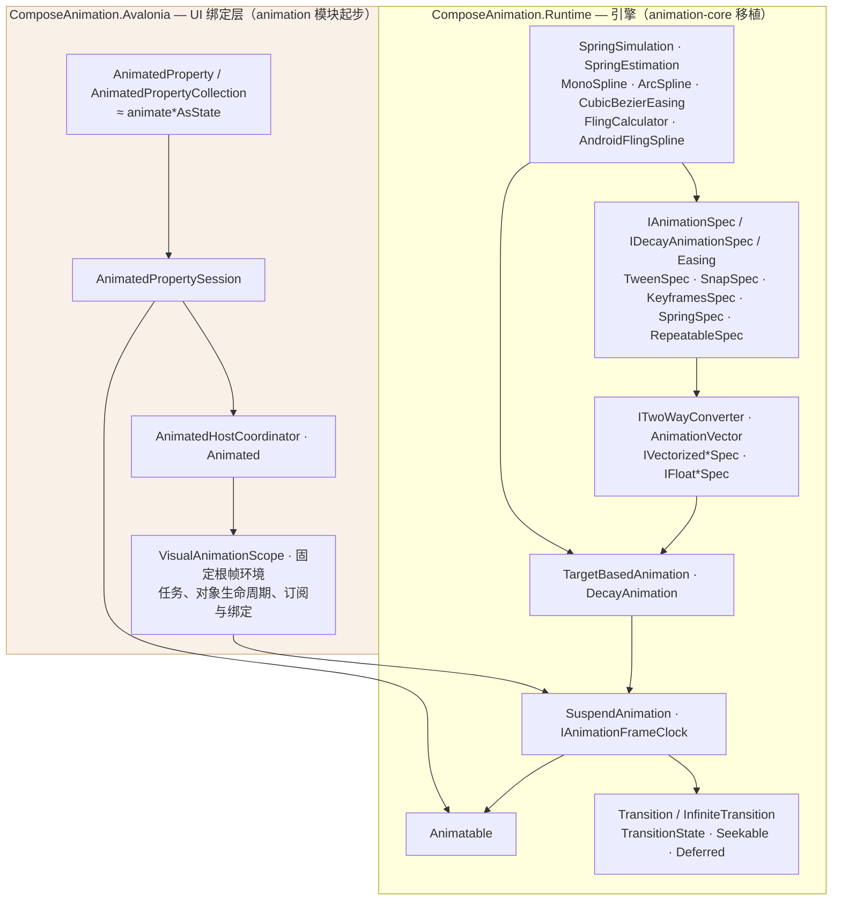

> **历史设计稿**：本文早于 2026-10 的动画基础重构，名称已过时。现行名称见 `/workspace/m3e-anim-refactor/ROADMAP.md`：`SharedAnimationFrameClock` → 内部 `FrameClock`，`VisualAnimationScope` → `AnimationScope`（`AnimationScope.Get`），`AnimationScope<T>` → `AnimationRun<T>`。

# 项目现状 · Current Status

本仓库把 Jetpack Compose 的动画系统移植到 Avalonia。目标 API 尽量贴近上游（`androidx.compose.animation:animation-core` / `animation`），仅做必要的小改动以适应 .NET 与 Avalonia 的属性系统。

## 1. 完成情况简述

- **VisualAnimationScope 已实现**：固定 TopLevel 根帧环境、工厂对象的不可逆生命周期、受管任务、订阅/绑定、根诊断、Popup 派生、属性吸附及独立 TestSupport。Catalog 和相邻 Material3ExpressiveRefactor 消费者已迁移；见 [使用与迁移](usage/visual-animation-scope.md) 和 [验收记录](VISUAL_ANIMATION_SCOPE_IMPLEMENTATION.md)。

| 部分 | 状态 | 说明 |
| --- | --- | --- |
| `ComposeAnimation.Runtime` | ✅ 基本完成 | 对应 `animation-core`（外加少量 `animation` 模块的 decay 依赖），纯逻辑、无 UI，可独立测试 |
| `ComposeAnimation.Avalonia` | 🚧 持续扩展 | `AnimatedProperty`、`AnimatedVisibility`、`AnimatedContent` / `Crossfade` |
| `ComposeAnimation.TestSupport` | ✅ 已实现 | 独立手动单帧时钟、初始化先于 Content 的测试窗口、有上限 Dispatcher 等待 |
| `ComposeAnimation.Test` | ✅ 随 Runtime 同步 | xUnit + 手动步进时钟，按类型组织测试 |
| `Catalog` | 演示与验证 | 基础动画、显隐、内容、布局与共享过渡的交互示例及自动化入口 |

- **已完成**：animation-core 的类型转换、向量化 spec、目标/decay 动画、`Animatable`、`SuspendAnimation`、`Transition` / `InfiniteTransition` 及其状态机、spring/decay/spline 底层数学、ArcSpline/MonoSpline 曲线，以及 `animate*AsState` 在 Avalonia 侧的初版等价物（`AnimatedProperty`）。
- **新增**：`AnimatedVisibility`、`EnterTransition`/`ExitTransition`、四类基础效果、`AnimateEnterExit` 与自定义动画作用域；详见 [使用文档](ANIMATED_VISIBILITY.md)。Deferred 手势接管、veil 和截帧退出留待后续。
- **SharedTransition 已接到 Host**：正式库在既有准备 / Session / 自动匹配之上提供 `SharedTransitionHost`、`SharedElement`、`SharedBounds`、默认布局读取器和 VisualBrush 后端。同一 Host 内可完成往返、运动中反向、目标布局变化、失败回退和嵌套去重。见 [使用文档](SHARED_TRANSITION.md) 与 [协调协议](SHARED_COORDINATION_PROTOCOL.md)。交互演示见 Catalog；行为验证见 SharedTransition 和 SharedBounds 测试。
- **新增**：`AnimatedContent`（多槽 enter/exit + 容器 `SizeTransform`）与 `Crossfade` 预设；见 [使用文档](ANIMATED_CONTENT.md)。DeferredAnimatedContent、veil 仍未做。
- **AnimatedContentSize 普通路径已收尾**：支持内容尺寸过渡、动态对齐、装饰与自定义模板、重挂恢复/显式回收重置、Scope 固定帧环境与错误诊断；见 [使用与上游差异](ANIMATED_CONTENT_SIZE.md)。
- **协作式 Lookahead（实验性）**：AnimatedBounds、Box、StackPanel、ScrollViewport、Size、Position 可在普通 Avalonia 父级中自动建立局部域，或加入已有父域；LookaheadRoot 保留为固定有限 viewport 的兼容入口。目标 Measure 候选可按最终槽位重复 placement，Arrange 原子提交最近实际选择的分支；未放置测量不公开 Rect、TargetBounds 或动画。Boundary 把普通 Grid/UserControl 作为外域终点，并允许内容侧建立隔离的内域。支持范围见 [Lookahead 实验](LOOKAHEAD_EXPERIMENT.md)。
- **AnimatedBounds 完整约束与中间布局（实验性）**：完整 Rect 动画、活动内层 fixed 真实重测、完成后恢复目标约束；两边界包围可组合尺寸/Padding/Offset 及自定义单子项策略。局部入口向原生父级报告终点 DesiredSize，宿主 Bounds 保持原生终点槽位，CurrentBounds 表示动画显示矩形；纯位置帧复用 Measure。见 [用法与上游差异](ANIMATED_BOUNDS.md)。
- **同步跨父级移动（实验性）**：Lookahead.MoveContent（兼容 Root.MoveContent）可在同一附着域和坐标参考内保留符合条件的 AnimatedBounds motion 状态，并补偿 motion-frame 链变化。回调或提交失败释放动画、不回滚树；不提供完整 movableContent/keyed identity、焦点、离场或 overlay 保留。
- **局部域与生命周期已接入**：上下文通过继承环境传播，并以已注册成员关系验证归属；detach、reparent、父域加入和 Boundary 穿越会清理旧域、约束缓存和 approach 状态。目标失效、approach measure 与 approach arrange 分离；位置帧不重建目标或重测整棵树。
- **SharedBounds 局部域重测（实验性）**：`ResizeMode=RemeasureToBounds` 自动加入或创建局部 Lookahead 域，显式 Root 可选；同一 SharedTransitionHost 可配对不同域的端点，各自以 CoordinateReference 转换到 Host。共享 Rect 驱动 fixed 真实测量，父级保留终点占位；最终交接验证 session、域身份、快照版本和 capture 布局。ScaleToBounds 保持普通路径，模板/任意变换/虚拟化限制仍在。见 [SharedTransition](SHARED_TRANSITION.md#experimental-live-remeasurement)。
- **协作坐标与 motion frame（实验性）**：ReferenceScope 选择同域协作祖先，AnimateMotionFrameOfReference 控制连续位移直接跟随或进入动画；LookaheadCoordinates 查询已提交目标与实际几何。LookaheadScrollViewport 支持 Offset/Extent/Viewport、双轴选择、滚轮与边缘冒泡；滚动不重建目标快照。仍不等于原生 ScrollViewer/虚拟化、RenderTransform 或跨窗口坐标适配。
- **未开始**：`animation` 模块其余高层 UI API，例如 `animateColorAsState`。
- **完整约束与统一布局策略（实验性）**：LookaheadConstraints 提供四边界；推荐同时具备 placement-host 契约的 ILookaheadLayoutPolicy，用一个 MeasureLayout 策略复用 Native/Target/Approach 三阶段，并通过 LookaheadPanel、LookaheadDecorator、LookaheadControl 自动接入。旧 ILookaheadConstrainedLayoutNode + LookaheadMeasure 双策略桥保留为兼容路径。见 [协议](LOOKAHEAD_PROTOCOL.md)。
- **尺寸与位置 approach 组合实验**：LookaheadSize 按中间尺寸实际重测，可与 LookaheadPosition 双向嵌套；两者已支持完整约束、自动入口和父域加入。它们仍使用独立动画状态，不等于 Compose 统一的 animateBounds Modifier。

## 2. 模块关系

要点：

- `Specs` 通过 `Vectorize(converter)` 产出 `Vec`（`IVectorized*Spec`）；`Calc` 同时持有 converter 与向量化 spec 计算每帧的 value / velocity。
- `Sus`（`SuspendAnimation` + `IAnimationFrameClock`）是唯一的帧循环驱动源；`Animatable` 与 `Transition` 都建立在它之上。
- `Math` 被 `Specs`（spring/tween 依赖 `SpringSimulation`/`SpringEstimation`、`CubicBezierEasing`）与 `Calc`（keyframes 依赖 `MonoSpline`/`ArcSpline`，decay 依赖 `FlingCalculator`/`AndroidFlingSpline`）共用。
- `AnimatedPropertySession` 使用 `Animatable` 驱动值，Host 保留本地逐帧目标检查和发布顺序，根 Scope 统一共享帧环境并拥有生命周期。`AnimatedVisibility` 使用 `Transition<EnterExitState>` 协调布局、绘制效果、子元素和退出完成判定。

## 3. 类型对照

> 阅读者默认熟悉 androidx 源码与 Compose 用法，故只按类别给一句话说明；同类不逐条展开。`→` 左侧为 Compose（`animation-core`，除非特别标注），右侧为本仓库实现。

### 3.1 类型转换与向量（`VectorConverters.kt` / `AnimationVectors.kt`）

`ITwoWayConverter<T>` 是 `TwoWayConverter<T, V>` 的非泛型化版本（`V` 固定为 `AnimationVector`），`AnimationVector` 内部是 `double[]`。

| Compose | 本项目 | 备注 |
| --- | --- | --- |
| `TwoWayConverter<T, V>` | `ITwoWayConverter<T>` | `VectorConverter.cs` |
| `AnimationVector` | `AnimationVector` | `AnimationVector.cs` |
| `Float` / `Int` / `Dp` / `Offset` / `Size` / `Rect` / `RoundRect` / `Color` 转换器 | `Double/Float/Int32/Point/Vector/Size/Rect/Thickness/CornerRadius/Color` | `VectorConverter.cs`，按 Avalonia 类型裁剪 |

裁剪与替换：Compose 的 `Dp` 在 Avalonia 中即 `double`；`Offset` 对应 `Point`/`Vector`；`TextUnit`/`IntOffset`/`IntSize`/`RoundRect` 无对应类型，未移植。`ColorConverter` 位于 `ColorConverter.cs`，沿用固定上游的 Oklab 转换、Float 边界及 Half / 10 位 alpha 中间存储，但**输出固定为 byte sRGB**，不提供任意源色彩空间往返。

### 3.2 规格接口与面向用户的 Spec（`AnimationSpec.kt` 等）

| Compose | 本项目 | 备注 |
| --- | --- | --- |
| `AnimationSpec<T>` / `FiniteAnimationSpec<T>` / `DurationBasedAnimationSpec<T>` | `IAnimationSpec<T>` / `IFiniteAnimationSpec<T>` / `IDurationBasedAnimationSpec<T>` | `AnimationSpec.cs` |
| `TweenSpec<T>` | `TweenSpec<T>` | |
| `SnapSpec<T>` | `SnapSpec<T>` | |
| `KeyframesSpec<T>` + `KeyframesSpecConfig` + `KeyframeEntity` | 同名 | `KeyframesSpec.cs`，`KeyframeBaseEntity` 与 `KeyframeEntity` 合并为一个 |
| `KeyframesWithSplineSpec<T>` + `KeyframesWithSplineSpecConfig` | 同名 | |
| `RepeatableSpec<T>` / `InfiniteRepeatableSpec<T>` / `RepeatMode` / `StartOffset` / `StartOffsetType` | 同名 | `RepeatableSpec.cs`，上游以顶层函数 `repeatable()` 暴露，此处直接是类 |
| `SpringSpec<T>` | `SpringSpec<T>` | |
| `ArcAnimationSpec<T>` + `ArcMode` | 同名 | `ArcAnimationSpec.cs` / `ArcMode.cs` |
| `delayed()`（内部） | `StartDelayAnimationSpec<T>`（内部） | `StartDelayAnimationSpec.cs` |

### 3.3 向量化 / 标量规格（`VectorizedAnimationSpec.kt` 等）

上游的 `Vectorized*Spec` 均带 `V : AnimationVector` 泛型，此处一律去泛型，改用 `ReadOnlySpan<double>` / `Span<double>`。

| Compose | 本项目 | 备注 |
| --- | --- | --- |
| `VectorizedAnimationSpec` / `VectorizedFiniteAnimationSpec` / `VectorizedDurationBasedAnimationSpec` | `IVectorized*` 三个接口 | `VectorizedAnimationSpec.cs` |
| `VectorizedTweenSpec` / `VectorizedSnapSpec` / `VectorizedSpringSpec` | 同名 | |
| `VectorizedKeyframesSpec` | 同名 | `VectorizedKeyframesSpec.cs` |
| `VectorizedMonoSplineKeyframesSpec` | 同名 | `VectorizedMonoSplineKeyframesSpec.cs` |
| `VectorizedRepeatableSpec` / `VectorizedInfiniteRepeatableSpec` | 同名 | `RepeatableSpec.cs` |
| `VectorizedFloatAnimationSpec` | 同名 | `VectorizedFloatAnimationSpec.cs` |
| `Vectors` / `Animations`（内部辅助接口） | `VectorValidation` + 每维 `IFloatAnimationSpec[]` | `AnimationVector.cs` |
| `VectorizedDecayAnimationSpec` | `IVectorizedDecayAnimationSpec` | `VectorizedDecayAnimationSpec.cs` |
| `FloatAnimationSpec` / `FloatSpringSpec` / `FloatTweenSpec` | `IFloat*` + 同名实现 | `FloatAnimationSpec.cs` |
| `FloatDecayAnimationSpec` / `FloatExponentialDecaySpec` | `IFloatDecayAnimationSpec` / `FloatExponentialDecaySpec` | `FloatDecayAnimationSpec.cs` |

### 3.4 Decay（`DecayAnimationSpec.kt` + `animation` 模块依赖）

| Compose | 本项目 | 备注 |
| --- | --- | --- |
| `exponentialDecay<T>()` | `DecayAnimationSpec.ExponentialDecay<T>()` | `DecayAnimationSpec.cs` |
| `calculateTargetValue` | `DecayAnimationSpec.CalculateTargetValue`（含 float/double 重载） | |
| `splineBasedDecay` / `rememberSplineBasedDecay`（`animation` 模块） | `DecayAnimationSpec.SplineBasedDecay<T>(density)` | 依赖密度参数，需在 RenderScaling 变化时重建 |
| `SplineBasedFloatDecayAnimationSpec`（`animation` 模块） | 同名 | `SplineBasedFloatDecayAnimationSpec.cs` |
| `FlingCalculator` / `AndroidFlingSpline`（`animation` 模块） | 同名（internal） | `FlingCalculator.cs` / `AndroidFlingSpline.cs` |

### 3.5 物理 / 数学 / Easing

| Compose | 本项目 | 备注 |
| --- | --- | --- |
| `Spring`（常量对象） | `Spring`（静态类） | |
| `SpringSimulation` | 同名（internal） | |
| `SpringEstimation` | 同名（internal） | |
| `MonoSpline` | 同名（internal） | |
| `ArcSpline` | 同名（internal） | 1:1 移植，含 LUT |
| `Easing`（fun interface） | 复用 Avalonia 的 `Avalonia.Animation.Easings.Easing` | 不自建 easing 基类 |
| `CubicBezierEasing` | `CubicBezierEasing`（继承 Avalonia `Easing`） | `CubicBezierEasing.cs` |
| `FastOutSlowInEasing` / `LinearOutSlowInEasing` / `FastOutLinearInEasing` / `LinearEasing` | `ComposeEasings` 同名常量 | `Easings.cs` |
| `PathEasing` | ❌ 未移植 | Avalonia 自带多种 easing，无需 path easing |

### 3.6 动画执行（`Animation.kt` / `Animatable.kt` / `SuspendAnimation.kt`）

| Compose | 本项目 | 备注 |
| --- | --- | --- |
| `Animation<T, V>` / `TargetBasedAnimation` / `DecayAnimation` / `AnimationResult` | 同名（去 `V` 泛型） | `Animation.cs` |
| `AnimationEndReason` | 同名 enum | |
| `AnimationState<T, V>` | `AnimationState<T>` | |
| `AnimationScope<T, V>` | `AnimationScope<T>` | |
| `InternalMutatorMutex` / `MutatePriority` | `MutatorMutex` / `MutatePriority`（public） | `MutatorMutex.cs` |
| `Animatable<T, V>` | `Animatable<T>` | 基于 `CommunityToolkit.Mvvm` 的 `ObservableObject` |
| `SuspendAnimation.kt`（`animate` / `animateTo` / `animateDecay`） | `SuspendAnimation` 静态类 | `SuspendAnimation.cs` |
| `withFrameNanos`（协程帧时钟） | `IAnimationFrameClock` + 根 Scope | 默认帧源内部提供，初始化时可注入测试帧源 |
| `MotionDurationScale`（协程 context） | `MotionDurationScale`（`AsyncLocal`） | `MotionDurationScale.cs` |
| `InfiniteAnimationPolicy` | ❌ 未移植 | |
| `AnimationSample` | 新增 `AnimationSample<T>` + `Sample()` | 上游无对应，聚合 value/velocity/IsFinished |

### 3.7 过渡动画（`Transition.kt` / `InfiniteTransition.kt`）

| Compose | 本项目 | 备注 |
| --- | --- | --- |
| `Transition<S>` / `TransitionSegment<S>` | 同名 | `Transition.cs` / `TransitionOfT.cs` |
| `TransitionState` / `MutableTransitionState` / `SeekableTransitionState` / `DeferredTransitionState` | 同名 | `TransitionState.cs`，基类为 `ObservableObject` |
| `Transition.TransitionAnimationState` | `Transition<TState>.TransitionAnimationState<TValue>` | `TransitionAnimationState.cs` |
| `Transition.DeferredAnimation` | `DeferredAnimation<TValue>` | |
| `updateTransition` / `animateValue` / `createChildTransition` / `createDeferredAnimation` | `AnimateValue` / `CreateChildTransition` / `CreateDeferredAnimation` | `TransitionOfT.cs` |
| `InfiniteTransition` | 同名 | `InfiniteTransition.cs` |
| `rememberInfiniteTransition` / `animateValue` | `AnimateValue`（显式传入 initial/target/spec） | `InfiniteTransition.cs` |
| `DeferredTargetAnimation`（`animate*AsState` 内部） | ❌ 未直接移植 | 其职责由 Avalonia 层的 `AnimatedPropertySession` 承担 |

### 3.8 过渡 / 无限过渡便捷扩展

`TransitionExtensions.cs` / `InfiniteTransitionExtensions.cs` 提供的 `AnimateDouble/Float/Int/Point/Vector/Size/Rect/Thickness/CornerRadius/Color` 对应上游每个 `animate*AsState` 的类型重载（`animateDpAsState`、`animateOffsetAsState` …），此处仅为 Transition/InfiniteTransition 提供 `AnimateValue` 的强类型包装。

### 3.9 Avalonia 层（`animation` 模块起步）

| Compose | 本项目 | 备注 |
| --- | --- | --- |
| `animate*AsState`（`AnimateAsState.kt`，`animation-core`） | `AnimatedProperty` / `AnimatedProperty<T>` + 10 个具体类型 | `AnimatedProperty.cs`，声明式、可经 Style 共享 |
| （Compose 通过 `remember`/快照观察） | `AnimatedPropertyCollection` + `AnimatedHostCoordinator` + `AnimatedPropertySession` | 监听 base value 变化，以 `BindingPriority.Animation` 写回 |
| （无对应） | `AnimatedSpecs.cs` | 为 XAML 提供具名 spec 类型（`DoubleSpringSpec` 等） |

`Animated`（`Animated.cs`）通过 `Animated.Properties` 挂载声明，提供继承的 `DurationScale` 播放策略和 `SnapToTargetAsync`。诊断统一由根 `VisualAnimationScope.AnimationFailed` / `LastError` 提供；演示见 `Catalog/Demos/Properties/PropertiesAnimationDemo.axaml`。

## 4. 与上游的已知差异

1. **时钟注入**：Compose 依赖协程 `withFrameNanos`；此处抽象为 `IAnimationFrameClock`（生产默认帧源由根 Scope 内部提供，测试用 TestSupport 的 `ManualAnimationFrameClock`）。
2. **线程模型**：所有公共 API 要求时钟线程（`VerifyAccess`）；状态变更经 `ObservableObject.PropertyChanged` 直接供 Avalonia 绑定消费（`Animatable.cs`）。
3. **时间表示**：上游用 `Long`（纳秒）记录帧时间，此处用 `TimeSpan`；`AnimationConstants.UnspecifiedTime = TimeSpan.MinValue` 对应上游 `Long.MIN_VALUE`。
4. **数值精度**：动画求解与向量存储用 `double`（上游向量用 `Float`）；颜色转换按固定上游保留 Float / Half 边界。velocity 经 `AnimationVector` 保留未投影精度（整数 / 颜色转换器）。
5. **`MotionDurationScale`** 用 `AsyncLocal` 取代协程 context element。
6. **颜色**：`ColorConverter` 输出固定 byte sRGB，`VisibilityThresholds` 因此不提供 Color 阈值（见 `VisibilityThresholds.cs` 注释）。
7. **`Animatable.Stop`** 是取消信号而非 mutation，可在帧回调内安全调用（`Animatable.cs`）。
8. 由于上游 `Vectorized*Spec` 的 `V` 泛型被去掉，`AnimationVector` / `ITwoWayConverter` 均为非泛型，`Vectorize` 依赖 `converter.Dimension` 决定维度。

## 5. 测试

`ComposeAnimation.Test`（xUnit）按类组织：`SpringSpecTest`、`KeyframesSpecTest`、`KeyframesWithSplineSpecTest`、`RepeatableSpecTest`、`SnapSpecTest`、`DecayAnimationSpecTest`、`SplineBasedDecayTest`、`TargetBasedAnimationTest`、`MutatorMutexTest`、`AnimatableTest`、`TransitionStateTest`、`TransitionTest`、`TransitionBoundaryTest`、`InfiniteTransitionTest`、`SuspendAnimationTest`、`VisibilityThresholdsTest`、`ColorConverterTest`、`EasingsTest` 等。

- 纯逻辑测试用 `ManualAnimationFrameClock` 手动步进，保证确定性。
- 属性层测试（`AnimatedPropertyTest`）走 `Avalonia.Headless`（`TestApp.cs`）。
