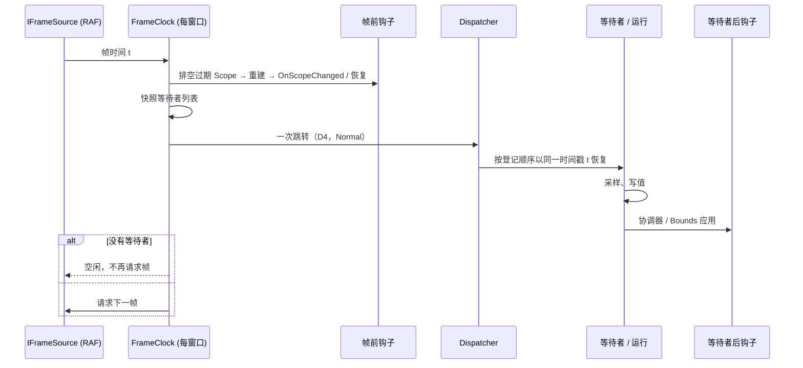
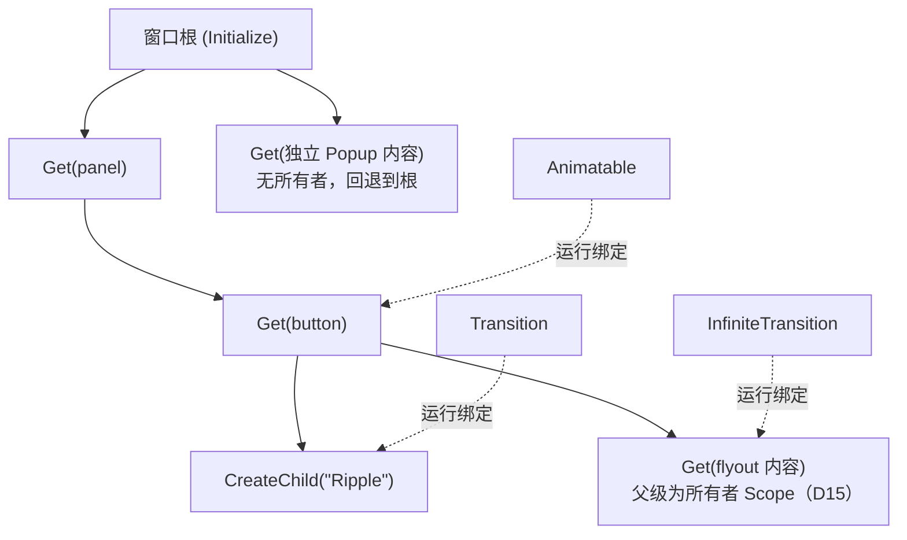
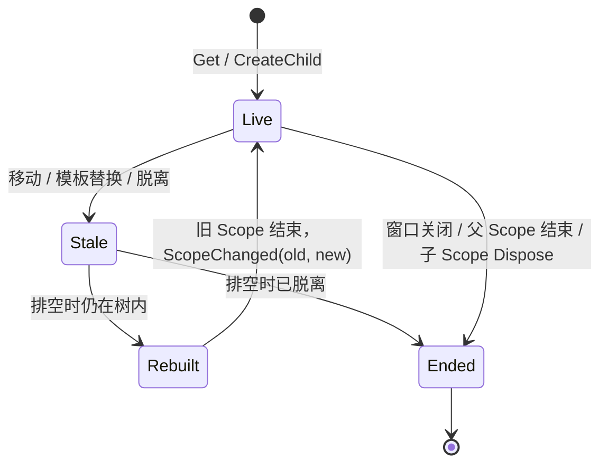

# AnimationScope：动画环境与生命周期

Scope 管理直接动画、任务、值订阅和动画属性贡献。Material 等消费者继续决定目标值、规格和交互规则。

## 建立根环境

在 UI 线程、加载 XAML 或设置 Content **之前**初始化，每个应用 TopLevel 仅一次：

```csharp
public MainWindow()
{
    var root = AnimationScope.Initialize(this);
    root.AnimationFailed += (_, failure) =>
        logger.LogError(failure.Exception, "{Host}: {Operation}",
            failure.Host.GetType().Name, failure.OperationLabel);
    InitializeComponent();
}
```

`Initialize(window, clock)` 可以提供固定帧源；源仍由提供者拥有。默认 UI 帧源和每窗口唯一的内部 FrameClock 由内部实现提供，旧的共享帧时钟类型已删除。同根控件和派生 PopupRoot 自动共享按需请求，空闲时不泵帧；Overlay 使用所在根环境。关闭窗口结束根环境，根没有公开的 `Dispose`；根结束后不能重新初始化同一个普通 TopLevel。

## 控件与 Scope 归属

控件已附着后调用 `AnimationScope.Get(owner)`（`owner` 为 Visual），重复调用返回同一个 Scope。它的父级是最近的祖先控件 `Get` Scope（沿继承链，含 Popup/Flyout），否则是窗口根。不要释放它：控件脱离树时 Scope 结束；在树内移动时 Scope 会被标记为过期，并在下一帧等待者恢复前合并重建一次（每帧至多一次），随后控件的直接路由事件 `AnimationScope.ScopeChangedEvent` 触发，参数 `AnimationScopeChangedEventArgs` 携带 `OldScope` 与 `NewScope`（控件离开树时 `NewScope` 为 null）。用 `AnimationScope.AddScopeChangedHandler(control, handler)` / `RemoveScopeChangedHandler` 订阅，并在处理程序中重启运行；恢复期间发生的移动从下一帧生效。

控件脱离树时 Scope 不会同步结束：它与移动一样先标记为过期，在下一次排空（下一帧开始前，或没有帧时由一次合并的分发器回调）结束，`ScopeChanged` 以 `NewScope = null` 触发；在此之前它的任务和动画仍在运行。若 Scope 已因父 Scope 结束而结束，`Get` 会当场同步重建它（同时触发 `ScopeChanged`），因此 `Get` 不会返回已结束的 Scope。通过 `AddScopeChangedHandler` 添加的处理程序相互隔离：某个处理程序抛错会被报告到 `AnimationFailed`，其余处理程序照常执行。非 `Interactive` 宿主的事件参数 `Source` 为 null。没有宿主会推迟自身 Scope 的重建：`Lookahead.MoveContent` 是同步事务，事务进行期间排空不会运行（窗口根上的移动标志让排空保持队列不动，事务提交或中止后再重新安排）。事务提交后，即使跨不同祖先 Scope 移动，`AnimatedBounds` 的飞行也会在下一次排空时移入新 Scope（随之采用新 Scope 的 `DurationScale` 与生命周期），不会中断。

内置宿主在 Scope 重建时恢复在途运行，而不是重启或丢弃：`AnimatedVisibility`、`AnimatedContent`、`AnimatedContentSize`、`LookaheadSize`、`LookaheadPosition`、`AnimatedBounds` 与 `Animated.Properties` 都把当前值与速度带入新 Scope；控件脱离且不再挂回时在该次排空释放。`AnimatedBounds` 仅在运动参考基准不受影响时恢复（同一坐标参考祖先、同一运动帧），否则释放。重建处理程序若让宿主再次过期，会在下一帧再重建一次，期间数值保持一帧。

```csharp
var motion = AnimationScope.Get(button);
var surface = currentSurface; // 捕获本次模板，异步退出不重新读取可变字段
var alpha = Animatable.Create(0d, label: "State layer");
motion.SubscribeValue(alpha, value => surface.SetLayerOpacity(value));

_ = motion.Launch(ct => alpha.AnimateToAsync(motion, .12,
    new TweenSpec<double>(TimeSpan.FromMilliseconds(75)), cancellationToken: ct), "Hover");
```

```csharp
AnimationScope.AddScopeChangedHandler(button, (_, e) =>
{
    if (e.NewScope is { } scope) _ = StartHoverAsync(scope); // 持有旧 Scope 的运行在这里重启
});
```

逻辑子 Scope 用 `scope.CreateChild(label)`，返回 `AnimationChildScope : AnimationScope, IDisposable`；`using var child = scope.CreateChild();` 只结束该子 Scope 及其后代，父 Scope 结束或重建时它也会自动结束。没有 `DisposeAsync`。

`Animatable`、`Transition`、`InfiniteTransition` 只是状态，不持有时钟、生命周期或 Scope（D19）。每次运行在调用处指定 Scope：`AnimateToAsync(scope, …)`、`AnimateDecayAsync(scope, …)`、`RunAsync(scope, …)`、`SeekableTransitionState.AnimateToAsync(scope, …)`；Scope 提供帧、生命周期和时长倍率。Scope 结束时其中的运行被取消，之后在该 Scope 上启动运行会抛 `ObjectDisposedException`；状态对象本身不受影响，可以在新 Scope 中从停下的值继续。不带 Scope 的成员（`SnapToAsync`、`UpdateTarget`、`Stop` 等）只在对象自身 `Dispose` 之后抛错。同一对象的第二次运行接管第一次：旧运行的清理完成后新运行才采样。

## FrameScope：运行为什么接收 Scope

`ComposeAnimation.Runtime` 不依赖 Avalonia，因此不认识 `AnimationScope`。运行入口接收它的基类 `FrameScope`：提供 `NextFrameAsync`、`Lifetime`（Scope 结束时取消）与有效 `DurationScale`。`AnimationScope` 就是一个 `FrameScope`，所以 `alpha.AnimateToAsync(AnimationScope.Get(this), …)` 直接可用；`SuspendAnimation` 等运行时辅助同样接收 `FrameScope`。

`scope.DelayAsync(delay, ct)` 是普通的挂起等待：不请求动画帧、不受 `DurationScale` 影响，取消跟随调用者令牌与 Scope 生命周期；负的 `delay`（`Timeout.InfiniteTimeSpan` 除外）同步抛 `ArgumentOutOfRangeException`。

## ScopeChanged 的重入

`ScopeChangedEvent` 是直接路由事件。`AddScopeChangedHandler` 添加的处理程序彼此隔离（抛错报告到 `AnimationFailed`，其余照常执行）；直接用 `AddHandler(ScopeChangedEvent, …)` 添加的处理程序**不隔离**，抛错会打断同一次分发。处理程序内再次移动控件或让 Scope 过期是允许的：它在下一帧再重建一次（每帧至多一次，D18），期间数值保持一帧。

## 重建规则

- **父级**：沿逻辑/继承父链找最近的 `Get` Scope（D13），否则窗口根。
- **过期与排空**：移动、模板替换、脱离只把 Scope 标记为过期；同一帧内的多次变化合并，在下一帧等待者恢复前统一排空（D14/D16）；没有帧时由一次合并的分发器回调排空。
- **每帧至多一次**（D18）：排空中再次过期的宿主留到下一帧。
- **弹层**（D15）：`Flyout`、`ContextMenu`、`ToolTip` 的内容以所有者控件的 Scope 为父，继承其 `DurationScale` 并共用窗口帧时钟；独立 `Popup` 没有所有者 Scope 时回退到所在窗口的根。

## D17：恢复而不是重启

七个内置宿主在重建时把当前值与速度带入新 Scope 继续：`AnimatedVisibility`、`AnimatedContent`、`AnimatedContentSize`、`LookaheadSize`、`LookaheadPosition`、`AnimatedBounds`、`Animated.Properties`。仍然重置的情况：

- 显式 `ResetAnimation`；
- 真正的 Lookahead 上下文变化（进入另一个 Lookahead 根）；
- `AnimatedBounds` 的运动参考基准改变（Q-H：坐标参考祖先或运动帧不同）；
- 控件脱离后没有在本次排空前挂回：在排空时释放。

批次进行中发生的换父从下一帧生效。

## MoveContent 规则

`Lookahead.MoveContent` 是同步事务：事务内不能发生布局、帧或分发器轮转，否则抛 `InvalidOperationException("MoveContent failed: {reason}. Tree edits are not rolled back.")`——已做的树编辑**不会回滚**。事务打开期间排空被挂起；提交后，已提交的 `AnimatedBounds` 飞行在下一次排空时移入新 Scope，随之采用新 Scope 的 `DurationScale` 与生命周期（Q-E），不会中断。

## 已知交互

同一属性上不要同时使用 Avalonia `Transitions` 与 `Animated.Properties`：运行期间较新的 `Animated.Properties` 贡献胜出；它结束后 Avalonia 过渡自己的值重新显现，而该过渡按 Avalonia 的墙钟计时而非 Scope 的帧时钟，结果不确定（O6，`KnownInteractionsTest` 记录当前行为，不是承诺）。

## 已知限制

- **O3**：D18 的“每帧至多一次重建”是权宜方案；处理程序反复让宿主过期时，数值每次保持一帧。
- **O7**：被取消的运行在何处展开（内联还是投递）取决于它启动时的 `SynchronizationContext`；Avalonia 每个优先级一个上下文，属性变化中启动的运行按 Normal 投递，布局中启动的按 Render 投递。详见研究备忘（仓库外 `O7.md`），目前没有修改承诺。
- **O2（帧跳转）**：每帧的分发器跳转（D4）有约 356 B 的固定分配，与动画数量无关；替换它需要改变顺序，留待评审。

## 图示

一帧的流程：



Scope 树：



Scope 的生命：



## 任务、取消和诊断

`Launch(Func<CancellationToken, Task>, label?)` 在调用线程同步调用委托，在用户代码之前登记，不使用 Task.Run。它返回委托原任务，保留成功、取消和失败状态，同时完整观察错误。委托的同步异常转成失败任务；错误线程、已结束 Scope 或空委托属于同步调用错误。

新任务不会预先停止已有动画。Animatable 自身的互斥、中断、当前值与速度接续规则不变。一个任务失败不会取消兄弟任务。顺序流程应等待子任务并传递取消令牌；用户在流程内部自行创建并丢弃的任意业务任务不会自动被接管。

`scope.NextFrameAsync(ct)` 等待窗口的下一帧，并在该帧批次中内联恢复；取消跟随令牌与 Scope 生命周期。

根 `AnimationFailed` 提供 `FailureId`、`SourceScope`、实际 `Host`、可选 `OperationLabel` 和原始异常；`LastError`、`LastDiagnosticError` 等诊断成员不再公开，统一从这里取失败。取消任务不报告；以 Faulted 状态完成的任务即使携带 OperationCanceledException 也报告。聚合异常逐项处理，未保留来源的新异常是新失败。受管操作链、保留的 await/EDI 异常传播轨迹用于去重，不按消息文本去重；弱异常记录不持有永久任务或 Scope 历史。

诊断处理器抛错不会打断其他处理器或必要清理，也不递归发布。帧源故障在根报告一次，并停止同一固定环境的后续源请求。规格和局部回调故障不破坏其他控件的帧源。

## 值订阅与动画绑定

```csharp
var progress = Animatable.Create(0d);
using var binding = motion.BindAnimatedValue(bar, ProgressBar.ValueProperty, progress);
using var subscription = motion.SubscribeValue(progress, value => UpdateDrawing(value));
```

建立关系立即发布当前值，响应 Value、null 或空属性名通知，不额外合并相等值。订阅不拥有外部传入的动画对象。

`BindAnimatedValue` 以单向 Animation 优先级贡献采样值，不建立额外过渡。释放只移除自己的贡献，恢复普通绑定、样式或本地值。两类资源可提前释放，也会在 Scope 结束时统一撤销。Ending 后同步重入或排队通知不再通过受管消费端更新。

## 结束与临时效果

Scope 因控件脱离树、在树内移动重建、父 Scope 结束或重建、窗口关闭而结束。结束时先禁用订阅再撤销绑定，随后取消任务和帧等待、停止动画；它不阻塞 UI，也没有公开的 `Dispose`/`DisposeAsync`。持有旧 Scope 的运行在 `ScopeChanged` 处理程序中重启；忽略取消的用户代码仍需自行合作退出。

临时效果用子 Scope，随 `using` 结束：

```csharp
using var ripple = motion.CreateChild("Ripple");
var radius = Animatable.Create(0d);
ripple.SubscribeValue(radius, value => surface.SetRippleRadius(value));
await ripple.Launch(ct => radius.AnimateToAsync(ripple, 100, cancellationToken: ct), "Grow");
```

子 Scope 提前 `Dispose()` 只结束它自己和后代，父 Scope 不受影响；父 Scope 结束或重建时也会自动结束它。完成任务和提前释放的消费资源会及时移出活动登记。

## 调速与属性吸附

Scope 链的 `DurationScale` 是继承的时长乘数；控件子树用继承的附加属性 `AnimationScope.DurationScale`（`AnimationScope.GetDurationScale` / `SetDurationScale`，XAML 写作 `AnimationScope.DurationScale="0.5"`）。有效倍率 = Scope 链的 `DurationScale`（根在初始化时取自 `MotionDurationScale.ScaleFactor`）× 宿主自身的附加属性值。4 表示 0.25× 播放，0 让有限动画在下一帧到达终点。它们改变播放策略，保持原始帧时间戳；倍率变化时沿用上游语义：`Transition` 按新倍率从起点重算播放时间（`(帧时间 − 起点) / 倍率`，可能出现一次跳变），`InfiniteTransition` 从初值重新起播；`Animatable` 的单次运行按每帧增量计时。0 时有限动画到达终点，`InfiniteTransition` 吸附到目标并在倍率恢复为正数后重新起播。

在 `Get` 得到的 Scope 上直接设置 `scope.DurationScale` 会在该 Scope 重建后丢失，需要时在 `ScopeChanged` 处理程序中重新设置。

```csharp
AnimationScope.SetDurationScale(demo, 4);
await Animated.SnapToTargetAsync(border, Visual.OpacityProperty);
```

属性吸附立即结束当前贡献并读取实际基础目标，即使目标未变也结束。声明、Spec、普通绑定和样式保持原样，未来目标变化继续按声明播放。

## 测试支持

测试项目通过 NuGet 引用同版本的 `ComposeAnimation.TestSupport` 包：

```csharp
using var clock = new ManualFrameSource(Dispatcher.UIThread.VerifyAccess);
var window = new AnimationTestWindow(clock) { Content = control };
window.Show();
Dispatcher.UIThread.RunJobs();

var motion = AnimationScope.Get(control);
var value = Animatable.Create(0d);
var playing = motion.Launch(ct => value.AnimateToAsync(motion, 1,
    new TweenSpec<double>(TimeSpan.FromMilliseconds(100)), cancellationToken: ct));
clock.SendFrame(TimeSpan.Zero); // 显式起点帧
Dispatcher.UIThread.RunJobs();
clock.AdvanceBy(TimeSpan.FromMilliseconds(100)); // 只发送这一帧
await AnimationTestDispatcher.WaitUntilAsync(() => playing.IsCompleted);
await playing;
window.Close();
```

`SendFrame` 绝对时间单调不减；`AdvanceBy` 不隐式补帧。手动时钟支持多等待者、取消、PendingFrameCount 和 Dispose。送帧不代表布局或渲染完成。条件等待有 Dispatcher 轮数上限，也不声称整个应用已空闲。`window.Close()` 结束根环境，根没有公开的 Dispose。

## 从旧 API 迁移

旧的 Scope、时钟和工厂成员已删除，没有兼容别名。逐项对照、前后代码与行为差异见 [迁移指南](migration-from-visual-animation-scope.md)。
