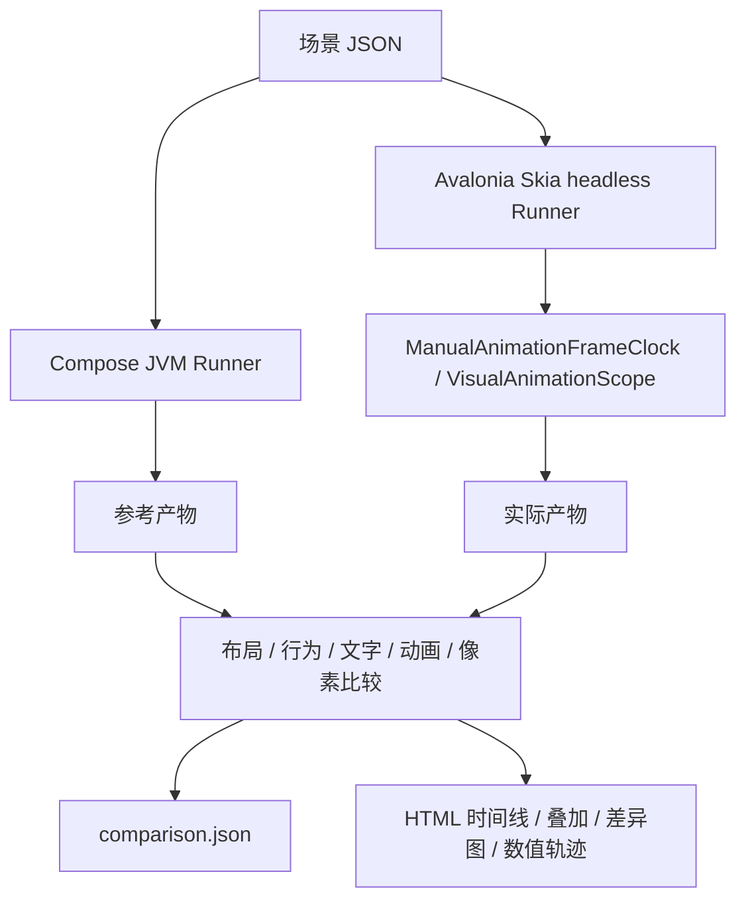

# Visual parity

真实 Compose Material3 与 Material3Expressive 的确定性差分测试。参考版本来自
[`docs/upstream-baseline.json`](../../docs/upstream-baseline.json)，首批覆盖 Surface、Button、
IconButton、文本排版和 ComposeAnimation 数值／中断场景。

## 运行

目前支持 Windows x64。需要 .NET 10、可运行 Gradle 9.7.1 的 JDK（本机使用 JDK 25）及仓库 README 中的本地 NuGet 包。
首次构建需要访问 Maven Central、Google Maven 和 Gradle 分发站点。

在仓库根目录：

```powershell
./tests/VisualParity/parity.ps1 build
./tests/VisualParity/parity.ps1 list
./tests/VisualParity/parity.ps1 run --case surface.radius-12
./tests/VisualParity/parity.ps1 run --family button
./tests/VisualParity/parity.ps1 run
./tests/VisualParity/parity.ps1 test
./tests/VisualParity/parity.ps1 self-test --case motion.tween.reverse
./tests/VisualParity/parity.ps1 capture-actual --case button.filled.label
```

每次 run 输出独立目录，默认为 `artifacts/visual-parity/<run>/`。报告路径会显示在控制台。
运行时将验证过的场景及其默认值写入该目录，两端均读取这份快照，避免运行期间源场景的修改影响其中一端。
可用 `--output <new-directory>` 指定位置；已存在的目录不会被覆盖。
`--refresh-reference` 强制重新捕获参考，保留新的产物供重复性调查。
`run` 对含输入事件的实际捕获执行重复运行和加密检查点自检；不稳定时为 ERROR。
`self-test` 在两侧分别执行这两项自检，**不是两侧一致性验收**；其 JSON 的 `kind` 为 `repeatability`。
`capture-actual` 不构建或运行 Compose，只导出实际观测，结果为 UNVERIFIED。

Agent 修改组件时，先运行对应 `--case` 或 `--family`，读取 `comparison.json` 的首次差异帧、
探针和指标，再用 HTML 检查同一帧的叠加、文字图层与数值轨迹。修改后复跑该场景；
新增交互／动画时补上相应事件场景并执行 `self-test`。报告中的 PASS 只覆盖场景声明的能力。
ERROR 应先调查采集环境或重复性；UNVERIFIED 表示缺少必要证据，不能作为迁移通过。
FAIL 保留具体差异，不通过更新截图、移动图像或扩大单个组件的阈值消除。

```powershell
./tests/VisualParity/parity.ps1 inspect --directory artifacts/visual-parity/<run>/<case>
./tests/VisualParity/parity.ps1 verify-reference --directory artifacts/visual-parity/<run>/<case>/expected
```

`verify-reference` 检查文件集合、内容哈希、Runner 身份和当前基线；它不重新构建，也不证明组件已对齐。

退出码：`0 PASS`、`1 FAIL`、`2 ERROR`、`3 UNVERIFIED`。
混合结果按 ERROR、FAIL、UNVERIFIED、PASS 的顺序返回；每个失败和未验证项都保留在 JSON 中。

## 执行结构



两个 Runner 独立构建真实组件。固定内容槽隔离容器问题；真实文字场景保留自然测量与字形渲染。
Button 与 IconButton 均使用接受 `shapes` 的 Expressive 重载，保留上游的按压形变。
图标场景用相同 Material Symbols Rounded 字体文件，但两侧使用各自的实际绘制路径，不能据此
把字形路径差异归因于 IconButton 的容器。

每个场景创建新组件树，所有帧连续执行。时间单位为整数微秒，.NET 按 100ns tick 转换，
Compose 按 ns 转换。动画首帧时间为 1 秒；显式安装阶段为 -2000us 和 -1000us，
均早于任何输入。安装之后不插入针对某个动画的注册帧，不对齐各自的启动时间。

同时间点顺序：文件中排在前面的输入 → 当前可运行任务 → 动画帧 → 当前可运行任务 → 布局绘制 → 观测。
帧间输入独立交付，不额外送动画帧。Compose 协程调度器的延迟分辨率仍为 1ms；
Avalonia 的框架计时器没有被这个动画时钟接管，因此不声明 `virtualDelays` 能力。

Compose 直接使用固定版本的 `FrameRecomposer` 与 `CanvasLayersComposeScene`，遵循其
`ImageComposeScene` 的执行顺序，将动画帧投递与绘制分开。辅助绘制不投递帧。
这是测试宿主对 `InternalComposeUiApi` 的使用，升级参考时必须重新核对。
Avalonia 每帧有界处理 Dispatcher 和真实 Skia 绘制，用 `GetLastRenderedFrame` 被动读取。
`CaptureRenderedFrame` 会触发额外 render tick，故不用于检查点。超时与动画异常作为 ERROR。
捕获不会推进自定义动画时钟；捕获前的框架绘制工作仍由宿主显式完成。
关闭窗口后等待动画根作用域的 `DisposeAsync`（最多 5 秒），并检查未完成的任务、子作用域和动画均已清除；
清理过程中报告的异常也计入捕获结果，随后才开始下一个场景。

## 场景和扩展

`scenarios/*.json` 为唯一共享实验定义。字段见 `Material3Expressive.Parity/Contracts.cs`，
Kotlin 的对应序列化类型在 `reference/src/main/kotlin/Main.kt`。
未知字段、未知操作、倒退时间和无效检查点在运行前失败，不能静默忽略。

支持组件：`surface`、`button`、`iconbutton`、`text`、`motion`。
输入：`down`、`up`、`move`、`leave`、`disable`、`detach`、`target`。
target 只用于 motion；tween 为 100ms Linear，spring 为 stiffness 1600、阈值 .01。
Surface/motion 的 `container`、Button/IconButton 的 `allocation`、内容、文字和图标分别导出稳定探针。
`allocation` 为组件在父布局中的占位；Compose 的 48dp 最小交互布局可能大于其绘制容器，
该探针不能当成背景边缘或真实命中区域。内部 UI 树不要求一致。
颜色由场景显式提供，首批场景用于隔离布局和绘制；它们不验收默认动态颜色算法。

新增组件时，在两侧 Runner 各自添加 fixture，定义对应探针和实际支持的观测能力，再添加场景。
必需能力在 `required` 中声明。没有探针或时间控制能力时，标为 UNVERIFIED；
不得把输入的配置值当作实际测量，或为了截图一致另建测试专用动画／字体求解器。

## 产物与判定

每个 case 目录包含 `scenario.json`、`profile.json`、`comparison.json`、`report.html`，
以及 expected/actual 两个捕获包与 diff/ 的图像、全图指标和区域指标。
捕获包包含 `observations.json`、`trace.json`、`frames/` 和逐文件 SHA256 manifest。
非检查点仍采集布局、行为和动画数值，因此报告可以定位到首次差异帧。

参考缓存键包含场景、基线、字体、安装后的参考程序与运行依赖、操作系统、CPU 架构和 Java 版本。
实际结果记录 Material、ComposeAnimation Runtime/Avalonia、Runner DLL 哈希和 NuGet 锁哈希。
缓存命中仍校验 manifest；损坏缓存报错，不静默替换为成功。

布局以 DIP 比较，像素保持原坐标，解码为非预乘 RGBA，在 sRGB 中比较通道。
全图检查可以发现参考区域外多画的像素；区域指标使用两侧边界的并集，不移动或缩放图像。
颜色通道最大差、不同像素数量、差异边界、覆盖量与轮廓距离都保存。
轮廓距离采用 chamfer 距离，仅作诊断，不自动决定通过。

当前 `strict-v1`：布局 .01 DIP、动画绝对误差 .001、通道差 2、超限像素数 0。
这些是保守起始门槛，尚非跨字体／渲染器的校准结论。
文字不被遮罩；比较实际文本、字号、字重、字距、行数、基线、行宽／高度、截断与完整图像。
独立 text fixture 显式设置字距（默认 0），避免继承 Compose Material bodyLarge 的 .5sp 字距；
Button 标签仍使用组件自身的文字样式。
`textLayers` 保留原树的测量，额外隐藏文字绘制，生成 `without-text/`。
两次真实绘制的像素差生成灰度文字绘制贡献图，保存在 `text-paint-*`；它不是推导出的 alpha 覆盖图。
比较器分别输出非文字指标、文字贡献指标和全图指标，报告可切换图层。
文字抗锯齿差异可能产生 FAIL，应先调查和校准，不能给单个组件扩大遮罩。

## 已实现边界

- 主要执行环境为 Windows x64，density=1、fontScale=1；其他缩放配置返回 UNVERIFIED。
- Compose 未导出实际解析字体，`resolvedFont` 必需时返回 UNVERIFIED；实际字体文件哈希
  只证明输入文件相同，不证明所有字符没有 fallback。Avalonia 导出实际 shaped run 的字体家族。
- 已有无文字辅助捕获和文字绘制贡献诊断；尚未实现独立 alpha 覆盖图、文本簇／caret 比较
  及经过校准的抗锯齿容差。当前不会自动豁免字形差异。
- 组件交互的动画差异由连续图像和布局检查；数值 value/velocity trace 目前用于 motion 引擎场景。
  不声称已经观察到了组件内部 ripple 或 shape 的全部数值。
- 未接管 SharedTransition preparation timeout 或任意业务 Task.Delay，不覆盖原生 Android RippleDrawable。
- 首批尚不包含原生窗口输入、键盘、焦点、Popup、所有尺寸变体和跨操作系统验收。
- 本地 NuGet 包源和子模块可获取性的限制仍沿用仓库 README；脚本可作为 CI 入口，但不能
  宣称当前公共 CI 已能在没有这些依赖的全新克隆上运行。

## 系统自身的验证

`Material3Expressive.Parity.Tests` 包含阈值边界、缺失能力、错误帧序列、字体环境不一致、
产物篡改、小特征丢失、速度清零、单帧批次、重复 headless 捕获、真实 Button 输入和真实 Surface
圆角缺陷注入、文字绘制与测量分离及截图密度不变性。跨 Runner 的重复性用 `self-test` 独立验证。

2026-09-30 本机验证：锁定依赖的 Compose 构建和真实捕获、整个 .NET 解决方案构建、
17 项系统测试及 171 项现有控件测试通过。35 个场景的双端对比为 3 PASS、31 FAIL、1 ERROR；
独立重复性自检为 34 PASS、1 ERROR。结果分别保存在
`artifacts/visual-parity/delivery-run/` 与 `artifacts/visual-parity/delivery-self-test/`（本地生成，不提交）。
这份记录对应报告内的二进制和环境哈希，不能替代后续修改后的验证。

目前已观察到：

- `button.filled.disable-pressed` 在相同输入下以及增加截图检查点时出现像素变化，
  因此返回 ERROR；尚未确定其发生在组件、动画运行时还是宿主调度中。
- Button 的布局占位／宽度与参考不同；文本仍有基线和绘制差异。圆角边缘的像素差
  也可能来自两侧 Skia 版本，当前没有把这一可能性当成已接受差异。
- 非整毫秒的 spring 场景出现数值偏差，整毫秒的不规则帧场景通过；
  固定上游的 FloatAnimationSpec 将纳秒截断为毫秒，本地实现使用秒数。
  tween 中断场景还存在 float／double 速度残差。测试工具保留这些差异，没有修改动画库。

## 升级参考

日常构建使用 Gradle 依赖锁／SHA256 验证和 NuGet locked restore，不自动写新锁。
升级由维护者审查基线、构建版本、源码差异及验证元数据后执行：

```powershell
Push-Location tests/VisualParity/reference
./gradlew.bat resolveLocks installDist --write-locks --write-verification-metadata sha256
Pop-Location
```

检查实际解析的 runtime/UI/foundation/animation/Material3 版本，再重新运行代表场景和 self-test。
新版本使用独立参考缓存；旧验证不会自动变成新版本的验证。
