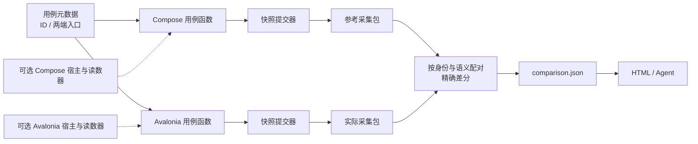
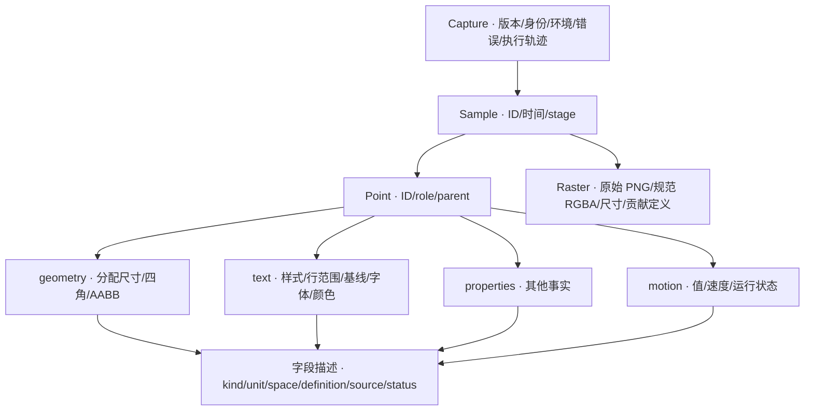
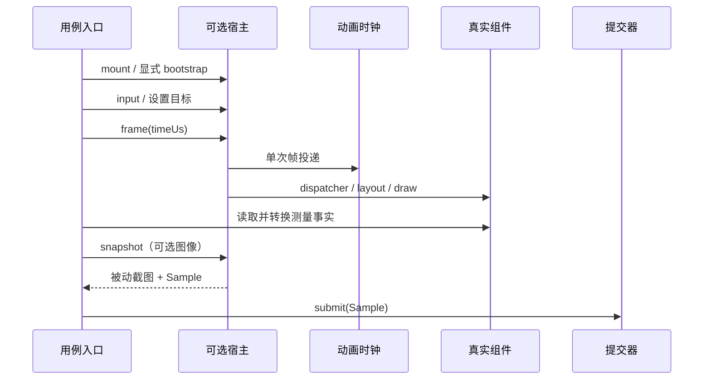

# Visual parity · schema 2

采集 Compose 与 Avalonia 两端的测量事实，呈现差异。系统不推断原因，不提供修复建议，
不通过文字遮罩、图像配准、经验偏移或组件专用容差消除差异。

## 结构



一个测试用例对应 `cases/<id>.json`、一个 Kotlin `suspend` 入口和一个 C# `Task` 入口。
用例自己构建场景、初始化状态、执行输入、推进帧并决定何时提交什么数据。
框架没有通用组件开关、可复用场景注册表或 JSON 操作语言。例子的构建和读取函数只是测试作者的代码，
复用方式不受框架约束。`protocol.direct` 演示完全自行构造快照与透明像素夹具，不使用宿主；它同时核验跨语言的非预乘 RGBA 协议。

| 文件 | 职责 |
| --- | --- |
| `cases/*.json` | 用例身份、描述、分类和两端入口名称；不承载场景参数或事件列表 |
| `Material3Expressive.Parity/Cases.cs` | Avalonia 用例入口及这些用例自行共享的函数 |
| `reference/src/main/kotlin/Cases.kt` | Compose 用例入口及其共享函数 |
| `Contracts.cs` / `Contracts.kt` | 双端数据协议、快照身份和测量描述 |
| `AvaloniaCapture.cs` / `Host.kt` | 可选宿主、快照提交、明确分开的帧、绘制和捕获 |
| `Measurements.cs` / `Measurements.kt` | 可选几何、文字读数；返回值可被作者替换或补充 |
| `Comparison.cs` | 配对、数值和像素差分、区域统计 |
| `Report.cs` / `Report*.html` / `Report.styles.css` | 同一差分 JSON 的交互呈现；详情与汇总共用样式，生成后内嵌为独立 HTML |
| `ReferenceProducer.cs` | 参考进程、内容寻址缓存与产物复制 |

## 运行

当前执行参考为 Windows x64、density=1、fontScale=1。需要 .NET 10、JDK（本机 JDK 25）、
锁定的 Gradle 依赖及项目 README 中的本地 ComposeAnimation NuGet 包；没有使用兄弟仓库 ProjectReference。
参考源码与制品版本按 [`upstream-baseline.json`](../../docs/upstream-baseline.json) 固定。

```powershell
./tests/VisualParity/parity.ps1 build
./tests/VisualParity/parity.ps1 list
./tests/VisualParity/parity.ps1 run --case button.filled.press
./tests/VisualParity/parity.ps1 run --family button
./tests/VisualParity/parity.ps1 run
./tests/VisualParity/parity.ps1 self-test --case motion.interrupted
./tests/VisualParity/parity.ps1 test
./tests/VisualParity/parity.ps1 capture-actual --case text.wrapped
```

输出默认在 `artifacts/visual-parity/<run>/`。`--output <new-directory>` 指定新目录，不覆盖已有目录。
运行前冻结元数据为 `case.json`，两侧读取同一份。源码和二进制身份由环境哈希记录。
`--refresh-reference` 重新捕获参考；缓存命中也验证文件集合、哈希、观测和像素协议。

`run` 成功生成报告时返回 **0**，即使观察到差异或未比较项。执行错误返回 **2**。
需要外部严格门禁时显式加 `--require-equal`：存在差异返回 **1**，只有未比较项返回 **3**；
执行错误仍优先返回 2。这个门禁只覆盖实际提交的事实，不证明测试作者没有遗漏某个维度；不包含经验阈值，也不把环境版本差异算作组件差异。
`capture-actual` 保留实际读数，参考缺失的项目为 `notCompared`。

`self-test` 仍生成双端差分，另在 `repeatability.json` 中分别记录两端重复捕获和增加截图的结果。
自检对观测、环境、执行轨迹和共有截图做精确比较；增加截图只允许增加捕获记录和额外的被动截图。
自检不稳定返回 2，不能把自检成功理解为组件视觉一致。普通 `run` 不额外重复运行用例。

```powershell
./tests/VisualParity/parity.ps1 inspect --directory artifacts/visual-parity/<run>/<case>
./tests/VisualParity/parity.ps1 inspect --directory artifacts/visual-parity/<run>/<case> --sample initial --x 120 --y 80
./tests/VisualParity/parity.ps1 verify-reference --directory artifacts/visual-parity/<run>/<case>/expected
```

`compare --directory <case-directory>` 可以直接从已有采集包重新生成差分与报告，不执行两端入口，
也不修改原始包。先验证 manifest 与冻结的 case.json 身份；可用于独立分析或重新呈现历史 schema 2 数据。
像素查询返回结构化 JSON，读取用于差分的 RGBA 文件。`verify-reference` 校验包和当前基线，不表示组件已经对齐。

## 编写用例

元数据只描述用例，未知字段拒绝接受：

```json
{
  "schemaVersion": 2,
  "id": "surface.static",
  "title": "Surface with explicit fill",
  "family": "surface",
  "composeEntry": "surfaceStatic",
  "avaloniaEntry": "SurfaceStatic"
}
```

在两侧 `Cases.Entries` / `Cases.entries` 将入口名称映射到普通函数。入口可以直接提交作者构造的 Sample，
也可以使用可选宿主。现有 `SurfaceStatic` / `surfaceStatic` 展示完整宿主用法，
`ButtonPressed` / `buttonPressed` 展示输入与时序，`MotionInterrupted` / `motionInterrupted` 展示动画值及速度。

```csharp
public static Task MyCase(CaptureWriter writer)
{
    writer.Submit(new Sample("initial", 0, "ready",
        [new ProbePoint("custom", "measurement", null,
            [Measurement.Numeric("value", 42, "count", source: "declared")])], []));
    return Task.CompletedTask;
}
```

```kotlin
suspend fun myCase(w: CaptureWriter) {
    w.submit(Sample("initial", 0, "ready",
        listOf(ProbePoint("custom", "measurement", null,
            listOf(number("value", 42.0, "count", source = "declared")))), emptyList()))
}
```

写作约定：

- Sample ID 表示两侧同一个采样步骤，逻辑时间、最后投递的动画帧时间与 stage 也必须匹配。同一时间允许多个不同 ID 的样本。
- Point ID 表示可对照的领域对象，不使用框架自动生成的对象地址或视图树路径。
  `role` 区分 allocation、container、text-block 等；`parentId` 表示领域关系，不要求两端内部树一致。
- 在完成绘制后读取、立即转换并提交快照。提交器复制集合；报告阶段不会读取活的控件、LayoutCoordinates 或 TextLayout。
- Compose probe 使用普通 holder，采集回调不能通过 `mutableStateOf` 触发额外重组；真实场景状态仍可以使用 Compose 状态。
- 额外测量使用稳定名称、明确单位、坐标系、定义和来源。调用不同 API 没关系，但相同名称不能代表不同含义。
- 不可读用 `unsupported`，应有但没采到用 `missing`，读取失败用 `error`，都附 reason，且不能附一个伪造的值。
  输入配置可以作为 `source=declared` 的独立事实保留，不冒充运行时测量。

成功的入口至少提交一个 Sample。用例代码异常、动画异常或清理失败保留在 Capture.Errors；
采集包仍可审阅。协议损坏和进程超时属于基础设施错误。

## 测量协议



测量值支持 number、point、rect、quad、matrix、range、color、boolean、string 和 strings。
数字保持原精度；只对明确的同单位、同坐标系、同定义的值做 `actual - expected`。
不舍入、不平移、不推测单位。不同定义保留两侧字段并标为 `notCompared`。
文字行同时保留 nativeRange 与 UTF-16 range：Avalonia 原始 Length 可包含超出输入字符串的段落结束标记，
规范 range 明确求原始范围与输入字符串索引域的交集；原值、定义与转换来源均保留，不用固定减一补丁。
环境和二进制身份独立展示，不与组件覆盖计数混在一起。

当前读数器：

| 维度 | 已采集 | 明确边界 |
| --- | --- | --- |
| 几何 | 未裁剪的四角、场景坐标 AABB、本地尺寸 | 分配框不是背景边缘或命中区域；没有声称采集完整 clip/paint path |
| 文字块 | 内容、字号、字重、字距、行数、前景色 | 当前只支持纯色前景；没有用字号推测字形大小 |
| 文字行 | UTF-16 半开范围、文字局部 top/height/baseline、截断、行宽原值 | 两端行宽 API 的尾随空白语义尚未确证，使用不同 definition，故暂不直接比较 |
| 实际字体 | Avalonia shaped runs 的实际家族 | Compose 高层 API 未导出实际字体，明确 unsupported；输入字体 SHA 不代替实际解析事实 |
| 绘制与字形 | 原始全图 PNG、规范 RGBA | 实际 drawOrigin 与 glyphInk 读数未接入，两端明确 unsupported；不把 caret box 当 ink box |
| 动画与交互 | 示例记录 value/velocity/running、点击次数、enabled、操作与帧轨迹 | 不声称读到了组件内部所有 ripple/shape 参数；作者可显式加读数 |

这些边界是当前实现范围，不是视觉等价豁免。协议可容纳追加的 run/glyph、caret、裁剪或图层字段；
目前没有提供这些字段的完整内置读数器，也没有无文字辅助图层适配器。

## 帧、绘制、捕获

三个操作在宿主 API 与 trace 中明确分开：



例子显式发送 -2000us、-1000us 两个安装帧，然后执行自身的采样序列。时钟原点为 1000000us，
每次 Frame 只发一个帧。`AdvanceTo` 支持两帧之间的事件时间，不发送动画帧；Compose 同时推进其协程 scheduler，Avalonia 只记录逻辑时间，不伪造全局虚拟 delay。
Sample 同时保存 TimeUs 和 FrameTimeUs；没有帧证据时 FrameTimeUs 为 null。捕获不执行 Draw 或 Frame；Draw 处理框架工作但不发送 ComposeAnimation 帧。
两端时间相同并不保证动画内部注册、输入分发和开始顺序相同，trace 保留真实执行次序供使用者对照。

Compose 使用固定版本的 FrameRecomposer、CanvasLayersComposeScene 和 TestCoroutineScheduler。
逻辑动画帧以 ns 投递，协程 delay 调度仍为整毫秒；Avalonia 任意 Task.Delay 和框架计时器未被虚拟化。
Avalonia 使用 Skia headless 与 ManualAnimationFrameClock；被动截图用 GetLastRenderedFrame，
不用会推进渲染的 CaptureRenderedFrame。每次绘制最多 20 轮 Dispatcher/render 工作；这不是全局异步任务静止证明。
窗口关闭后等待动画根 DisposeAsync 并检查残留任务、子作用域和动画。系统不修改生产动画求解器。

`ExtraImages` 只使作者调用 Snapshot 的非截图采样点多读一次图像，不插入采样点、帧或绘制。
作者若自行实现捕获，需要自行维持并验证同样的时序性质。

## 差分与报告

每个字段、图像和层级节点用 `equal / different / notCompared` 描述；执行错误独立存在。
总状态只供扫描，报告同时保留三种覆盖计数。例如 different 不会隐藏同一用例的 notCompared。
不存在 required-capability 宣称替代事实，也没有 PASS/FAIL 经验判定。

图像保持原坐标。PNG 原文件保留，解码为 **straight sRGBA8、行优先、RGBA 通道顺序**的规范字节。
解码直接指定 RGBA / Unpremul / sRGB，不先解到预乘缓存再反预乘，避免丢失透明像素的 RGB。解码约定是测量协议的一部分；manifest 验证也检查字节与 PNG 一致。比较四个通道的绝对差，
包括 alpha 和透明像素的 RGB；不先与背景合成。差分文件 `.rgba` 保存绝对差，PNG 是最大通道差的灰度可视化。
保留全图不同像素数、逐通道 max/mean、差异 AABB；区域是同一个 point 的两侧 AABB 并集、向外取整并裁到画布。
区域不会移位，重叠区域计数不能相加；区域统计不取代全图统计。

HTML 读取同一份 Comparison：

- 左栏切换样本时间线与跨时间字段导航；上方按 Sample → Point → 维度筛选、折叠字段，文字再按块与行分组。
  点击字段，在下方三栏查看两侧完整精度值、逐项带符号 delta；Descriptor 保留单位、坐标系、来源和语义。
- Trends 保留首次不同的样本、最大绝对 delta、不同/未比较计数；标量动画有双端采样曲线及对应原值表，各侧按自己的逻辑时间绘制。
- Raster 提供全图、叠加、差异图、区域轮廓、像素缩放；悬停、点击固定或输入坐标读取规范字节，给出 RGBA 与带符号/绝对通道差。
  单端或尺寸不一致时仍显示各自原图，不生成错误的叠加。
- 显示阈值只调整高亮与当前高亮像素数，不修改 comparison.json、原始统计或差分文件。
- 环境、二进制来源、执行轨迹、原始快照与重复性结果通过下方面板页签查看；页签支持方向键切换。
  汇总页按用例、分类和状态筛选。报告内嵌数据与样式，可直接打开本地文件，不需要网络服务。

产物：

```text
<run>/summary.json + report.html
<run>/<case>/case.json + comparison.json + report.html
              expected/observations.json + manifest.json + images/*.png/*.rgba
              actual/observations.json + manifest.json + images/*.png/*.rgba
              diff/*.png/*.rgba
              repeatability.json + expected-repeat/actual-repeat/...  # self-test
```

manifest 校验完整文件集合、SHA256、Runner、Environment、schema、样本身份和图像协议。
参考缓存包含元数据、安装后的参考 JAR/依赖、锁与验证文件、基线、字体、Java、OS/架构和截图模式。
schema 1 产物仍可作为历史记录保留，但 schema 2 工具不会重新解释它们；35 个旧通用场景与阈值配置已移除，
当前七个用例是新入口的代表实践，不是原有组件覆盖的完整迁移。

## 验证与后续范围

系统测试覆盖精确差分、语义不匹配、缺失/unsupported、重复 ID/父关系、微小像素与 alpha 差、区域并集、
快照脱离可变集合、产物篡改与 PNG/字节不一致、真实 Button 内容/输入、动画重复性和增加截图的不变性。
跨语言的实际采集包也经过同一 schema 与像素协议校验。

没有宣称覆盖所有控件变体、原生桌面窗口、键盘/焦点、Popup、任意虚拟 delay 或跨平台环境。
这些新增用例可以自行定义执行与测量。字体 run/glyph、真实绘制原点和辅助图层需要具体读数适配，
不能只添加一个 capability 字符串宣称支持。依赖升级仍需要维护者核对源码、版本、锁与产物来源，
日常构建不自动更新锁或验证元数据。

2026-10-01 本机验证：锁定的 Compose 构建、整个 .NET 解决方案构建、23 项系统测试与 171 项现有控件测试通过。
七个代表用例完成双端捕获、重复运行与额外截图模式自检；透明像素夹具也经过双端解码一致性核验。
报告与采集二进制身份保存在 `artifacts/visual-parity/refactor-complete/`（本地产物，不提交）。
这些检查验证工具的执行与证据完整性，不意味着组件已经视觉一致；实际差异仍完整保留。
